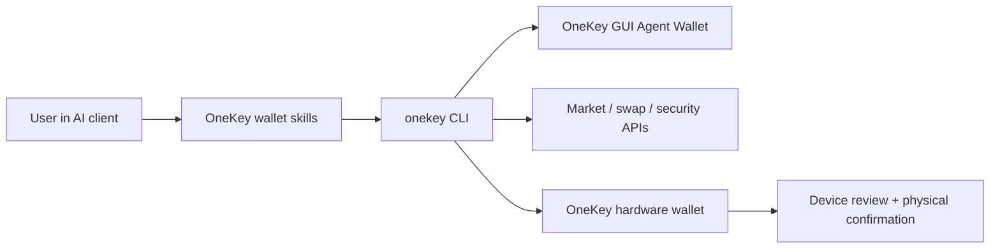

# OneKey Agent Wallet

> Private Beta. Zugriff, unterstützte Befehle und Wallet-Abläufe hängen von Ihren OneKey- und CLI-Versionen ab. Prüfen Sie das Schema der installierten CLI, bevor Sie diese Beispiele verwenden.

OneKey Agent Wallet ist die Wallet-Ebene für KI-Agenten, die echte On-Chain-Aktionen, Marktkontext und nutzergesteuertes Signieren benötigen. Agenten können den Wallet-Status lesen, Empfangsadressen ermitteln, Tokens recherchieren, Swap-Angebote einholen und Swaps vorbereiten, Sicherheitsprüfungen ausführen und riskante Aktionen zur Nutzerbestätigung an die OneKey-GUI oder -Hardware übergeben.

Verwenden Sie diesen Abschnitt, wenn Sie KI-Agenten, Skills, MCP-Tools, Automatisierungen oder Befehlszeilenabläufe entwickeln, die Wallet-Funktionen benötigen. Verwenden Sie die Hardware-SDK-Dokumentation, wenn Sie OneKey-Gerätetransporte und grundlegende Signier-APIs direkt integrieren.

## Was Agenten tun können [#what-agents-can-do]

| Bereich | Agentenfunktion | Beispiel einer Nutzeranfrage |
| --- | --- | --- |
| Wallet | Guthaben prüfen, Empfangsadressen anzeigen, den Verlauf einsehen, Überweisungen vorbereiten, BTC-Adresstypen ableiten | `Show my ETH balance and receiving address.` |
| Swap &amp; Bridge | Angebote einholen, Swaps erstellen, ausführen und verfolgen, BTC-PSBTs nur signieren, Bridge-Netzwerke ermitteln | `Swap 1 ETH to USDC after showing me the quote.` |
| Markt &amp; Recherche | Tokens suchen, Preise, Trendlisten, K-Line-Daten, Liquidität und Inhaber abrufen, schnelle oder eingehende Recherchen durchführen | `What Solana tokens are trending right now?` |
| Sicherheit | Tokens prüfen, Transaktionen simulieren, Freigaben prüfen, Abweichungen zwischen Chain und Adresse sowie Token-Risikosignale melden | `Is this token safe before I buy it?` |
| Gerätesteuerung | Ein OneKey-Gerät verbinden, seine Echtheit prüfen, den Passphrase-Modus nutzen und unterstützte Signieranfragen auf dem Gerät prüfen | `Use my hardware wallet for this transfer.` |
| Sitzungssteuerung | Eine über die GUI verwaltete Agent Wallet per App Transfer koppeln oder zu einer hardwaregestützten Sitzung wechseln | `Connect my OneKey Agent Wallet.` |

## Funktionsweise [#how-it-works]

Der Agent kommuniziert mit OneKey über das Paket `onekey-wallet-skills` und die CLI `onekey`. App Transfer und Hardware-Anmeldung wählen unterschiedliche Sitzungstypen aus. Prüfen Sie die aktive Sitzung, bevor Sie Wallet-Befehle verwenden; die Gerätebestätigung gilt für hardwaregestützte Signieranfragen.

## Wählen Sie Ihren Einstieg [#choose-your-path]

| Zielgruppe | Beginnen Sie mit | Warum |
| --- | --- | --- |
| Entwickler einer Agentenintegration | [Funktionen](/de/agent-wallet/capabilities) und [Wallet-Skills](/de/agent-wallet/wallet-skills) | Jede Produktfunktion einem schemabasierten CLI-Befehl und einem definierten Antwortformat zuordnen. |
| Vibe-Coding-Nutzer, der Wallet-Automatisierung ausprobiert | [Schnellstart](/de/agent-wallet/quickstart) und [Anwendungsbeispiele](/de/agent-wallet/recipes) | Zuerst Prompts in natürlicher Sprache kopieren, dann die zugrunde liegenden Befehle prüfen. |
| Sicherheitsprüfer oder Wallet-Inhaber | [Sicherheitsregeln](/de/agent-wallet/safety) und [Gerätesteuerung](/de/agent-wallet/hardware-control) | Klären, was Agenten lesen und ausführen können und wann OneKey-Hardware übernehmen muss. |
| Produkt- oder Supportmitarbeiter | [Agent-Wallet-Sitzung](/de/agent-wallet/wallet-session) und [Schlüssellose Verknüpfung](/de/agent-wallet/keyless-binding) | Die über die GUI verwaltete Agent Wallet, die schlüssellose Kontoverknüpfung und das Modell der aktiven Sitzung verstehen. |

## Aktuelle Implementierung [#current-implementation]

Der öffentliche Einstiegspunkt ist das externe Repository [`onekey-wallet-skills`](https://github.com/OneKeyHQ/onekey-wallet-skills). Die Skills unterstützen Claude Code, Codex, Cursor, OpenCode und OpenClaw und leiten Anfragen in natürlicher Sprache in Wallet-, Swap-, Markt- und Sicherheitsabläufe weiter.

Das Paket `@onekeyfe/cli` bildet weiterhin die Implementierungsebene hinter den Skills. Die Skills verwenden sein aktuelles Schema, um unterstützte Befehle und Parameter zu ermitteln, App-Transfer- oder hardwaregestützte Sitzungen zu koppeln und strukturierte Antworten zu liefern, statt Nutzern rohe Terminalausgaben zu zeigen.
