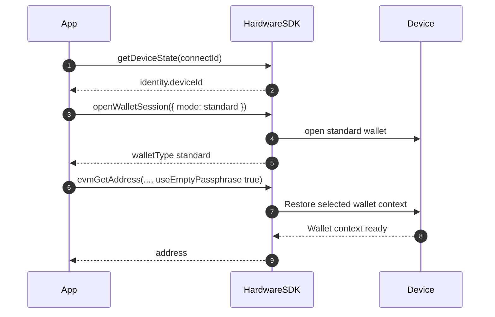
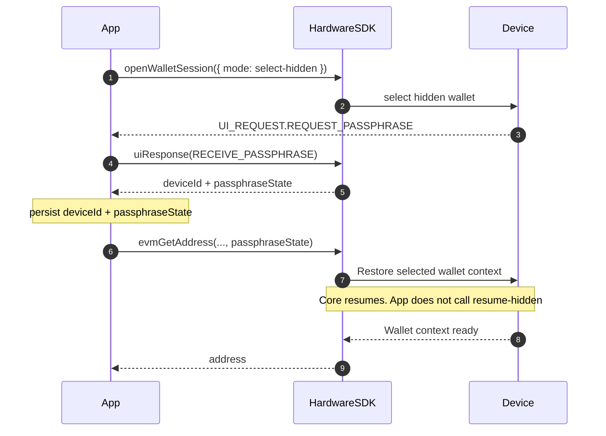

# Passphrase

Regeln und bewährte Vorgehensweisen für Passphrasen (versteckte Wallets).

## Grundbegriffe [#core-concepts]

- **Standard-Wallet** = Seed + leere Passphrase; **versteckte Wallet** = Seed + nicht leere Passphrase (Groß-/Kleinschreibung beachten).
- Jede andere Passphrase erzeugt eine völlig andere Wallet — selbst die Änderung eines einzigen Zeichens.
- Passphrasen lassen sich nicht wiederherstellen; sichern Sie sie zuverlässig.
- Erzwingen Sie die Standard-Wallet durch Setzen von `useEmptyPassphrase: true`.

## Geräteunterstützung [#device-support]

Leiten Sie die Unterstützung für Host- oder Geräteeingabe nicht allein aus einem Modellnamen ab. Lesen Sie `getDeviceState`, um Gerät, Firmware und aktuellen Status zu bestimmen, und folgen Sie dann der tatsächlichen UI-Anfrage. Die Verfügbarkeit hängt von Gerät, Firmware, SDK und Laufzeit ab.

| Anfrage oder Bedingung | Host-Verhalten |
| --- | --- |
| `REQUEST_PASSPHRASE` | Bieten Sie nur die von Anfrage und Zielgerät unterstützten Eingabeoptionen an. Behalten Sie die Antwortzuordnung bei. |
| Eine Anfrage mit der Markierung `deviceOnly` | Bitten Sie den Nutzer, auf dem Gerät fortzufahren; erfassen Sie die Passphrase nicht auf dem Host. |
| `REQUEST_PASSPHRASE_ON_DEVICE` | Nur Benachrichtigung; zeigen Sie Gerätehinweise an und senden Sie kein `uiResponse`. |
| Angeforderter Eingabemodus nicht verfügbar | Erklären Sie die Einschränkung; wechseln Sie die Eingabemethode nicht stillschweigend. |

Speichern Sie gegebenenfalls die Wallet-Bindung (`deviceId` und `passphraseState`), keine Firmware-`session_id`.

## Interaktionsablauf [#interaction-flow]

Hardware SDK 1.2.x: `searchDevices` → `getDeviceState` → `openWalletSession` → Adresse / Signieren mit `deviceId` + `passphraseState` (oder `useEmptyPassphrase: true`). Abonnieren Sie `UI_EVENT` vor dem Öffnen einer Wallet. Siehe [Wallet-Sitzungen](/de/hardware-sdk/concepts/wallet-session).

### Standard-Wallet [#standard-wallet]



```ts
const state = await HardwareSDK.getDeviceState(connectId);
if (!state.success) throw new Error(state.payload.error);
const deviceId = state.payload.identity.deviceId;
if (!deviceId) throw new Error("Device has no wallet identity");

const standard = await HardwareSDK.openWalletSession(connectId, { mode: 'standard' });
if (!standard.success) throw new Error(standard.payload.error);

await HardwareSDK.evmGetAddress(connectId, deviceId, {
  path: "m/44'/60'/0'/0/0",
  useEmptyPassphrase: true,
});
```

### Versteckte Wallet (einmal öffnen, Fingerabdruck wiederverwenden) [#hidden-wallet-open-once-reuse-fingerprint]



```ts
import { UI_EVENT, UI_REQUEST, UI_RESPONSE } from '@onekeyfe/hd-core';

HardwareSDK.on(UI_EVENT, async (message) => {
  if (message.type === UI_REQUEST.REQUEST_PASSPHRASE) {
    await HardwareSDK.uiResponse({
      type: UI_RESPONSE.RECEIVE_PASSPHRASE,
      ...message.payload.responseCorrelation,
      payload: { passphraseOnDevice: true, value: '', save: false },
    });
  }
});

const opened = await HardwareSDK.openWalletSession(connectId, {
  mode: 'select-hidden',
});
if (!opened.success) throw new Error(opened.payload.error);
if (opened.payload.walletType !== 'hidden') {
  throw new Error('A hidden wallet was not opened');
}
const deviceId = opened.payload.deviceId;
const passphraseState = opened.payload.passphraseState;

await HardwareSDK.evmGetAddress(connectId, deviceId, {
  path: "m/44'/60'/0'/0/0",
  passphraseState,
});
await HardwareSDK.btcGetAddress(connectId, deviceId, {
  path: "m/84'/0'/0'/0/0",
  coin: 'btc',
  passphraseState,
});
```

Passphrase-Eingabe auf dem Gerät oder per Software:

```ts
// On-device
payload: { passphraseOnDevice: true, value: '' }

// Software
payload: { value: userInput, passphraseOnDevice: false, save: false }
```

### Späterer Prozess / Wiederverbindung [#later-process--reconnect]

Speichern Sie nur `deviceId + passphraseState`. Speichern Sie die Firmware-`session_id` **nicht** dauerhaft. Laden Sie die Bindung und übergeben Sie sie beim nächsten Adress-/Signieraufruf. Core setzt die Sitzung innerhalb dieser Methode fort. `openWalletSession` hat keinen Fortsetzungsmodus.

```ts
import { OpenWalletSessionMode } from '@onekeyfe/hd-core';

// Process 1 — after the user selects the hidden wallet
const opened = await HardwareSDK.openWalletSession(connectId, {
  mode: OpenWalletSessionMode.SelectHidden,
});
if (!opened.success) throw new Error(opened.payload.error);
if (opened.payload.walletType !== 'hidden') {
  throw new Error('A hidden wallet was not opened');
}
saveBinding({
  deviceId: opened.payload.deviceId,
  passphraseState: opened.payload.passphraseState,
});

// Process 2 — later process, same machine
const { deviceId, passphraseState } = loadBinding();

await HardwareSDK.evmGetAddress(connectId, deviceId, {
  path: "m/44'/60'/0'/0/0",
  passphraseState,
});
```

`preloadSessionCache` ist ein Kompatibilitätseinstieg für alte App-/CLI-Schlüsselbunddatensätze. Neue Integrationen sollten ihn nicht aufrufen und keine `session_id` speichern.

Wenn das Gerät zwischen Prozessen gesperrt wurde, wird beim ersten geschützten Aufruf erneut die PIN abgefragt. Siehe [Wallet-Sitzungen](/de/hardware-sdk/concepts/wallet-session).

### Zuerst entsperren (CLI-Muster) [#unlock-first-pattern-cli]

```ts
const state = await HardwareSDK.getDeviceState(connectId);
if (!state.success) throw new Error(state.payload.error);

if (!state.payload.status.unlocked) {
  await HardwareSDK.deviceUnlock(connectId, {});
}

await HardwareSDK.evmGetAddress(connectId, savedDeviceId, {
  path: "m/44'/60'/0'/0/0",
  passphraseState: savedPassphraseState,
});
```

## Sicherheitstipps [#security-tips]

- **Niemals protokollieren oder dauerhaft speichern:** Passphrasen im Klartext.
- Verwenden Sie `useEmptyPassphrase: true`, um das versehentliche Erstellen einer versteckten Wallet zu verhindern.
- Pro-/Touch-Geräte: Die PIN muss auf dem Gerät eingegeben werden; die Passphrase kann auf dem Gerät oder per Software eingegeben werden.

## FAQ [#faq]

### Was passiert, wenn ich meine Passphrase vergesse? [#what-happens-if-i-forget-my-passphrase]

Gelder in der versteckten Wallet sind dauerhaft unzugänglich. Eine vergessene Passphrase lässt sich nicht wiederherstellen. Bewahren Sie stets eine sichere Sicherungskopie auf.

### Ist die Passphrase dasselbe wie die PIN? [#is-the-passphrase-the-same-as-the-pin]

Nein. Die PIN schützt den physischen Zugriff auf das Gerät. Die Passphrase erzeugt aus demselben Seed eine vollständig andere Wallet. Sie erfüllen unterschiedliche Sicherheitszwecke:

| | PIN | Passphrase |
|---|-----|-----------|
| Zweck | Schutz des Gerätezugriffs | Erstellen versteckter Wallets |
| Wiederherstellung | Kann durch Löschen des Geräts + Seed-Wiederherstellung zurückgesetzt werden | Kann nicht wiederhergestellt werden |
| Speicherung | Auf dem Gerät gespeichert | Keinen Klartext dauerhaft speichern; SDK-Zwischenspeicherung hängt vom Eingabeablauf und `save` |
| Groß-/Kleinschreibung relevant | Nicht zutreffend (numerisch) | Ja |

### Kann ich mehrere versteckte Wallets haben? [#can-i-have-multiple-hidden-wallets]

Ja. Jede eindeutige Passphrase erzeugt eine eigene versteckte Wallet. Sie können beliebig viele versteckte Wallets haben — eine pro eindeutiger Passphrase.

### Prüft das Gerät meine Passphrase? [#does-the-device-validate-my-passphrase]

Eine neu eingegebene Passphrase kann eine andere Wallet ableiten. Wenn ein späterer Aufruf einen erwarteten `passphraseState` angibt, prüft das SDK diese Bindung und schlägt bei Abweichung fehl; behandeln Sie eine falsch eingegebene Passphrase nicht als die vorgesehene Wallet.

### Was ist der Unterschied zwischen `passphraseOnDevice` und Software-Eingabe? [#whats-the-difference-between-passphraseondevice-and-software-input]

- **Auf dem Gerät**: Die Passphrase wird direkt auf dem Bildschirm/der Tastatur des Hardwaregeräts eingegeben. Sie verlässt das Gerät nie.
- **Software-Eingabe**: Die Passphrase wird in Ihrer App eingegeben und über das SDK an das Gerät gesendet.

Siehe auch: [Gemeinsame Parameter](/de/hardware-sdk/concepts/common-params), [Ereignisse &amp; UI-Anbindung](/de/hardware-sdk/core-api-guide#events-ui).

Auf Protocol V1 kann `select-hidden` eine Standard-Wallet zurückgeben, wenn der Passphrase-Schutz deaktiviert ist. Prüfen Sie `walletType` vor dem Speichern oder Verwenden von `passphraseState`.
