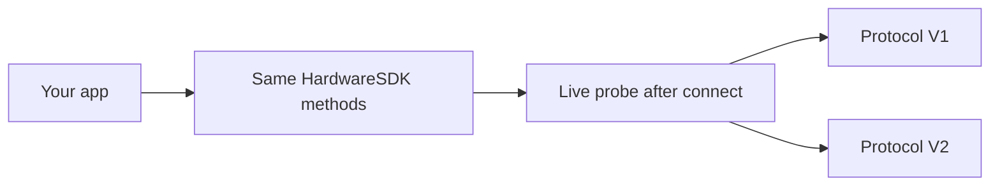

<span id="protocol-v1-and-v2" />

# Protocol V1 und V2

Hardware SDK 1.2.0 kommuniziert über zwei Übertragungsprotokolle. Integratoren behalten eine JavaScript-API. Verzweigen Sie nicht anhand von USB-PID, BLE-Namen oder Produktzeichenfolge.



| | Protocol V1 | Protocol V2 |
| --- | --- | --- |
| Aktuelle Geräte | Classic, Mini, Touch, Pro | Pro 2, Neo |
| Wie das SDK es erkennt | Aktuelle Antwort nach dem Verbinden | Aktuelle `Ping`-Antwort / Protokollabfrage nach dem Verbinden |
| Öffentliche Methoden | Bestehende Hardware-SDK-Methoden | Dieselben Methoden, innerhalb von Core zugeordnet |
| Aufrufregel | In der Praxis pro Gerät serialisieren | Pro Gerät serialisieren; erforderlich |
| Firmware-Update | `firmwareUpdateV2` / `firmwareUpdateV3` | `firmwareUpdateV4` |
| Chain-Methoden | V1+V2-Familien sowie reine V1-Familien | Nur V1+V2-Familien |
| Gerätestatus | [`getDeviceState`](/de/hardware-sdk/basic-api/get-device-state) (`getFeatures` ist veraltet) | Identisch |

Stellar, Alephium, Nexa, Dynex, Nervos, SCDO, Benfen und die Neo-Chain unterstützen nur V1. Sie werden auf Pro 2 / Neo nicht unterstützt. Vollständige Matrix: [Chain-Unterstützung](/de/hardware-sdk/concepts/chain-support). Geräte-USB / -BLE / -Air-Gap: [Geräte](/de/hardware-sdk/concepts/devices).

## Erkennung [#detection]

Das SDK bestätigt das Protokoll anhand der **aktiven Verbindung**. Leiten Sie V1/V2 nicht ab aus:

- USB-PID / -VID
- Ausgesendeter BLE-Name
- Produktzeichenfolge oder Gehäuse

Wenn Sie ein früheres Ergebnis speichern, binden Sie es **pro `connectId`** (USB und BLE desselben Geräts sind unterschiedliche Endpunkte). Das öffentliche Feld ist `connectProtocol` im Geräteobjekt.

Die Angabe von `connectProtocol` bei einem Aufruf ist eine verbindliche Erwartung: Das SDK wechselt nicht stillschweigend auf das andere Protokoll.

## Was gleich bleibt [#what-stays-the-same]

- `HardwareSDK.init({ env })` wählt weiterhin den **Transport** (USB / BLE / Low-Level), nicht Protocol V1 oder V2.
- `searchDevices` → `connectId` → `getDeviceState` → Chain-Methoden.
- PIN-, Passphrase- und Tastenbestätigung kommen weiterhin als `UI_EVENT`. Antworten Sie nur mit `uiResponse` bei Eingabeanfragen. Siehe die [Core-API-Anleitung](/de/hardware-sdk/core-api-guide).

## Was Sie nicht tun dürfen [#what-you-must-not-do]

- Führen Sie nicht zwei fachliche Aufrufe gleichzeitig auf demselben Gerät aus.
- Wiederholen Sie Signieren, Löschen oder Firmware-Updates nach Trennung oder Zeitüberschreitung nicht automatisch.
- Lesen Sie keine Firmware-`session_id` aus Antworten aus, um sie zu speichern. Die Wallet-Identität ist `deviceId + passphraseState`. Siehe [Wallet-Sitzungen](/de/hardware-sdk/concepts/wallet-session).
- Rufen Sie keine internen Protocol-V2-Funktionen auf (`DeviceSessionGet`, `DeviceInfoGet`, …). Sie sind keine öffentlichen `CoreApi`.

## Gerätestatus [#device-state]

Verwenden Sie [`getDeviceState`](/de/hardware-sdk/basic-api/get-device-state). `getFeatures` unterstützt nur Protocol V1 (Classic / Mini / Touch / Pro); Pro 2 und Neo lehnen dies vor jeder Kompatibilitätsdarstellung ab. `getDeviceState` enthält weiterhin einen Status im Features-Format für V1 und V2.

```ts
const state = await HardwareSDK.getDeviceState(connectId);
if (!state.success) throw new Error(state.payload.error);
```

Verwenden Sie `scope: 'settings'` oder `scope: 'firmware'` nur, wenn diese Teilbereiche aktualisiert werden müssen. Der Rückgabewert bleibt ein vollständiger Status.

## Weiter [#next]

- [Geräte](/de/hardware-sdk/concepts/devices)
- [Gerätestatus abrufen](/de/hardware-sdk/basic-api/get-device-state)
- [firmwareUpdateV4](/de/hardware-sdk/device-api/firmwareupdatev4)
