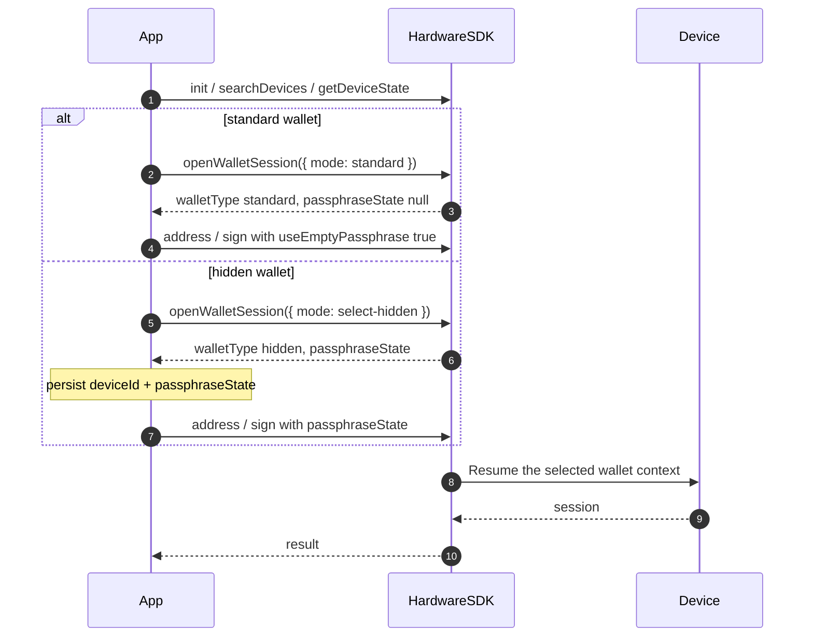

<span id="wallet-sessions" />

# Wallet-Sitzungen

Diese Seite beschreibt die **Hardware-Wallet-Sitzung**: welcher Seed-/Passphrase-Kontext auf dem Gerät entsperrt ist.

Sie ist von der [Agent-Wallet-Sitzung](/de/agent-wallet/wallet-session) zu unterscheiden. Agent Wallet ist ein Produkt auf Basis der OneKey-GUI. Hardware-Sitzungen existieren auf Classic / Pro / Pro 2 / Neo unabhängig davon, ob Agent Wallet beteiligt ist.

## Öffentliche Identität [#public-identity]

Speichern Sie nur dieses Paar als Wallet-Bindung:

| Feld | Bedeutung | Dauerhaft speichern? |
| --- | --- | --- |
| `deviceId` | Aktuelle Seed-Lebensdauer (`device_id` aus Features / DeviceState) | Ja |
| `passphraseState` | Fingerabdruck einer versteckten Wallet. `null` bei der Standard-Wallet | Ja, wenn versteckt |
| Firmware `session_id` | Geräteseitiges Entsperr-Handle | **Nein.** Core hält es intern |

Wenn Sie `passphraseState` bei einer versteckten Wallet weglassen, können Adress- und Signier-APIs ohne Fehler auf der **Standard-Wallet** erfolgreich sein. Übergeben Sie immer `useEmptyPassphrase: true` oder einen echten `passphraseState`.

## Bevorzugte API (1.2.0) [#preferred-api-120]



Neue Integrationen sollten eine Wallet öffnen mit [`openWalletSession`](/de/hardware-sdk/basic-api/open-wallet-session):

```ts
import { OpenWalletSessionMode } from '@onekeyfe/hd-core';

// Standard wallet
const standard = await HardwareSDK.openWalletSession(connectId, {
  mode: OpenWalletSessionMode.Standard,
});
if (!standard.success) throw new Error(standard.payload.error);
```

Oder den Nutzer eine versteckte Wallet auswählen lassen:

```ts
// Choose this flow instead of the standard-wallet example.
const hidden = await HardwareSDK.openWalletSession(connectId, {
  mode: OpenWalletSessionMode.SelectHidden,
});
if (!hidden.success) throw new Error(hidden.payload.error);
if (hidden.payload.walletType !== 'hidden' || !hidden.payload.passphraseState) {
  throw new Error('A hidden wallet was not opened');
}
```

Speichern Sie `payload.deviceId`, `payload.walletType` und `payload.passphraseState`. Übergeben Sie diese Werte dann bei Adress-/Signieraufrufen. Core stellt den erforderlichen Wallet-Kontext innerhalb dieser Methode wieder her. Rufen Sie `openWalletSession` nicht vor jedem Signierer auf.

`openWalletSession` hat keinen `resume-hidden`-Modus. Das Übergeben von `mode: 'resume-hidden'` gibt zurück: `CallMethodInvalidParameter`. Laden Sie die gespeicherte Bindung und übergeben Sie `passphraseState` beim nächsten Adress-/Signieraufruf.

## Veraltete Kompatibilitäts-API [#deprecated-compatibility-api]

[`getPassphraseState`](/de/hardware-sdk/basic-api/get-passphrase-state) ist veraltet. Bestehende Apps können es zusammen mit `initSession` / `useEmptyPassphrase` / `passphraseState` bei jedem Aufruf beibehalten. Core bildet diesen Pfad weiterhin auf Protocol V1 und V2 ab. Neuer Code sollte `openWalletSession` verwenden.

Kombinieren Sie nicht `openWalletSession({ mode })` mit `useEmptyPassphrase` / `initSession` im selben Aufruf.

## Attach-to-PIN [#attach-to-pin]

Einige Pro-/Pro-2-Geräte können eine versteckte Wallet an eine eigene PIN binden. Die öffentliche API gibt weiterhin `walletType: 'hidden'` und einen `passphraseState` zurück. Implementieren Sie für Attach-to-PIN kein zweites Sitzungsprotokoll.

Wenn das SDK `DeviceCheckUnlockTypeError` zurückgibt, kann der aktuelle Entsperrtyp die angeforderte Wallet nicht erreichen. Sperren Sie das Gerät und lassen Sie den Nutzer mit der vorgesehenen PIN entsperren; wiederholen Sie dieselbe Bindung nicht in einer Schleife.

## Weiter [#next]

- [openWalletSession](/de/hardware-sdk/basic-api/open-wallet-session)
- [Kennungen](/de/hardware-sdk/concepts/identifiers)
- [Passphrase](/de/hardware-sdk/concepts/passphrase)
