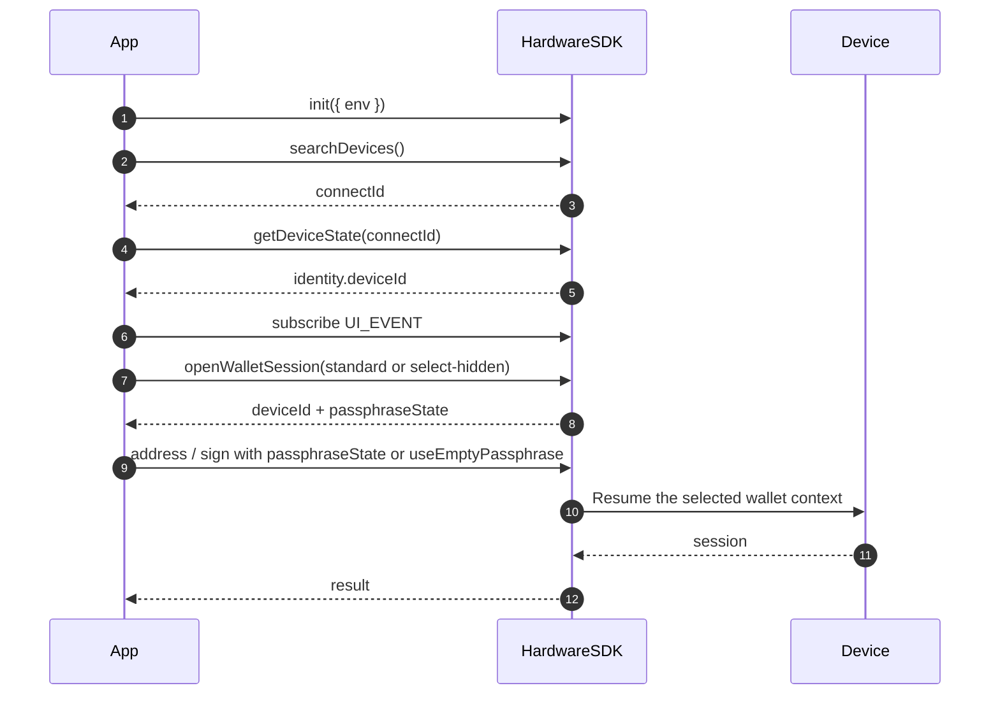

<span id="hardware-sdk-core-api-guide" />

# Hardware-SDK-Core-API-Anleitung

Lebenszyklusanleitung: initialisieren → suchen → Ereignisse → erster geschützter Aufruf → bereinigen.

Parametertabellen befinden sich unter [Gemeinsame Parameter](/de/hardware-sdk/concepts/common-params). Geräte- und Protokollunterschiede finden Sie unter [Geräte](/de/hardware-sdk/concepts/devices) und [Protocol V1 und V2](/de/hardware-sdk/concepts/protocol).

## Kurzablauf [#quick-flow]
<div id="request-basics" />

- Aufrufformat: `HardwareSDK.method(connectId, deviceId?, params)` → `Promise<{ success, payload }>`; prüfen Sie immer `success` vor dem Zugriff auf `payload`.
- Kennungen: `connectId` aus `searchDevices`; `deviceId` aus `getDeviceState` (für BLE erforderlich, für WebUSB empfohlen). Aktualisieren Sie `deviceId` nach Zurücksetzen/Wiederherstellung. Vollständige Tabelle: [Kennungen](/de/hardware-sdk/concepts/identifiers).
- UI-Vertrag: abonnieren Sie `UI_EVENT` einmal; rufen Sie nur `uiResponse` bei Eingabe-`UI_REQUEST` auf (PIN / Passphrase / Bootloader-Auswahl). Ordnen Sie bei mehreren verbundenen Geräten pro Gerät zu.
- Führen Sie Aufrufe pro Gerät nacheinander aus. Verwenden Sie eine versteckte Wallet erneut, indem Sie `passphraseState` an spätere Methoden übergeben (Kompatibilitätspfad: `initSession + passphraseState`). Rufen Sie dafür nicht erneut `openWalletSession` auf.

```ts
const res = await HardwareSDK.evmGetAddress(connectId, deviceId, {
  path: "m/44'/60'/0'/0/0",
  useEmptyPassphrase: true,
});

if (!res.success) throw new Error(res.payload.error);
console.log(res.payload.address);
```

### Interaktionsablauf [#interaction-flow]



## Core-Kennungen &amp; Umgebungen [#core-identifiers--environments]

| ID | Zweck | Abrufen über | Ändert sich bei |
| --- | --- | --- | --- |
| `connectId` | Welche Verbindung | `searchDevices()` | USB erneut anschließen, BLE neu koppeln, Transport wechseln |
| `deviceId` | Welche Seed-Lebensdauer | `getDeviceState` (`getFeatures` ist veraltet) | Löschen, Wiederherstellung, Seed-Wechsel |

USB- und BLE-`connectId`-Werte für dasselbe Gerät unterscheiden sich — speichern Sie sie getrennt zwischen. Siehe [Kennungen](/de/hardware-sdk/concepts/identifiers) und [Verbindungsabbrüche und Wiederverbindung](/de/hardware-sdk/transport/reconnect).

**Laufzeitanforderungen**

- `webusb` — HTTPS + Nutzeraktion.
- `react-native` — BLE-Berechtigung + (häufig) Standortberechtigung.
- `lowlevel` — Host-BLE-Adapter, der rohe Benachrichtigungsblöcke weiterleitet.
- Firmware — einige APIs schlagen im Bootloader fehl.

### Welche Kennungen sind erforderlich? [#which-identifiers-are-required]

| Anforderung | Beschreibung | Beispiel-APIs |
| :--- | :--- | :--- |
| 🟢 Keine Kennungen | SDK-Initialisierung, Konfiguration, Ereignisverwaltung | `init` `on/off` `searchDevices` `getLogs` `dispose` `uiResponse` |
| 🟡 `connectId` nur | Geräteverwaltung, Status, Firmware-Vorgänge | `getDeviceState` `openWalletSession` `cancel` `deviceSettings` |
| 🔵 `connectId` + `deviceId` | Blockchain-Signieren, Adressen, Verschlüsselung | `evmSignTransaction` `btcSignTransaction` `solSignMessage` `allNetworkGetAddress` |

## Standardlebenszyklus (empfohlen) [#standard-lifecycle-recommended]
<div id="standard-lifecycle" />

`init → search → getDeviceState → subscribe UI/DEVICE/FIRMWARE → call + uiResponse → cleanup`

```ts
import HardwareSDK from '@onekeyfe/hd-common-connect-sdk';
import { UI_EVENT, UI_REQUEST, UI_RESPONSE } from '@onekeyfe/hd-core';

const initialized = await HardwareSDK.init({ env: 'webusb', fetchConfig: true, debug: false });
if (!initialized) throw new Error('SDK initialization failed');

const devices = await HardwareSDK.searchDevices();
if (!devices.success || !devices.payload.length) throw new Error('No device');
// Select explicitly in the application when more than one device is available.
if (devices.payload.length !== 1) throw new Error('Select exactly one device before continuing');
const { connectId } = devices.payload[0];
if (!connectId) throw new Error("Missing connectId");

const state = await HardwareSDK.getDeviceState(connectId);
if (!state.success) throw new Error(state.payload.error);
const deviceId = state.payload.identity.deviceId;
if (!deviceId) throw new Error("Device has no wallet identity");

// Register the UI_EVENT handler shown below before any protected call.
HardwareSDK.on(UI_EVENT, handleUiEvent);

const address = await HardwareSDK.evmGetAddress(connectId, deviceId, {
  path: "m/44'/60'/0'/0/0",
  useEmptyPassphrase: true,
});
if (!address.success) throw new Error(address.payload.error);
```

Pro Gerät serialisieren. Aktualisieren Sie `getDeviceState` nach einem Gerätewechsel. Entfernen Sie Listener beim Unmount. Rufen Sie `HardwareSDK.dispose()` nur beim Beenden des Transports auf — siehe [Verbindungsabbrüche und Wiederverbindung](/de/hardware-sdk/transport/reconnect).

## Gemeinsame Parameter [#common-params]

Die vollständige Tabelle, Transportmatrix, Kombinationen und HD-Pfade befinden sich jetzt unter [Gemeinsame Parameter](/de/hardware-sdk/concepts/common-params).

<div id="hd-path" />

HD-Pfadbeispiele: [Gemeinsame Parameter → HD-Pfad](/de/hardware-sdk/concepts/common-params#hd-path).

Zum PIN- und Passphrase-Nutzererlebnis siehe [PIN](/de/hardware-sdk/concepts/pin) und [Passphrase](/de/hardware-sdk/concepts/passphrase). Neuer Code zum Öffnen einer Wallet sollte der Anleitung unter [Wallet-Sitzungen](/de/hardware-sdk/concepts/wallet-session) folgen.

## Ereignisse &amp; UI-Anbindung [#events--ui-wiring]
<div id="events-ui" />

Abonnieren Sie einmal nahe dem App-Start. Rufen Sie nur `uiResponse` für Eingabeanfragen auf. Kopieren Sie `payload.responseCorrelation`, sofern vorhanden, in jede Antwort; es identifiziert die ausstehende Interaktion. Machen Sie Dialog-Callbacks nach Abbruch oder UI-Schließereignis ungültig und brechen Sie die ausgewählte Verbindung ab, wenn der Nutzer die Eingabe schließt. Protokollieren Sie keine UI-Ereignisnutzlasten oder Eingabewerte.

**UI-Anfragen, die Folgendes erfordern: `uiResponse`**

| UI_REQUEST | Wann ausgelöst | Antworten mit |
| --- | --- | --- |
| `REQUEST_PIN` | Host-PIN-Eingabeanfrage; reine Geräteaufforderungen benötigen keine Antwort | `UI_RESPONSE.RECEIVE_PIN` |
| `REQUEST_PASSPHRASE` | Host- oder Geräteeingabe wählen (`value: ""`, `passphraseOnDevice: true` für Geräteeingabe) | `UI_RESPONSE.RECEIVE_PASSPHRASE` |
| `REQUEST_DEVICE_IN_BOOTLOADER_FOR_WEB_DEVICE` | Web-Bootloader-Auswahl | `UI_RESPONSE.SELECT_DEVICE_IN_BOOTLOADER_FOR_WEB_DEVICE` |

**UI-Benachrichtigungen (kein `uiResponse`)**

| UI_REQUEST | Zweck |
| --- | --- |
| `REQUEST_PASSPHRASE_ON_DEVICE` | Passphrase auf dem Gerät eingeben; nur Benachrichtigung |
| `REQUEST_BUTTON` | Auf dem Gerät bestätigen. Firmware-Update verwendet `reason='firmware-update'` — weiterhin kein `uiResponse` |
| `DEVICE_PROGRESS` | Fortschritt lang laufender Aufgaben |
| `FIRMWARE_PROCESSING` / `FIRMWARE_PROGRESS` / `FIRMWARE_TIP` | Firmware-Upgrade-Zustände |
| `BLUETOOTH_PERMISSION` / `LOCATION_PERMISSION` | BLE-Berechtigungsaufforderungen |
| `BOOTLOADER` / `REQUIRE_MODE` / `NOT_INITIALIZE` / `FIRMWARE_NOT_SUPPORTED` | Modus- oder Unterstützungshinweise |

**Geräte-/Firmware-Ereignisse**

| Kanal | Ereignis | Übliche Behandlung |
| --- | --- | --- |
| `DEVICE.CONNECT` | direkte Nutzlast | Geräteliste aktualisieren |
| `DEVICE.DISCONNECT` | direkte Nutzlast | Verbindung ungültig machen; Aufrufe mit Nebenwirkungen nicht wiederholen. [Wiederverbinden](/de/hardware-sdk/transport/reconnect) |
| `DEVICE.STATE` / `DEVICE.FEATURES` / `DEVICE.SUPPORT_FEATURES` | direkte Nutzlast | Gerätestatus / Features / unterstützte Funktionen aktualisieren |
| `FIRMWARE_EVENT` | `RELEASE_INFO` / `BLE_RELEASE_INFO` | Upgrade anbieten, wenn sicher. [Firmware-Update](/de/hardware-sdk/firmware-update) |

```ts
import HardwareSDK from '@onekeyfe/hd-common-connect-sdk';
import { UI_EVENT, UI_REQUEST, UI_RESPONSE } from '@onekeyfe/hd-core';

import type { UiEventMessage } from '@onekeyfe/hd-core';

// These modal functions are provided by your application's UI.
declare function openPinModal(submit: (input: { value: string }) => void): void;
declare function openPassphraseModal(submit: (input: { value: string; onDevice: boolean; save: boolean }) => void): void;

const handleUiEvent = (msg: UiEventMessage) => {
  switch (msg.type) {
    case UI_REQUEST.REQUEST_PIN:
      if (msg.payload.deviceOnly || msg.payload.type === 'ButtonRequest_PinEntry' || msg.payload.type === 'ButtonRequest_AttachPin') {
        // Display an on-device prompt; no uiResponse is needed.
        return;
      }
      openPinModal(({ value }) =>
        HardwareSDK.uiResponse({ ...msg.payload.responseCorrelation, type: UI_RESPONSE.RECEIVE_PIN, payload: value })
      );
      return;
    case UI_REQUEST.REQUEST_PASSPHRASE:
      if (msg.payload.deviceOnly) {
        HardwareSDK.uiResponse({
          ...msg.payload.responseCorrelation,
          type: UI_RESPONSE.RECEIVE_PASSPHRASE,
          payload: { value: '', passphraseOnDevice: true, save: false },
        });
        return;
      }
      openPassphraseModal(({ value, onDevice, save }) =>
        HardwareSDK.uiResponse({
          ...msg.payload.responseCorrelation,
          type: UI_RESPONSE.RECEIVE_PASSPHRASE,
          payload: { value: onDevice ? "" : value, passphraseOnDevice: onDevice, attachPinOnDevice: false, save },
        })
      );
      return;
    default:
      break;
  }
};

HardwareSDK.on(UI_EVENT, handleUiEvent);
```

## Fehler [#errors]
<div id="error-codes" />

| Gruppe | Häufige Ursachen | Empfohlene Maßnahmen |
| --- | --- | --- |
| Gerät (101–118, 200) | Falscher Modus, beschäftigt, `deviceId`-Abweichung, nicht initialisiert | Modus prüfen, wiederverbinden, erneut ausführen: `init` + `getDeviceState` |
| IFrame (300–305) | Initialisierung fehlt, Laden/Zeitüberschreitung/Blockierung | Sicherstellen, dass `init` erfolgreich war; CSP / Iframe prüfen |
| Methode/Firmware (400–418) | Ungültige Parameter, Firmware erforderlich, unzulässiger Pfad | HD-Pfad validieren; [Firmware-Update](/de/hardware-sdk/firmware-update) |
| Transport (600–603) | Transport nicht konfiguriert, gleichzeitiger Aufruf | Prüfung `env`, Aufrufe serialisieren |
| Bluetooth (700–722) | Scan/Berechtigung/Verbindung/Zeitüberschreitung | Berechtigung, Nähe; nicht mit veralteter Kopplung in einer Schleife versuchen |
| Laufzeit/Bridge (800–822) | PIN abgebrochen, Bridge-Zeitüberschreitung | Abbruch respektieren; Verbindung wiederherstellen, ohne Signieren automatisch zu wiederholen |
| Webgerät (901–902) | WebUSB nicht autorisiert | HTTPS + Nutzeraktion |

Zuordnen: `payload.code`, nicht den `payload.error`-Text. Definitionen: [`HardwareError.ts`](https://github.com/OneKeyHQ/hardware-js-sdk/blob/onekey/packages/shared/src/HardwareError.ts).

## Verwandte Themen [#related]

- [Erste Schritte](/de/hardware-sdk/getting-started)
- [Transport](/de/hardware-sdk/transport) · [Wiederverbinden](/de/hardware-sdk/transport/reconnect)
- [Gemeinsame Parameter](/de/hardware-sdk/concepts/common-params)
- [Firmware-Update](/de/hardware-sdk/firmware-update)
- [Anleitungen zum Signieren](/de/hardware-sdk/signers)
