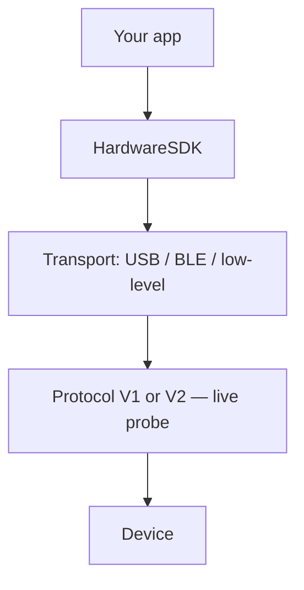

import { ExternalLink, Play, Monitor } from 'lucide-react'

<span id="introduction" />

# Einführung

Entwicklerorientierte Dokumentation zur Integration von OneKey-Hardware in Web- und native Apps.

Hardware-SDK **1.2.x** unterstützt Protocol V1 und Protocol V2 über dieselbe JavaScript-API. Neu hier? Beginnen Sie mit [Erste Schritte](/de/hardware-sdk/getting-started).

Diese Seite ist die **Orientierung** — wählen Sie das passende SDK-Paket für Ihre Plattform und installieren Sie es. Den vollständigen Ablauf (Suchen → Ereignisse → PIN/Passphrase → erster Signieraufruf) sowie Parameter, Ereignisse und Fehlerbehandlung finden Sie in der [Core-API-Anleitung](/de/hardware-sdk/core-api-guide).

## Transport auswählen [#choose-your-transport]

USB-Integrationen sollten `@onekeyfe/hd-common-connect-sdk` verwenden. Verwenden Sie `@onekeyfe/hd-web-sdk` nur, wenn der Host eine Iframe-/Plugin-Einrichtung voraussetzt.

### Verbindungsmethoden [#connection-methods]

| Methode | Beschreibung | Unterstützte Geräte |
|--------|-------------|-------------------|
| **USB / WebUSB** | Kabelgebundenes USB; im Browser über WebUSB; in Node.js / CLI über node-usb | Geräte mit kompatibler USB-Schnittstelle und Firmware |
| **Bluetooth BLE (nativ)** | Native Apps über BLE (kein Web Bluetooth); benötigt Bluetooth-Unterstützung und Berechtigung des Betriebssystems | Pro, Pro 2, Neo, Touch, Classic 1s / Classic 1s Pure; **Mini unterstützt kein BLE** |
| **Air-Gap (QR)** | Offline-Signieren per QR-Code | OneKey Pro und Pro 2; **Neo hat keine Kamera** |

### Plattformanleitung [#platform-guide]

| Plattform (Stack) | Transport | SDK-Paket | Anleitung |
|------------------|-----------|-------------|-------|
| Web (Browser) | WebUSB | [@onekeyfe/hd-common-connect-sdk](https://github.com/OneKeyHQ/hardware-js-sdk/tree/onekey/packages/hd-common-connect-sdk) | [WebUSB-Verbindungsanleitung](/de/hardware-sdk/transport/web-usb) |
| React Native | BLE | [@onekeyfe/hd-ble-sdk](https://github.com/OneKeyHQ/hardware-js-sdk/tree/onekey/packages/hd-ble-sdk) | [React Native BLE](/de/hardware-sdk/transport/react-native-ble) |
| Android (nativ) | BLE | [@onekeyfe/hd-common-connect-sdk](https://github.com/OneKeyHQ/hardware-js-sdk/tree/onekey/packages/hd-common-connect-sdk) | [Android BLE](/de/hardware-sdk/transport/android) |
| iOS (nativ) | BLE | [@onekeyfe/hd-common-connect-sdk](https://github.com/OneKeyHQ/hardware-js-sdk/tree/onekey/packages/hd-common-connect-sdk) | [iOS BLE](/de/hardware-sdk/transport/ios) |
| Flutter | BLE | [@onekeyfe/hd-common-connect-sdk](https://github.com/OneKeyHQ/hardware-js-sdk/tree/onekey/packages/hd-common-connect-sdk) | [Flutter BLE](/de/hardware-sdk/transport/flutter) |



Protokoll auf niedriger Ebene und eigene Kanäle: [Low-Level-Transport-Plugin &amp; Protokoll](/de/hardware-sdk/concepts/low-level-plugin)

## SDK installieren [#install-sdk]

Wählen Sie einen Einstieg nach Laufzeit:

```bash
# Web / desktop WebUSB (recommended)
npm i @onekeyfe/hd-common-connect-sdk

# React Native BLE
npm i @onekeyfe/hd-ble-sdk

# Native host with low-level plugin (Android/iOS/Flutter bridge)
npm i @onekeyfe/hd-common-connect-sdk

# Plugin iframe host only (plugin-only)
npm i @onekeyfe/hd-web-sdk
```

Transportdetails:
- WebUSB: [WebUSB-Anleitung](/de/hardware-sdk/transport/web-usb)
- React Native BLE: [BLE-Anleitung](/de/hardware-sdk/transport/react-native-ble)
- Natives Android / iOS / Flutter: JS-Aufrufe über Low-Level-Transport-Plugins überbrücken (Beispiele auf den jeweiligen Seiten).
- Eigener Kanal &amp; Protokoll: [Low-Level-Transport-Plugin &amp; Protokoll](/de/hardware-sdk/concepts/low-level-plugin)

## SDK initialisieren [#initialize-the-sdk]

Verwenden Sie die zu Ihrer Laufzeit passende Initialisierungsmethode — mischen Sie keine SDK-Einstiege.

### Web / Desktop-WebUSB [#web--desktop-webusb]

Verwenden Sie `@onekeyfe/hd-common-connect-sdk`:

```ts
import HardwareSDK from '@onekeyfe/hd-common-connect-sdk';

const initialized = await HardwareSDK.init({
  env: 'webusb',
  debug: false,
  fetchConfig: true,
});
if (!initialized) throw new Error('SDK initialization failed');
```

### React Native BLE [#react-native-ble]

Verwenden Sie `@onekeyfe/hd-ble-sdk`:

```ts
import HardwareSDK from '@onekeyfe/hd-ble-sdk';

const initialized = await HardwareSDK.init({
  debug: false,
});
if (!initialized) throw new Error('SDK initialization failed');
```

### Native Bridge / Low-Level [#native-bridge--low-level]

Verwenden Sie `@onekeyfe/hd-common-connect-sdk`:

```ts
import HardwareSDK from '@onekeyfe/hd-common-connect-sdk';
import type { LowlevelTransportSharedPlugin } from '@onekeyfe/hd-transport';

// Provide an implemented native BLE bridge; this is a preparation fragment.
declare const plugin: LowlevelTransportSharedPlugin;
const initialized = await HardwareSDK.init({
  env: 'lowlevel',
  debug: false,
  fetchConfig: true,
}, undefined, plugin);
if (!initialized) throw new Error('SDK initialization failed');
```

| Umgebung | Anwendungsfall |
|-------------|----------|
| `webusb` | Browser-WebUSB (ohne Iframe) |
| `lowlevel` | Native Apps, die JS über einen Low-Level-Adapter anbinden |
| `react-native` | Eigene RN-Bridge oder Electron BLE |
| `emulator` | Integrierter Emulatortransport |

### Plugin-Iframe-Host [#plugin-iframe-host]

Verwenden Sie `@onekeyfe/hd-web-sdk` (nur Plugin). Der standardmäßige Iframe-Host des SDKs ist `https://jssdk.onekey.so/<installed-package-version>/` aus `getSDKVersion()`. Lassen Sie `connectSrc` weg, sofern Sie den Iframe nicht selbst hosten.

import { SdkVersionNote } from '../../../components/SdkVersionNote'

<SdkVersionNote locale="de" />

```ts
import HdWebSdk from '@onekeyfe/hd-web-sdk';

const HardwareSDK = HdWebSdk.HardwareWebSdk;

const initialized = await HardwareSDK.init({
  debug: false,
  // omit connectSrc — SDK fills https://jssdk.onekey.so/<installed-version>/
});
if (!initialized) throw new Error('SDK initialization failed');
```

## Nächste Schritte [#next-steps]

Nachdem `HardwareSDK.init(...)` zurückkehrt, folgen Sie [Erste Schritte](/de/hardware-sdk/getting-started) für die erste Adresse und dann der [Core-API-Anleitung](/de/hardware-sdk/core-api-guide) für den restlichen Ablauf:

- Gerätematrix für 1.2.0: [Geräte](/de/hardware-sdk/concepts/devices)
- Welche Chains auf Pro 2 / Neo: [Chain-Unterstützung](/de/hardware-sdk/concepts/chain-support)
- Protocol V1 und V2 (automatisch erkannt): [Protokoll](/de/hardware-sdk/concepts/protocol)
- Eine Wallet öffnen / fortsetzen: [Wallet-Sitzungen](/de/hardware-sdk/concepts/wallet-session)
- Transportauswahl und Wiederverbindung: [Transport](/de/hardware-sdk/transport) · [Wiederverbinden](/de/hardware-sdk/transport/reconnect)
- Firmware V2 / V3 / V4: [Firmware-Update](/de/hardware-sdk/firmware-update)

- Standardlebenszyklus (`init → search → getDeviceState → subscribe → call + uiResponse → cleanup`): [Core-API-Anleitung → Standardlebenszyklus](/de/hardware-sdk/core-api-guide#standard-lifecycle)
- Gemeinsame Parameter für Adress-, Signier- und Gerätemethoden: [Gemeinsame Parameter](/de/hardware-sdk/concepts/common-params)
- Kennungsreferenz (`connectId` / `deviceId` / `passphraseState` / …): [Kennungen](/de/hardware-sdk/concepts/identifiers)
- PIN-Eingabeablauf: [PIN-Code](/de/hardware-sdk/concepts/pin)
- Passphrase-/Versteckte-Wallet-Ablauf: [Passphrase](/de/hardware-sdk/concepts/passphrase)

import { DeviceCompatibilityTable } from '../../../components/DeviceCompatibilityTable'

## Geräte- und Transportkompatibilität [#device-and-transport-compatibility]

<DeviceCompatibilityTable locale="de" />

> **Air-Gap-Modus:** OneKey Pro und Pro 2 unterstützen Air-Gap-Signieren per QR-Code — ohne USB- oder Bluetooth-Verbindung; Details werden vor dem Signieren auf dem Gerät geprüft. Siehe [Air-Gap-Integration](/de/air-gap) für Details.

## Core-Pakete [#core-packages]

| Paket | Zweck | NPM | Version |
|---------|---------|-----|---------|
| `@onekeyfe/hd-common-connect-sdk` | Einheitliche SDK-Oberfläche für Web/Native; empfohlener Einstieg für Transporte | [npm](https://www.npmjs.com/package/@onekeyfe/hd-common-connect-sdk) | [](https://www.npmjs.com/package/@onekeyfe/hd-common-connect-sdk) |
| `@onekeyfe/hd-ble-sdk` | Reiner React-Native-BLE-Stack (für RN-Projekte empfohlen) | [npm](https://www.npmjs.com/package/@onekeyfe/hd-ble-sdk) | [](https://www.npmjs.com/package/@onekeyfe/hd-ble-sdk) |
| `@onekeyfe/hd-transport-react-native` | React-Native-Transport-Nebenwirkungen/Bridge | [npm](https://www.npmjs.com/package/@onekeyfe/hd-transport-react-native) | [](https://www.npmjs.com/package/@onekeyfe/hd-transport-react-native) |
| `@onekeyfe/hd-transport-web-device` | Webtransport für den Gerätezugriff in Webkontexten | [npm](https://www.npmjs.com/package/@onekeyfe/hd-transport-web-device) | [](https://www.npmjs.com/package/@onekeyfe/hd-transport-web-device) |
| `@onekeyfe/hd-transport-emulator` | Emulatortransport (ohne physisches Gerät entwickeln und testen) | [npm](https://www.npmjs.com/package/@onekeyfe/hd-transport-emulator) | [](https://www.npmjs.com/package/@onekeyfe/hd-transport-emulator) |
| `@onekeyfe/hd-transport-http` | HTTP-Bridge-Transport | [npm](https://www.npmjs.com/package/@onekeyfe/hd-transport-http) | [](https://www.npmjs.com/package/@onekeyfe/hd-transport-http) |
| `@onekeyfe/hd-transport-lowlevel` | Schnittstellenvertrag des Low-Level-Host-Adapters (für native Integrationen) | [npm](https://www.npmjs.com/package/@onekeyfe/hd-transport-lowlevel) | [](https://www.npmjs.com/package/@onekeyfe/hd-transport-lowlevel) |
| `@onekeyfe/hd-core` | Core-Ereignisse, Konstanten, Nachrichtenanbindung | [npm](https://www.npmjs.com/package/@onekeyfe/hd-core) | [](https://www.npmjs.com/package/@onekeyfe/hd-core) |
| `@onekeyfe/hd-shared` | Gemeinsame Hilfsfunktionen und Typen | [npm](https://www.npmjs.com/package/@onekeyfe/hd-shared) | [](https://www.npmjs.com/package/@onekeyfe/hd-shared) |
| `@onekeyfe/hd-web-sdk` | Web-SDK-Wrapper (nicht empfohlen; hd-common-connect-sdk bevorzugen) | [npm](https://www.npmjs.com/package/@onekeyfe/hd-web-sdk) | [](https://www.npmjs.com/package/@onekeyfe/hd-web-sdk) |

- Änderungsprotokoll: [Releases](https://github.com/OneKeyHQ/hardware-js-sdk/releases)

## Weiterführende Informationen [#further-reading]

- Transport und Nachrichtenprotokoll auf niedriger Ebene (zum Debuggen oder für eigene Adapter): [Low-Level-Transport-Plugin](/de/hardware-sdk/concepts/low-level-plugin)
- Migration vom älteren `hd-web-sdk`-Ablauf: [Migrationsanleitung](/de/hardware-sdk/legacy-guides)
{/* - AI agent integration via OneKey skills: [AI Agent Integration](/en/hardware-sdk/agent-integration) */}

## Support [#support]

Für Nutzer: Diese Dokumentation richtet sich hauptsächlich an Entwickler. Bei Problemen mit unseren Produkten besuchen Sie bitte unser Hilfe-Center oder reichen Sie ein Support-Ticket ein.

- [Hilfe-Center](https://help.onekey.so)
- [Issues](https://github.com/OneKeyHQ/hardware-js-sdk/issues)

## Verwandte Repositorys [#related-repositories]

- [OneKey App (app-monorepo)](https://github.com/OneKeyHQ/app-monorepo)
- [OneKey Firmware](https://github.com/OneKeyHQ/firmware)
- [OneKey Hardware JS SDK](https://github.com/OneKeyHQ/hardware-js-sdk)

---

## Ausprobieren [#try-it-out]

<div className="mt-4 flex flex-wrap gap-3">
  <a
    href="/de/hardware-sdk/playground"
    className="group inline-flex items-center gap-2 rounded-lg border border-zinc-200 bg-white px-4 py-2.5 text-sm font-medium text-zinc-700 transition-all hover:border-emerald-500/50 hover:bg-emerald-50 hover:text-emerald-700 dark:border-zinc-700 dark:bg-zinc-800 dark:text-zinc-300 dark:hover:border-emerald-500/40 dark:hover:bg-emerald-500/10 dark:hover:text-emerald-400"
  >
    <Play className="h-4 w-4" strokeWidth={1.5} />
    Interaktive Testumgebung
  </a>
  <a
    href="https://hardware-example.onekey.so/#/emulator"
    target="_blank"
    rel="noopener noreferrer"
    className="group inline-flex items-center gap-2 rounded-lg border border-zinc-200 bg-white px-4 py-2.5 text-sm font-medium text-zinc-700 transition-all hover:border-blue-500/50 hover:bg-blue-50 hover:text-blue-700 dark:border-zinc-700 dark:bg-zinc-800 dark:text-zinc-300 dark:hover:border-blue-500/40 dark:hover:bg-blue-500/10 dark:hover:text-blue-400"
  >
    <Monitor className="h-4 w-4" strokeWidth={1.5} />
    Online-Emulator
    <ExternalLink className="h-3 w-3 opacity-50" strokeWidth={2} />
  </a>
</div>
