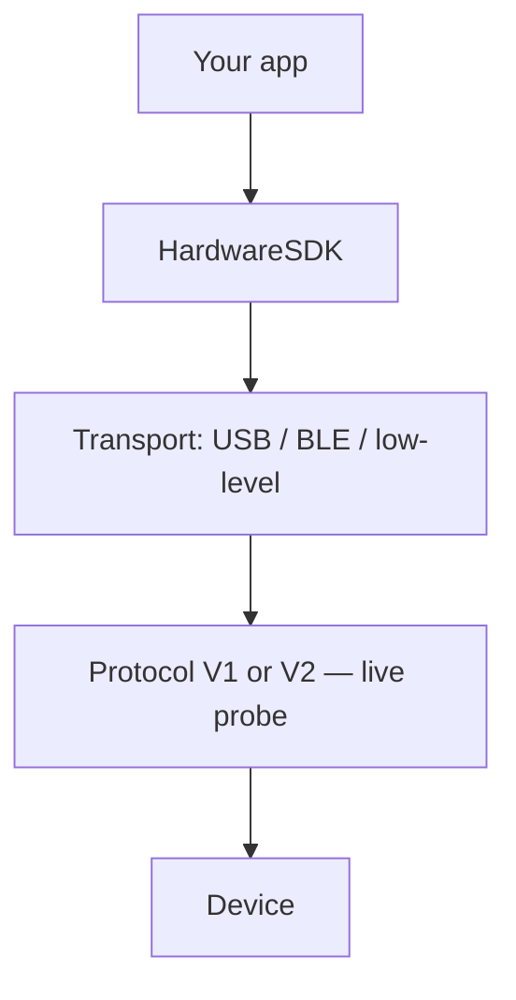

# Transport auswählen

Hardware SDK 1.2.x verwendet eine JavaScript-API. `init({ env })` wählt den **Transport**, nicht Protocol V1 oder V2.

| Plattform | Transport | Paket | `env` | Anleitung |
| --- | --- | --- | --- | --- |
| Browser / Desktop-WebUSB | WebUSB | `@onekeyfe/hd-common-connect-sdk` | `webusb` | [WebUSB](/de/hardware-sdk/transport/web-usb) |
| React Native | BLE | `@onekeyfe/hd-ble-sdk` | (Standard des BLE-SDKs) | [React Native BLE](/de/hardware-sdk/transport/react-native-ble) |
| Nativer Android-Host | BLE über Low-Level-Plugin | `@onekeyfe/hd-common-connect-sdk` | `lowlevel` | [Android](/de/hardware-sdk/transport/android) |
| Nativer iOS-Host | BLE über Low-Level-Plugin | `@onekeyfe/hd-common-connect-sdk` | `lowlevel` | [iOS](/de/hardware-sdk/transport/ios) |
| Flutter-Host | BLE über Low-Level-Plugin | `@onekeyfe/hd-common-connect-sdk` | `lowlevel` | [Flutter](/de/hardware-sdk/transport/flutter) |
| Übersicht zu nativem BLE | BLE | `@onekeyfe/hd-common-connect-sdk` | `lowlevel` | [Natives BLE](/de/hardware-sdk/transport/native-ble) |

USB erfordert eine kompatible Geräteschnittstelle und Firmware; prüfen Sie Verbindung und Signieren auf Ihrer Zielplattform. BLE wird von Pro, Pro 2, Neo, Touch und Classic 1s / Pure unterstützt — **nicht von Mini**. Air-Gap per QR ist ein separater Produktweg: [Air-Gap](/de/air-gap).

## Transport ist nicht das Protokoll [#transport-is-not-the-protocol]

| Ebene | Was es ist | Wie Sie auswählen |
| --- | --- | --- |
| **Transport** | Wie Bytes übertragen werden: USB, BLE oder ein natives BLE-Plugin | `init({ env })` — `webusb` / BLE SDK / `lowlevel` |
| **Protokoll** | V1 oder V2 als Übertragungsprotokoll nach dem Verbindungsaufbau | SDK-Abfrage. Lesen Sie `connectProtocol`. Leiten Sie das Protokoll **nicht** aus USB-PID oder BLE-Namen ab |

Ein Pro 2 über USB und ein Pro 2 über BLE verwenden beide Protocol V2. Ein Classic über USB verwendet Protocol V1. Siehe [Protocol V1 und V2](/de/hardware-sdk/concepts/protocol) und [Geräte](/de/hardware-sdk/concepts/devices).

Verwenden Sie OneKey Bridge (`env: 'web'` + `checkBridgeStatus`) nicht für neue WebUSB-Apps. Migration: [Bridge → WebUSB](/de/hardware-sdk/legacy-guides/migrate-bridge-to-common-connect-webusb).

## Nach dem Verbinden [#after-you-connect]

1. Erste Adresse: [Erste Schritte](/de/hardware-sdk/getting-started)
2. PIN / Ereignisse: [Core-API-Anleitung](/de/hardware-sdk/core-api-guide)
3. Abbrüche und `dispose()`: [Verbindungsabbrüche und Wiederverbindung](/de/hardware-sdk/transport/reconnect)
4. Firmware: [Firmware-Update](/de/hardware-sdk/firmware-update)
5. Eigene BLE-Bridge: [Transport auf niedriger Ebene](/de/hardware-sdk/concepts/low-level-plugin)
