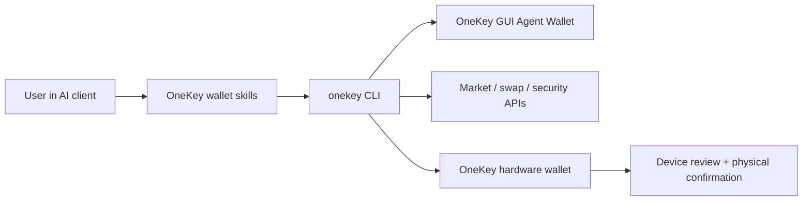

# OneKey Agent Wallet

> Beta privada. El acceso, los comandos disponibles y los flujos de cartera dependen de las versiones de OneKey y de la CLI. Consulta el esquema de la CLI instalada antes de usar estos ejemplos.

OneKey Agent Wallet es la capa de cartera para agentes de IA que necesitan realizar acciones reales en la cadena, consultar información de mercado y firmar bajo el control del usuario. Los agentes pueden consultar el estado de la cartera, encontrar direcciones de recepción, investigar tokens, cotizar y preparar intercambios, ejecutar comprobaciones de seguridad y derivar acciones de alto riesgo a la interfaz gráfica de OneKey o al dispositivo físico para que el usuario las confirme.

Usa esta sección si creas agentes de IA, skills, herramientas MCP, automatizaciones o flujos de trabajo de línea de comandos que necesitan funciones de cartera. Consulta la documentación del SDK de hardware si te integras directamente con los transportes de dispositivos OneKey y las API de firma de bajo nivel.

## Qué pueden hacer los agentes [#what-agents-can-do]

| Área | Capacidad del agente | Ejemplo de solicitud del usuario |
| --- | --- | --- |
| Cartera | Consultar saldos, mostrar direcciones de recepción, revisar el historial, preparar transferencias y derivar tipos de direcciones BTC | `Show my ETH balance and receiving address.` |
| Intercambios y puentes | Cotizar, construir, ejecutar y seguir intercambios; gestionar PSBT de BTC solo para firma; descubrir redes compatibles con puentes | `Swap 1 ETH to USDC after showing me the quote.` |
| Mercado e investigación | Buscar tokens, consultar precios, listas de tendencias, datos de velas, liquidez, titulares y análisis breves o detallados | `What Solana tokens are trending right now?` |
| Seguridad | Auditar tokens, simular transacciones, revisar autorizaciones e informar de discrepancias entre cadenas y direcciones y de señales de riesgo de los tokens | `Is this token safe before I buy it?` |
| Control por hardware | Conectar un dispositivo OneKey, verificar su autenticidad, usar el modo de passphrase y revisar en el dispositivo las solicitudes de firma compatibles | `Use my hardware wallet for this transfer.` |
| Control de sesiones | Vincular una Agent Wallet administrada desde la interfaz gráfica mediante App Transfer o cambiar a una sesión respaldada por hardware | `Connect my OneKey Agent Wallet.` |

## Cómo funciona [#how-it-works]

El agente se comunica con OneKey mediante el paquete `onekey-wallet-skills` y la CLI `onekey`. App Transfer y el inicio de sesión con hardware seleccionan tipos de sesión distintos. Comprueba la sesión activa antes de usar comandos de cartera; la confirmación en el dispositivo se aplica a las solicitudes de firma respaldadas por hardware.

## Elige tu recorrido [#choose-your-path]

| Perfil | Empieza por | Motivo |
| --- | --- | --- |
| Desarrollador que crea una integración de agentes | [Funciones](/es/agent-wallet/capabilities) y [Habilidades de la cartera](/es/agent-wallet/wallet-skills) | Asocia cada función del producto con un comando de la CLI definido por un esquema y un contrato de respuesta. |
| Usuario de vibe coding que prueba la automatización de carteras | [Inicio rápido](/es/agent-wallet/quickstart) y [Recetas](/es/agent-wallet/recipes) | Copia primero las instrucciones en lenguaje natural y después consulta los comandos que ejecutan. |
| Revisor de seguridad o propietario de una cartera | [Reglas de seguridad](/es/agent-wallet/safety) y [Control del hardware](/es/agent-wallet/hardware-control) | Confirma qué pueden leer los agentes, qué pueden ejecutar y cuándo debe intervenir el hardware de OneKey. |
| Compañero de producto o soporte | [Sesión de Agent Wallet](/es/agent-wallet/wallet-session) y [Vinculación sin claves](/es/agent-wallet/keyless-binding) | Comprende Agent Wallet administrada desde la interfaz gráfica, la vinculación con una cuenta sin claves y el modelo de sesión activa. |

## Implementación actual [#current-implementation]

El punto de entrada público es el repositorio externo [`onekey-wallet-skills`](https://github.com/OneKeyHQ/onekey-wallet-skills). Las skills son compatibles con Claude Code, Codex, Cursor, OpenCode y OpenClaw, y dirigen las solicitudes en lenguaje natural hacia flujos de cartera, intercambios, mercado y seguridad.

El paquete `@onekeyfe/cli` sigue siendo la capa de implementación de las skills. Estas usan su esquema en tiempo real para descubrir los comandos y parámetros compatibles, vincular sesiones de App Transfer o respaldadas por hardware y mantener respuestas estructuradas en lugar de mostrar al usuario la salida sin procesar del terminal.
