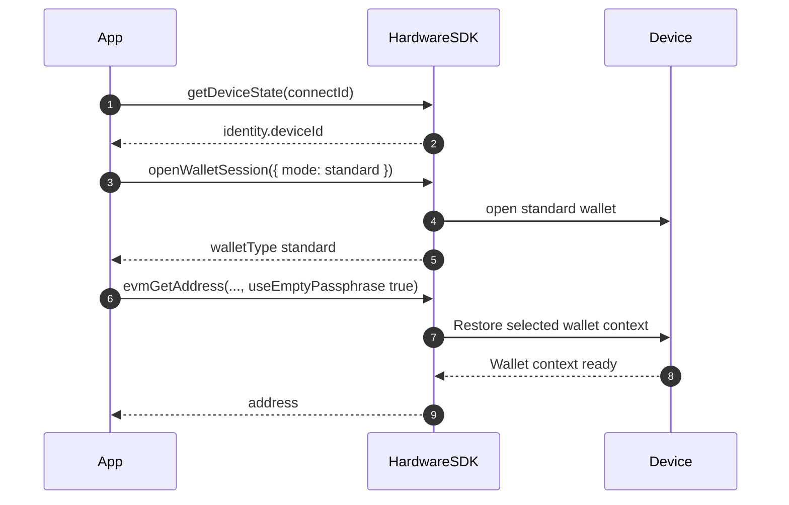
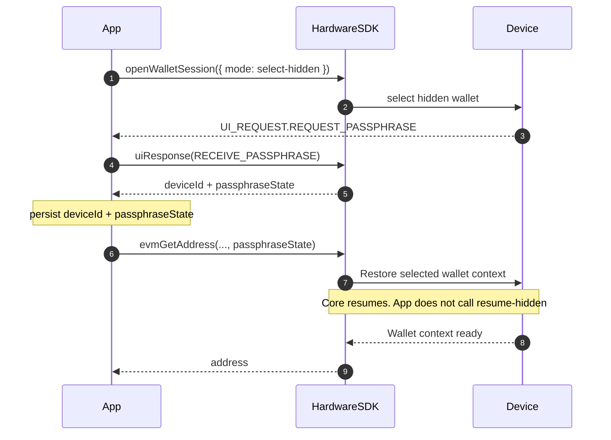

<span id="passphrase" />

# Frase de contraseña

Reglas y buenas prácticas para gestionar frases de contraseña (carteras ocultas).

## Conceptos fundamentales [#core-concepts]

- **Cartera estándar** = semilla + frase de contraseña vacía; **cartera oculta** = semilla + frase de contraseña no vacía (distingue mayúsculas y minúsculas).
- Cada frase de contraseña diferente genera una cartera completamente distinta, aunque solo cambie un carácter.
- Las frases de contraseña no se pueden recuperar; guarda copias de seguridad de forma segura.
- Fuerza la cartera estándar estableciendo `useEmptyPassphrase: true`.

## Compatibilidad de dispositivos [#device-support]

No deduzcas que se admite la entrada en el host o en el dispositivo solo por el nombre del modelo. Lee `getDeviceState` para identificar el dispositivo, el firmware y el estado actual, y después sigue la solicitud real de la interfaz. La disponibilidad depende del dispositivo, el firmware, el SDK y el entorno de ejecución.

| Solicitud o condición | Comportamiento del host |
| --- | --- |
| `REQUEST_PASSPHRASE` | Presenta solo las opciones de entrada admitidas por la solicitud y el dispositivo de destino. Conserva la correlación de respuestas. |
| Una solicitud marcada como `deviceOnly` | Pide al usuario que continúe en el dispositivo; no recojas la frase de contraseña en el host. |
| `REQUEST_PASSPHRASE_ON_DEVICE` | Solo notificación; muestra instrucciones para el dispositivo y no envíes `uiResponse`. |
| Modo de entrada solicitado no disponible | Explica la limitación; no cambies silenciosamente el método de entrada. |

Guarda de forma persistente la vinculación de la cartera (`deviceId` y `passphraseState`) cuando corresponda, no el identificador del firmware `session_id`.

## Flujo de interacción [#interaction-flow]

SDK de hardware 1.2.x: `searchDevices` → `getDeviceState` → `openWalletSession` → dirección / firma con `deviceId` + `passphraseState` (o `useEmptyPassphrase: true`). Suscríbete a `UI_EVENT` antes de abrir una cartera. Consulta [Sesiones de cartera](/es/hardware-sdk/concepts/wallet-session).

### Cartera estándar [#standard-wallet]



```ts
const state = await HardwareSDK.getDeviceState(connectId);
if (!state.success) throw new Error(state.payload.error);
const deviceId = state.payload.identity.deviceId;
if (!deviceId) throw new Error("Device has no wallet identity");

const standard = await HardwareSDK.openWalletSession(connectId, { mode: 'standard' });
if (!standard.success) throw new Error(standard.payload.error);

await HardwareSDK.evmGetAddress(connectId, deviceId, {
  path: "m/44'/60'/0'/0/0",
  useEmptyPassphrase: true,
});
```

### Cartera oculta (abrir una vez, reutilizar la huella) [#hidden-wallet-open-once-reuse-fingerprint]



```ts
import { UI_EVENT, UI_REQUEST, UI_RESPONSE } from '@onekeyfe/hd-core';

HardwareSDK.on(UI_EVENT, async (message) => {
  if (message.type === UI_REQUEST.REQUEST_PASSPHRASE) {
    await HardwareSDK.uiResponse({
      type: UI_RESPONSE.RECEIVE_PASSPHRASE,
      ...message.payload.responseCorrelation,
      payload: { passphraseOnDevice: true, value: '', save: false },
    });
  }
});

const opened = await HardwareSDK.openWalletSession(connectId, {
  mode: 'select-hidden',
});
if (!opened.success) throw new Error(opened.payload.error);
if (opened.payload.walletType !== 'hidden') {
  throw new Error('A hidden wallet was not opened');
}
const deviceId = opened.payload.deviceId;
const passphraseState = opened.payload.passphraseState;

await HardwareSDK.evmGetAddress(connectId, deviceId, {
  path: "m/44'/60'/0'/0/0",
  passphraseState,
});
await HardwareSDK.btcGetAddress(connectId, deviceId, {
  path: "m/84'/0'/0'/0/0",
  coin: 'btc',
  passphraseState,
});
```

Entrada de frase de contraseña en el dispositivo o mediante software:

```ts
// On-device
payload: { passphraseOnDevice: true, value: '' }

// Software
payload: { value: userInput, passphraseOnDevice: false, save: false }
```

### Proceso posterior / reconexión [#later-process--reconnect]

Guarda de forma persistente solo `deviceId + passphraseState`. **No** guardes de forma persistente el identificador del firmware `session_id`. Carga la asociación y pásala en la siguiente llamada de dirección / firma. Core reanuda la sesión dentro de ese método. `openWalletSession` no tiene modo de reanudación.

```ts
import { OpenWalletSessionMode } from '@onekeyfe/hd-core';

// Process 1 — after the user selects the hidden wallet
const opened = await HardwareSDK.openWalletSession(connectId, {
  mode: OpenWalletSessionMode.SelectHidden,
});
if (!opened.success) throw new Error(opened.payload.error);
if (opened.payload.walletType !== 'hidden') {
  throw new Error('A hidden wallet was not opened');
}
saveBinding({
  deviceId: opened.payload.deviceId,
  passphraseState: opened.payload.passphraseState,
});

// Process 2 — later process, same machine
const { deviceId, passphraseState } = loadBinding();

await HardwareSDK.evmGetAddress(connectId, deviceId, {
  path: "m/44'/60'/0'/0/0",
  passphraseState,
});
```

`preloadSessionCache` es un punto de entrada de compatibilidad para los registros antiguos del llavero de App/CLI. Las nuevas integraciones no deben llamarlo ni almacenar `session_id`.

Si el dispositivo se bloqueó entre procesos, se vuelve a solicitar el PIN en la primera llamada protegida. Consulta [Sesiones de cartera](/es/hardware-sdk/concepts/wallet-session).

### Patrón de desbloqueo previo (CLI) [#unlock-first-pattern-cli]

```ts
const state = await HardwareSDK.getDeviceState(connectId);
if (!state.success) throw new Error(state.payload.error);

if (!state.payload.status.unlocked) {
  await HardwareSDK.deviceUnlock(connectId, {});
}

await HardwareSDK.evmGetAddress(connectId, savedDeviceId, {
  path: "m/44'/60'/0'/0/0",
  passphraseState: savedPassphraseState,
});
```

## Consejos de seguridad [#security-tips]

- **Nunca registres ni guardes de forma persistente** frases de contraseña en texto sin cifrar.
- Usa `useEmptyPassphrase: true` para evitar la creación accidental de una cartera oculta.
- Dispositivos Pro/Touch: el PIN debe introducirse en el dispositivo; la frase de contraseña puede introducirse en el dispositivo o mediante software.

## Preguntas frecuentes [#faq]

### ¿Qué ocurre si olvido mi frase de contraseña? [#what-happens-if-i-forget-my-passphrase]

Los fondos de la cartera oculta quedan inaccesibles de forma permanente. No existe ningún modo de recuperar una frase de contraseña olvidada. Conserva siempre una copia de seguridad protegida.

### ¿La frase de contraseña es lo mismo que el PIN? [#is-the-passphrase-the-same-as-the-pin]

No. El PIN protege el acceso físico al dispositivo. La frase de contraseña crea una cartera completamente distinta a partir de la misma semilla. Cumplen funciones de seguridad diferentes:

| | PIN | Frase de contraseña |
|---|-----|-----------|
| Finalidad | Protección del acceso al dispositivo | Creación de una cartera oculta |
| Recuperación | Se puede restablecer borrando el dispositivo y recuperando la semilla | No se puede recuperar |
| Almacenamiento | Almacenado en el dispositivo | No guardes texto sin cifrar de forma persistente; la caché del SDK depende del flujo de entrada y de `save` |
| Distingue mayúsculas y minúsculas | No corresponde (numérico) | Sí |

### ¿Puedo tener varias carteras ocultas? [#can-i-have-multiple-hidden-wallets]

Sí. Cada frase de contraseña única crea una cartera oculta distinta. Puedes tener tantas carteras ocultas como quieras: una por cada frase de contraseña única.

### ¿El dispositivo valida mi frase de contraseña? [#does-the-device-validate-my-passphrase]

Una frase de contraseña recién introducida puede derivar una cartera diferente. Cuando una llamada posterior proporciona un valor esperado de `passphraseState`, el SDK comprueba esa vinculación y falla si no coincide; no consideres que una frase de contraseña mal escrita corresponde a la cartera prevista.

### ¿Cuál es la diferencia entre `passphraseOnDevice` y la entrada mediante software? [#whats-the-difference-between-passphraseondevice-and-software-input]

- **En el dispositivo**: La frase de contraseña se introduce directamente en la pantalla o el teclado del dispositivo de hardware. Nunca sale del dispositivo.
- **Entrada mediante software**: La frase de contraseña se introduce en tu aplicación y se envía al dispositivo mediante el SDK.

Consulta también: [Parámetros comunes](/es/hardware-sdk/concepts/common-params), [Eventos y conexión de la interfaz](/es/hardware-sdk/core-api-guide#events-ui).

En Protocol V1, `select-hidden` puede devolver una cartera estándar cuando la protección por frase de contraseña está desactivada. Comprueba `walletType` antes de guardar o usar `passphraseState`.
