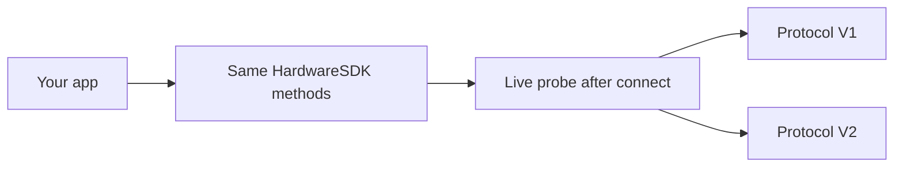

<span id="protocol-v1-and-v2" />

# Protocol V1 y V2

Hardware SDK 1.2.0 admite dos protocolos de comunicación. Las integraciones usan una única API de JavaScript. No diferencies los casos según el PID de USB, el nombre BLE ni la cadena de producto.



| | Protocol V1 | Protocol V2 |
| --- | --- | --- |
| Dispositivos actuales | Classic, Mini, Touch, Pro | Pro 2, Neo |
| Cómo lo detecta el SDK | Respuesta en tiempo real tras la conexión | `Ping` / consulta del protocolo en tiempo real tras la conexión |
| Métodos públicos | Métodos existentes de Hardware SDK | Los mismos métodos, adaptados dentro de Core |
| Regla para las llamadas | En la práctica, serializa las llamadas por dispositivo | Serializa las llamadas por dispositivo; obligatorio |
| Actualización del firmware | `firmwareUpdateV2` / `firmwareUpdateV3` | `firmwareUpdateV4` |
| Métodos de cadenas | Familias V1+V2 y familias exclusivas de V1 | Solo familias V1+V2 |
| Instantánea del dispositivo | [`getDeviceState`](/es/hardware-sdk/basic-api/get-device-state) (`getFeatures` está obsoleto) | Igual |

Stellar, Alephium, Nexa, Dynex, Nervos, SCDO, Benfen y la cadena Neo son exclusivos de V1. No son compatibles con Pro 2 / Neo. Matriz completa: [Compatibilidad de cadenas](/es/hardware-sdk/concepts/chain-support). USB / BLE / Air-Gap del dispositivo: [Dispositivos](/es/hardware-sdk/concepts/devices).

## Detección [#detection]

El SDK confirma el protocolo a partir de la **conexión activa**. No deduzcas V1/V2 a partir de:

- PID / VID de USB
- Nombre anunciado por BLE
- Cadena de producto o carcasa

Si guardas un resultado anterior, asócialo **por `connectId`** (USB y BLE del mismo dispositivo son endpoints distintos). El campo público es `connectProtocol` en el objeto del dispositivo.

Pasar `connectProtocol` en una llamada establece un requisito estricto: el SDK no recurrirá silenciosamente al otro protocolo.

## Lo que no cambia [#what-stays-the-same]

- `HardwareSDK.init({ env })` sigue seleccionando el **transporte** (USB / BLE / bajo nivel), no Protocol V1 o V2.
- `searchDevices` → `connectId` → `getDeviceState` → métodos de cadenas.
- El PIN, la passphrase y la confirmación mediante botón siguen llegando como `UI_EVENT`. Responde únicamente con `uiResponse` en las solicitudes de entrada. Consulta la [Guía de la API Core](/es/hardware-sdk/core-api-guide).

## Lo que debes evitar [#what-you-must-not-do]

- No ejecutes simultáneamente dos llamadas de negocio en el mismo dispositivo.
- No repitas automáticamente operaciones de firma, borrado ni actualización del firmware tras una desconexión o un tiempo de espera agotado.
- No leas el valor de firmware `session_id` de las respuestas para almacenarlo. La identidad de la cartera es `deviceId + passphraseState`. Consulta [Sesiones de cartera](/es/hardware-sdk/concepts/wallet-session).
- No llames a las funciones internas de Protocol V2 (`DeviceSessionGet`, `DeviceInfoGet`, …). No forman parte de la API pública `CoreApi`.

## Estado del dispositivo [#device-state]

Usa [`getDeviceState`](/es/hardware-sdk/basic-api/get-device-state). `getFeatures` es exclusivo de Protocol V1 (Classic / Mini / Touch / Pro); Pro 2 y Neo lo rechazan antes de aplicar cualquier proyección de compatibilidad. `getDeviceState` sigue incluyendo una instantánea con la estructura de Features para V1 y V2.

```ts
const state = await HardwareSDK.getDeviceState(connectId);
if (!state.success) throw new Error(state.payload.error);
```

Usa `scope: 'settings'` o `scope: 'firmware'` solo cuando necesites actualizar esas particiones. El valor devuelto sigue siendo una instantánea completa.

## Siguiente [#next]

- [Dispositivos](/es/hardware-sdk/concepts/devices)
- [Obtener el estado del dispositivo](/es/hardware-sdk/basic-api/get-device-state)
- [firmwareUpdateV4](/es/hardware-sdk/device-api/firmwareupdatev4)
