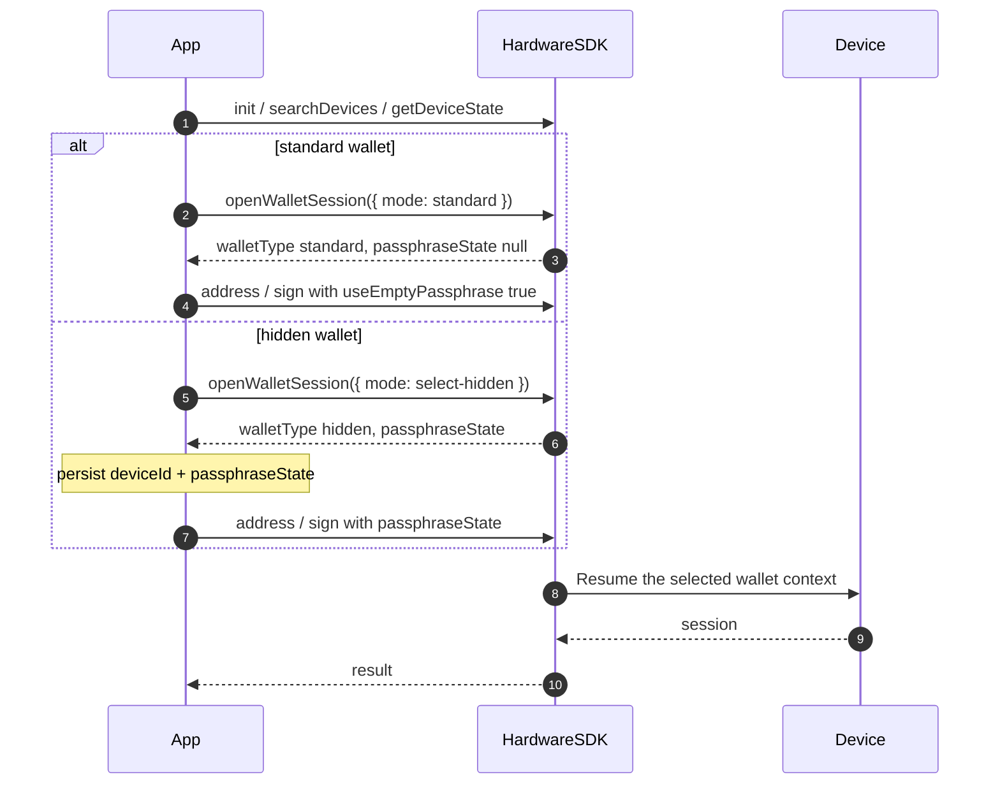

<span id="wallet-sessions" />

# Sesiones de cartera

Esta página trata la sesión de cartera **de hardware**: el contexto de semilla / passphrase desbloqueado en el dispositivo.

No es la [sesión de Agent Wallet](/es/agent-wallet/wallet-session). Agent Wallet es un producto basado en OneKey GUI. Las sesiones de hardware existen en Classic / Pro / Pro 2 / Neo independientemente de que se use Agent Wallet.

## Identidad pública [#public-identity]

Guarda únicamente este par como asociación de la cartera:

| Campo | Significado | ¿Guardar? |
| --- | --- | --- |
| `deviceId` | Vigencia de la semilla actual (`device_id` de Features / DeviceState) | Sí |
| `passphraseState` | Huella de la cartera oculta. `null` en la cartera estándar | Sí, si es oculta |
| firmware `session_id` | Identificador de desbloqueo del lado del dispositivo | **No.** Core lo mantiene internamente |

Si omites `passphraseState` en una cartera oculta, las API de dirección y firma pueden ejecutarse correctamente en la cartera **estándar** sin ningún error. Pasa siempre `useEmptyPassphrase: true` o un valor real de `passphraseState`.

## API recomendada (1.2.0) [#preferred-api-120]



Las nuevas integraciones deben abrir una cartera con [`openWalletSession`](/es/hardware-sdk/basic-api/open-wallet-session):

```ts
import { OpenWalletSessionMode } from '@onekeyfe/hd-core';

// Standard wallet
const standard = await HardwareSDK.openWalletSession(connectId, {
  mode: OpenWalletSessionMode.Standard,
});
if (!standard.success) throw new Error(standard.payload.error);
```

O permitir al usuario seleccionar una cartera oculta:

```ts
// Choose this flow instead of the standard-wallet example.
const hidden = await HardwareSDK.openWalletSession(connectId, {
  mode: OpenWalletSessionMode.SelectHidden,
});
if (!hidden.success) throw new Error(hidden.payload.error);
if (hidden.payload.walletType !== 'hidden' || !hidden.payload.passphraseState) {
  throw new Error('A hidden wallet was not opened');
}
```

Guarda `payload.deviceId`, `payload.walletType`, y `payload.passphraseState`. Después pasa esos valores en las llamadas de dirección / firma. Core reanuda el contexto de cartera requerido dentro de ese método. No llames a `openWalletSession` antes de cada llamada de firma.

`openWalletSession` no tiene un modo `resume-hidden`. Pasar `mode: 'resume-hidden'` devuelve `CallMethodInvalidParameter`. Carga la asociación guardada y pasa `passphraseState` en la siguiente llamada de dirección / firma.

## API de compatibilidad obsoleta [#deprecated-compatibility-api]

[`getPassphraseState`](/es/hardware-sdk/basic-api/get-passphrase-state) está obsoleto. Las aplicaciones existentes pueden seguir usándolo junto con `initSession` / `useEmptyPassphrase` / `passphraseState` en cada llamada. Core sigue adaptando ese flujo a Protocol V1 y V2. El código nuevo debe usar `openWalletSession`.

No mezcles `openWalletSession({ mode })` con `useEmptyPassphrase` / `initSession` en la misma llamada.

## Vinculación al PIN [#attach-to-pin]

Algunas unidades Pro / Pro 2 pueden vincular una cartera oculta a un PIN específico. La API pública sigue devolviendo `walletType: 'hidden'` y un `passphraseState`. No necesitas implementar un segundo protocolo de sesión para la vinculación al PIN.

Si el SDK devuelve `DeviceCheckUnlockTypeError`, el tipo de desbloqueo actual no permite acceder a la cartera solicitada. Bloquea el dispositivo y deja que el usuario lo desbloquee con el PIN correspondiente; no reintentes la misma asociación en bucle.

## Siguiente [#next]

- [openWalletSession](/es/hardware-sdk/basic-api/open-wallet-session)
- [Identificadores](/es/hardware-sdk/concepts/identifiers)
- [Frase de contraseña](/es/hardware-sdk/concepts/passphrase)
