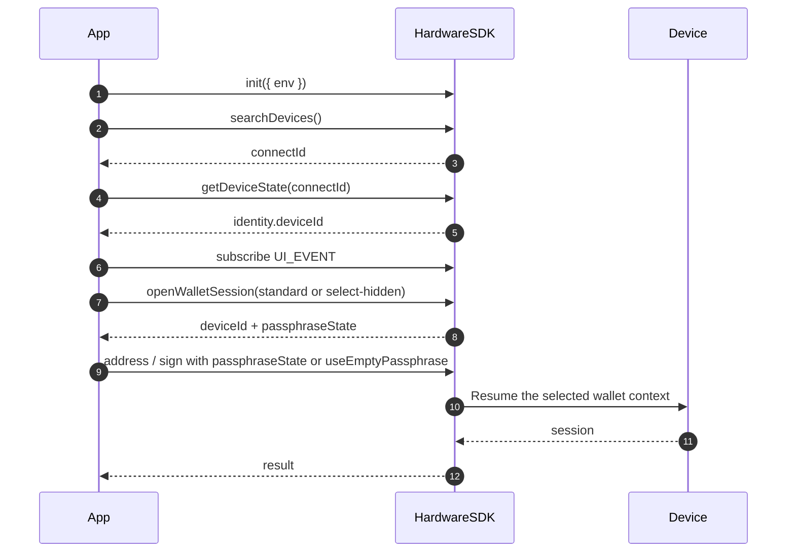

<span id="hardware-sdk-core-api-guide" />

# Guía de la API Core de Hardware SDK

Guía del ciclo de vida: inicialización → búsqueda → eventos → primera llamada protegida → limpieza.

Las tablas de parámetros se encuentran en [Parámetros comunes](/es/hardware-sdk/concepts/common-params). Las diferencias entre dispositivos y protocolos se encuentran en [Dispositivos](/es/hardware-sdk/concepts/devices) y [Protocol V1 y V2](/es/hardware-sdk/concepts/protocol).

## Flujo rápido [#quick-flow]
<div id="request-basics" />

- Estructura de las llamadas: `HardwareSDK.method(connectId, deviceId?, params)` → `Promise<{ success, payload }>`; comprueba siempre `success` antes de acceder a `payload`.
- Identificadores: `connectId` de `searchDevices`; `deviceId` de `getDeviceState` (obligatorio para BLE, recomendado para WebUSB). Actualiza `deviceId` tras un restablecimiento o una recuperación. Tabla completa: [Identificadores](/es/hardware-sdk/concepts/identifiers).
- Contrato de interfaz: suscríbete a `UI_EVENT` una sola vez; llama a `uiResponse` únicamente para eventos de entrada `UI_REQUEST` (PIN / Passphrase / selección de Bootloader). Dirige los eventos al dispositivo correspondiente cuando haya varios conectados.
- Serializa las llamadas por dispositivo. Reutiliza una cartera oculta pasando `passphraseState` en los métodos posteriores (flujo de compatibilidad: `initSession + passphraseState`). No llames a `openWalletSession` de nuevo para ello.

```ts
const res = await HardwareSDK.evmGetAddress(connectId, deviceId, {
  path: "m/44'/60'/0'/0/0",
  useEmptyPassphrase: true,
});

if (!res.success) throw new Error(res.payload.error);
console.log(res.payload.address);
```

### Flujo de interacción [#interaction-flow]



## Identificadores de Core y entornos [#core-identifiers--environments]

| ID | Finalidad | Se obtiene mediante | Cambia cuando |
| --- | --- | --- | --- |
| `connectId` | Qué conexión | `searchDevices()` | Reconexión USB, nuevo emparejamiento BLE, cambio de transporte |
| `deviceId` | Qué vigencia de semilla | `getDeviceState` (`getFeatures` está obsoleto) | Borrado, recuperación, cambio de semilla |

Los identificadores `connectId` de USB y BLE tienen valores distintos para la misma unidad; guárdalos en caché por separado. Consulta [Identificadores](/es/hardware-sdk/concepts/identifiers) y [Desconexiones y reconexión](/es/hardware-sdk/transport/reconnect).

**Requisitos del entorno de ejecución**

- `webusb` — HTTPS + gesto del usuario.
- `react-native` — autorización BLE + permiso de ubicación (habitualmente).
- `lowlevel` — adaptador BLE del host que reenvía los fragmentos de notificación sin procesar.
- Firmware — algunas API fallan en Bootloader.

### ¿Qué identificadores son obligatorios? [#which-identifiers-are-required]

| Requisito | Descripción | API de ejemplo |
| :--- | :--- | :--- |
| 🟢 Sin identificadores | Inicialización del SDK, configuración y gestión de eventos | `init` `on/off` `searchDevices` `getLogs` `dispose` `uiResponse` |
| 🟡 `connectId` solo | Gestión y estado del dispositivo, operaciones de firmware | `getDeviceState` `openWalletSession` `cancel` `deviceSettings` |
| 🔵 `connectId` + `deviceId` | Firma de blockchain, direcciones y cifrado | `evmSignTransaction` `btcSignTransaction` `solSignMessage` `allNetworkGetAddress` |

## Ciclo de vida estándar (recomendado) [#standard-lifecycle-recommended]
<div id="standard-lifecycle" />

`init → search → getDeviceState → subscribe UI/DEVICE/FIRMWARE → call + uiResponse → cleanup`

```ts
import HardwareSDK from '@onekeyfe/hd-common-connect-sdk';
import { UI_EVENT, UI_REQUEST, UI_RESPONSE } from '@onekeyfe/hd-core';

const initialized = await HardwareSDK.init({ env: 'webusb', fetchConfig: true, debug: false });
if (!initialized) throw new Error('SDK initialization failed');

const devices = await HardwareSDK.searchDevices();
if (!devices.success || !devices.payload.length) throw new Error('No device');
// Select explicitly in the application when more than one device is available.
if (devices.payload.length !== 1) throw new Error('Select exactly one device before continuing');
const { connectId } = devices.payload[0];
if (!connectId) throw new Error("Missing connectId");

const state = await HardwareSDK.getDeviceState(connectId);
if (!state.success) throw new Error(state.payload.error);
const deviceId = state.payload.identity.deviceId;
if (!deviceId) throw new Error("Device has no wallet identity");

// Register the UI_EVENT handler shown below before any protected call.
HardwareSDK.on(UI_EVENT, handleUiEvent);

const address = await HardwareSDK.evmGetAddress(connectId, deviceId, {
  path: "m/44'/60'/0'/0/0",
  useEmptyPassphrase: true,
});
if (!address.success) throw new Error(address.payload.error);
```

Serializa las llamadas por dispositivo. Actualiza `getDeviceState` tras cambiar de dispositivo. Elimina los listeners al desmontar. Llama a `HardwareSDK.dispose()` solo al cerrar el transporte; consulta [Desconexiones y reconexión](/es/hardware-sdk/transport/reconnect).

## Parámetros comunes [#common-params]

La tabla completa, la matriz de transportes, las combinaciones y las rutas HD se han trasladado a [Parámetros comunes](/es/hardware-sdk/concepts/common-params).

<div id="hd-path" />

Ejemplos de rutas HD: [Parámetros comunes → ruta HD](/es/hardware-sdk/concepts/common-params#hd-path).

Para la experiencia de PIN y passphrase, consulta [PIN](/es/hardware-sdk/concepts/pin) y [Frase de contraseña](/es/hardware-sdk/concepts/passphrase). El código nuevo para abrir carteras debe usar [Sesiones de cartera](/es/hardware-sdk/concepts/wallet-session).

## Conexión de eventos e interfaz [#events--ui-wiring]
<div id="events-ui" />

Suscríbete una sola vez, al iniciar la aplicación. Llama a `uiResponse` únicamente para solicitudes de entrada. Copia `payload.responseCorrelation` en cada respuesta cuando esté presente; identifica la interacción pendiente. Invalida los callbacks de los diálogos tras una cancelación o un evento de cierre de interfaz, y cancela la conexión seleccionada cuando el usuario descarte la entrada. No registres los payloads de eventos de interfaz ni los valores introducidos.

**Solicitudes de interfaz que requieren `uiResponse`**

| UI_REQUEST | Cuándo se activa | Responde con |
| --- | --- | --- |
| `REQUEST_PIN` | Solicitud de PIN en el host; los avisos de introducción exclusiva en el dispositivo no requieren respuesta | `UI_RESPONSE.RECEIVE_PIN` |
| `REQUEST_PASSPHRASE` | Seleccionar la introducción en el host o en el dispositivo (`value: ""`, `passphraseOnDevice: true` para introducirlo en el dispositivo) | `UI_RESPONSE.RECEIVE_PASSPHRASE` |
| `REQUEST_DEVICE_IN_BOOTLOADER_FOR_WEB_DEVICE` | Selector web de Bootloader | `UI_RESPONSE.SELECT_DEVICE_IN_BOOTLOADER_FOR_WEB_DEVICE` |

**Notificaciones de interfaz (sin `uiResponse`)**

| UI_REQUEST | Finalidad |
| --- | --- |
| `REQUEST_PASSPHRASE_ON_DEVICE` | Introducir la passphrase en el dispositivo; solo notificación |
| `REQUEST_BUTTON` | Confirmar en el dispositivo. La actualización del firmware usa `reason='firmware-update'` — tampoco requiere `uiResponse` |
| `DEVICE_PROGRESS` | Progreso de tareas prolongadas |
| `FIRMWARE_PROCESSING` / `FIRMWARE_PROGRESS` / `FIRMWARE_TIP` | Estados de actualización del firmware |
| `BLUETOOTH_PERMISSION` / `LOCATION_PERMISSION` | Avisos de permisos BLE |
| `BOOTLOADER` / `REQUIRE_MODE` / `NOT_INITIALIZE` / `FIRMWARE_NOT_SUPPORTED` | Indicaciones de modo o compatibilidad |

**Eventos del dispositivo / firmware**

| Canal | Evento | Gestión habitual |
| --- | --- | --- |
| `DEVICE.CONNECT` | payload directo | Actualizar la lista de dispositivos |
| `DEVICE.DISCONNECT` | payload directo | Invalida la conexión; no repitas llamadas que producen efectos. [Reconexión](/es/hardware-sdk/transport/reconnect) |
| `DEVICE.STATE` / `DEVICE.FEATURES` / `DEVICE.SUPPORT_FEATURES` | payload directo | Actualizar el estado, las características y las funciones compatibles del dispositivo |
| `FIRMWARE_EVENT` | `RELEASE_INFO` / `BLE_RELEASE_INFO` | Ofrecer la actualización cuando sea seguro. [Actualización del firmware](/es/hardware-sdk/firmware-update) |

```ts
import HardwareSDK from '@onekeyfe/hd-common-connect-sdk';
import { UI_EVENT, UI_REQUEST, UI_RESPONSE } from '@onekeyfe/hd-core';

import type { UiEventMessage } from '@onekeyfe/hd-core';

// These modal functions are provided by your application's UI.
declare function openPinModal(submit: (input: { value: string }) => void): void;
declare function openPassphraseModal(submit: (input: { value: string; onDevice: boolean; save: boolean }) => void): void;

const handleUiEvent = (msg: UiEventMessage) => {
  switch (msg.type) {
    case UI_REQUEST.REQUEST_PIN:
      if (msg.payload.deviceOnly || msg.payload.type === 'ButtonRequest_PinEntry' || msg.payload.type === 'ButtonRequest_AttachPin') {
        // Display an on-device prompt; no uiResponse is needed.
        return;
      }
      openPinModal(({ value }) =>
        HardwareSDK.uiResponse({ ...msg.payload.responseCorrelation, type: UI_RESPONSE.RECEIVE_PIN, payload: value })
      );
      return;
    case UI_REQUEST.REQUEST_PASSPHRASE:
      if (msg.payload.deviceOnly) {
        HardwareSDK.uiResponse({
          ...msg.payload.responseCorrelation,
          type: UI_RESPONSE.RECEIVE_PASSPHRASE,
          payload: { value: '', passphraseOnDevice: true, save: false },
        });
        return;
      }
      openPassphraseModal(({ value, onDevice, save }) =>
        HardwareSDK.uiResponse({
          ...msg.payload.responseCorrelation,
          type: UI_RESPONSE.RECEIVE_PASSPHRASE,
          payload: { value: onDevice ? "" : value, passphraseOnDevice: onDevice, attachPinOnDevice: false, save },
        })
      );
      return;
    default:
      break;
  }
};

HardwareSDK.on(UI_EVENT, handleUiEvent);
```

## Errores [#errors]
<div id="error-codes" />

| Grupo | Causas comunes | Acciones recomendadas |
| --- | --- | --- |
| Dispositivo (101–118, 200) | Modo incorrecto, ocupado, `deviceId` no coincide, sin inicializar | Confirma el modo, reconecta y vuelve a ejecutar `init` + `getDeviceState` |
| IFrame (300–305) | Falta inicialización; carga, tiempo de espera agotado o bloqueo | Comprueba que `init` se haya completado correctamente; revisa CSP / iframe |
| Método/Firmware (400–418) | Parámetros incorrectos, firmware requerido, ruta prohibida | Valida la ruta HD; [Actualización del firmware](/es/hardware-sdk/firmware-update) |
| Transporte (600–603) | Transporte sin configurar, llamada simultánea | Comprueba `env`, serializa las llamadas |
| Bluetooth (700–722) | Escaneo, permisos, conexión o tiempo de espera agotado | Permisos y proximidad; no reintentes en bucle un emparejamiento obsoleto |
| Entorno de ejecución/Bridge (800–822) | PIN cancelado, tiempo de espera de Bridge agotado | Respeta la cancelación; recupera la conexión sin repetir automáticamente la firma |
| Dispositivo web (901–902) | WebUSB no autorizado | HTTPS + gesto del usuario |

Interpreta `payload.code`, no el texto de `payload.error`. Definiciones: [`HardwareError.ts`](https://github.com/OneKeyHQ/hardware-js-sdk/blob/onekey/packages/shared/src/HardwareError.ts).

## Relacionado [#related]

- [Primeros pasos](/es/hardware-sdk/getting-started)
- [Transporte](/es/hardware-sdk/transport) · [Reconexión](/es/hardware-sdk/transport/reconnect)
- [Parámetros comunes](/es/hardware-sdk/concepts/common-params)
- [Actualización del firmware](/es/hardware-sdk/firmware-update)
- [Guías de firma](/es/hardware-sdk/signers)
