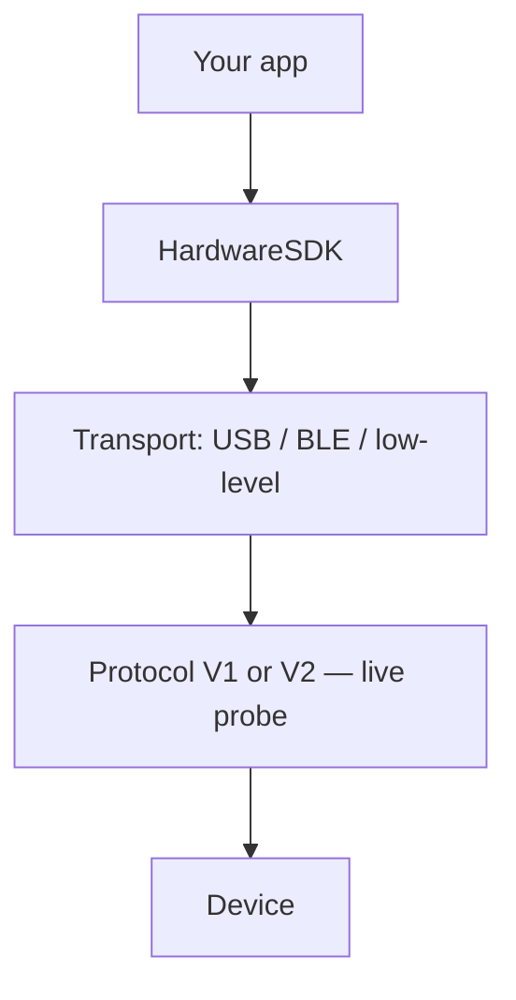

import { ExternalLink, Play, Monitor } from 'lucide-react'

<span id="introduction" />

# Introducción

Documentación para desarrolladores que integran hardware OneKey en aplicaciones web y nativas.

Hardware SDK **1.2.x** admite Protocol V1 y Protocol V2 mediante la misma API de JavaScript. ¿Acabas de empezar? Comienza con [Primeros pasos](/es/hardware-sdk/getting-started).

Esta página presenta la **guía de orientación**: elige el paquete SDK adecuado para tu plataforma e instálalo. Para el recorrido completo (búsqueda → eventos → PIN/passphrase → primera llamada de firma), así como parámetros, eventos y gestión de errores, consulta la [Guía de la API Core](/es/hardware-sdk/core-api-guide).

## Elige tu transporte [#choose-your-transport]

Las integraciones USB deben usar `@onekeyfe/hd-common-connect-sdk`; usa `@onekeyfe/hd-web-sdk` solo cuando el host requiera una configuración de iframe/plugin.

### Métodos de conexión [#connection-methods]

| Método | Descripción | Dispositivos compatibles |
|--------|-------------|-------------------|
| **USB / WebUSB** | USB por cable; navegador mediante WebUSB; Node.js / CLI mediante node-usb | Dispositivos con una interfaz USB y un firmware compatibles |
| **Bluetooth BLE (nativo)** | Aplicaciones nativas mediante BLE (no Web Bluetooth); requiere Bluetooth del sistema operativo y permisos | Pro, Pro 2, Neo, Touch, Classic 1s / Classic 1s Pure; **Mini no admite BLE** |
| **Air-Gap (QR)** | Firma sin conexión mediante QR | OneKey Pro y Pro 2; **Neo no tiene cámara** |

### Guía por plataforma [#platform-guide]

| Plataforma (tecnología) | Transporte | Paquete SDK | Guía |
|------------------|-----------|-------------|-------|
| Web (navegador) | WebUSB | [@onekeyfe/hd-common-connect-sdk](https://github.com/OneKeyHQ/hardware-js-sdk/tree/onekey/packages/hd-common-connect-sdk) | [Guía de conexión WebUSB](/es/hardware-sdk/transport/web-usb) |
| React Native | BLE | [@onekeyfe/hd-ble-sdk](https://github.com/OneKeyHQ/hardware-js-sdk/tree/onekey/packages/hd-ble-sdk) | [React Native BLE](/es/hardware-sdk/transport/react-native-ble) |
| Android (nativo) | BLE | [@onekeyfe/hd-common-connect-sdk](https://github.com/OneKeyHQ/hardware-js-sdk/tree/onekey/packages/hd-common-connect-sdk) | [BLE en Android](/es/hardware-sdk/transport/android) |
| iOS (nativo) | BLE | [@onekeyfe/hd-common-connect-sdk](https://github.com/OneKeyHQ/hardware-js-sdk/tree/onekey/packages/hd-common-connect-sdk) | [BLE en iOS](/es/hardware-sdk/transport/ios) |
| Flutter | BLE | [@onekeyfe/hd-common-connect-sdk](https://github.com/OneKeyHQ/hardware-js-sdk/tree/onekey/packages/hd-common-connect-sdk) | [Flutter BLE](/es/hardware-sdk/transport/flutter) |



Protocolo de bajo nivel y canales personalizados: [Plugin y protocolo de transporte de bajo nivel](/es/hardware-sdk/concepts/low-level-plugin)

## Instalar el SDK [#install-sdk]

Elige un punto de entrada según el entorno de ejecución:

```bash
# Web / desktop WebUSB (recommended)
npm i @onekeyfe/hd-common-connect-sdk

# React Native BLE
npm i @onekeyfe/hd-ble-sdk

# Native host with low-level plugin (Android/iOS/Flutter bridge)
npm i @onekeyfe/hd-common-connect-sdk

# Plugin iframe host only (plugin-only)
npm i @onekeyfe/hd-web-sdk
```

Detalles de los transportes:
- WebUSB: [Guía de WebUSB](/es/hardware-sdk/transport/web-usb)
- BLE en React Native: [Guía de BLE](/es/hardware-sdk/transport/react-native-ble)
- Android / iOS / Flutter nativos: conecta las llamadas JS mediante plugins de transporte de bajo nivel (consulta los ejemplos en sus páginas).
- Canal y protocolo personalizados: [Plugin y protocolo de transporte de bajo nivel](/es/hardware-sdk/concepts/low-level-plugin)

## Inicializar el SDK [#initialize-the-sdk]

Usa el método de inicialización correspondiente a tu entorno de ejecución; evita mezclar puntos de entrada del SDK.

### WebUSB en web / escritorio [#web--desktop-webusb]

Usa `@onekeyfe/hd-common-connect-sdk`:

```ts
import HardwareSDK from '@onekeyfe/hd-common-connect-sdk';

const initialized = await HardwareSDK.init({
  env: 'webusb',
  debug: false,
  fetchConfig: true,
});
if (!initialized) throw new Error('SDK initialization failed');
```

### React Native BLE [#react-native-ble]

Usa `@onekeyfe/hd-ble-sdk`:

```ts
import HardwareSDK from '@onekeyfe/hd-ble-sdk';

const initialized = await HardwareSDK.init({
  debug: false,
});
if (!initialized) throw new Error('SDK initialization failed');
```

### Puente nativo / bajo nivel [#native-bridge--low-level]

Usa `@onekeyfe/hd-common-connect-sdk`:

```ts
import HardwareSDK from '@onekeyfe/hd-common-connect-sdk';
import type { LowlevelTransportSharedPlugin } from '@onekeyfe/hd-transport';

// Provide an implemented native BLE bridge; this is a preparation fragment.
declare const plugin: LowlevelTransportSharedPlugin;
const initialized = await HardwareSDK.init({
  env: 'lowlevel',
  debug: false,
  fetchConfig: true,
}, undefined, plugin);
if (!initialized) throw new Error('SDK initialization failed');
```

| Entorno | Caso de uso |
|-------------|----------|
| `webusb` | WebUSB en el navegador (sin iframe) |
| `lowlevel` | Aplicaciones nativas que conectan JS mediante un adaptador de bajo nivel |
| `react-native` | Puente RN personalizado o BLE en Electron |
| `emulator` | Transporte de emulador integrado |

### Host iframe de plugin [#plugin-iframe-host]

Usa `@onekeyfe/hd-web-sdk` (solo plugin). El host iframe predeterminado del SDK es `https://jssdk.onekey.so/<installed-package-version>/` de `getSDKVersion()`. Omite `connectSrc` salvo que alojes el iframe por tu cuenta.

import { SdkVersionNote } from '../../../components/SdkVersionNote'

<SdkVersionNote locale="es" />

```ts
import HdWebSdk from '@onekeyfe/hd-web-sdk';

const HardwareSDK = HdWebSdk.HardwareWebSdk;

const initialized = await HardwareSDK.init({
  debug: false,
  // omit connectSrc — SDK fills https://jssdk.onekey.so/<installed-version>/
});
if (!initialized) throw new Error('SDK initialization failed');
```

## Próximos pasos [#next-steps]

Después de que `HardwareSDK.init(...)` devuelva un resultado, sigue [Primeros pasos](/es/hardware-sdk/getting-started) para obtener la primera dirección y después la [Guía de la API Core](/es/hardware-sdk/core-api-guide) para el resto del flujo:

- Matriz de dispositivos de 1.2.0: [Dispositivos](/es/hardware-sdk/concepts/devices)
- Qué cadenas admite Pro 2 / Neo: [Compatibilidad de cadenas](/es/hardware-sdk/concepts/chain-support)
- Protocol V1 frente a V2 (detección automática): [Protocolo](/es/hardware-sdk/concepts/protocol)
- Abrir / reanudar una cartera: [Sesiones de cartera](/es/hardware-sdk/concepts/wallet-session)
- Selección de transporte y reconexión: [Transporte](/es/hardware-sdk/transport) · [Reconexión](/es/hardware-sdk/transport/reconnect)
- Firmware V2 / V3 / V4: [Actualización del firmware](/es/hardware-sdk/firmware-update)

- Ciclo de vida estándar (`init → search → getDeviceState → subscribe → call + uiResponse → cleanup`): [Guía de la API Core → ciclo de vida estándar](/es/hardware-sdk/core-api-guide#standard-lifecycle)
- Parámetros compartidos para los métodos de dirección, firma y dispositivo: [Parámetros comunes](/es/hardware-sdk/concepts/common-params)
- Referencia de identificadores (`connectId` / `deviceId` / `passphraseState` / …): [Identificadores](/es/hardware-sdk/concepts/identifiers)
- Flujo de introducción del PIN: [Código PIN](/es/hardware-sdk/concepts/pin)
- Flujo de passphrase / cartera oculta: [Frase de contraseña](/es/hardware-sdk/concepts/passphrase)

import { DeviceCompatibilityTable } from '../../../components/DeviceCompatibilityTable'

## Compatibilidad de dispositivos y transportes [#device-and-transport-compatibility]

<DeviceCompatibilityTable locale="es" />

> **Modo Air-Gap:** OneKey Pro y Pro 2 permiten firmar de forma aislada mediante códigos QR, sin conexión USB ni Bluetooth, y revisar los detalles en el dispositivo antes de firmar. Consulta [Integración Air-Gap](/es/air-gap) para más detalles.

## Paquetes principales [#core-packages]

| Paquete | Finalidad | NPM | Versión |
|---------|---------|-----|---------|
| `@onekeyfe/hd-common-connect-sdk` | API unificada del SDK para web y nativo; punto de entrada recomendado para transportes | [npm](https://www.npmjs.com/package/@onekeyfe/hd-common-connect-sdk) | [](https://www.npmjs.com/package/@onekeyfe/hd-common-connect-sdk) |
| `@onekeyfe/hd-ble-sdk` | Implementación BLE puramente React Native (recomendada para proyectos RN) | [npm](https://www.npmjs.com/package/@onekeyfe/hd-ble-sdk) | [](https://www.npmjs.com/package/@onekeyfe/hd-ble-sdk) |
| `@onekeyfe/hd-transport-react-native` | Efectos secundarios de registro del transporte / puente de React Native | [npm](https://www.npmjs.com/package/@onekeyfe/hd-transport-react-native) | [](https://www.npmjs.com/package/@onekeyfe/hd-transport-react-native) |
| `@onekeyfe/hd-transport-web-device` | Transporte web para acceder al dispositivo en entornos web | [npm](https://www.npmjs.com/package/@onekeyfe/hd-transport-web-device) | [](https://www.npmjs.com/package/@onekeyfe/hd-transport-web-device) |
| `@onekeyfe/hd-transport-emulator` | Transporte de emulador (desarrolla y prueba sin un dispositivo físico) | [npm](https://www.npmjs.com/package/@onekeyfe/hd-transport-emulator) | [](https://www.npmjs.com/package/@onekeyfe/hd-transport-emulator) |
| `@onekeyfe/hd-transport-http` | Transporte mediante puente HTTP | [npm](https://www.npmjs.com/package/@onekeyfe/hd-transport-http) | [](https://www.npmjs.com/package/@onekeyfe/hd-transport-http) |
| `@onekeyfe/hd-transport-lowlevel` | Contrato del adaptador de host de bajo nivel (para integraciones nativas) | [npm](https://www.npmjs.com/package/@onekeyfe/hd-transport-lowlevel) | [](https://www.npmjs.com/package/@onekeyfe/hd-transport-lowlevel) |
| `@onekeyfe/hd-core` | Eventos, constantes y conexión de mensajes de Core | [npm](https://www.npmjs.com/package/@onekeyfe/hd-core) | [](https://www.npmjs.com/package/@onekeyfe/hd-core) |
| `@onekeyfe/hd-shared` | Utilidades y tipos compartidos | [npm](https://www.npmjs.com/package/@onekeyfe/hd-shared) | [](https://www.npmjs.com/package/@onekeyfe/hd-shared) |
| `@onekeyfe/hd-web-sdk` | Wrapper del SDK web (no recomendado; prefiere hd-common-connect-sdk) | [npm](https://www.npmjs.com/package/@onekeyfe/hd-web-sdk) | [](https://www.npmjs.com/package/@onekeyfe/hd-web-sdk) |

- Registro de cambios: [versiones](https://github.com/OneKeyHQ/hardware-js-sdk/releases)

## Más información [#further-reading]

- Transporte de bajo nivel y protocolo de mensajes (para depuración o adaptadores personalizados): [Plugin de transporte de bajo nivel](/es/hardware-sdk/concepts/low-level-plugin)
- Migración desde el flujo antiguo `hd-web-sdk`: [Guía de migración](/es/hardware-sdk/legacy-guides)
{/* - AI agent integration via OneKey skills: [AI Agent Integration](/en/hardware-sdk/agent-integration) */}

## Soporte [#support]

Para usuarios: esta documentación está dirigida principalmente a desarrolladores. Si tienes problemas al usar nuestros productos, consulta el Centro de ayuda o envía una solicitud de soporte.

- [Centro de ayuda](https://help.onekey.so)
- [Incidencias](https://github.com/OneKeyHQ/hardware-js-sdk/issues)

## Repositorios relacionados [#related-repositories]

- [OneKey App (app-monorepo)](https://github.com/OneKeyHQ/app-monorepo)
- [Firmware de OneKey](https://github.com/OneKeyHQ/firmware)
- [OneKey Hardware JS SDK](https://github.com/OneKeyHQ/hardware-js-sdk)

---

## Pruébalo [#try-it-out]

<div className="mt-4 flex flex-wrap gap-3">
  <a
    href="/es/hardware-sdk/playground"
    className="group inline-flex items-center gap-2 rounded-lg border border-zinc-200 bg-white px-4 py-2.5 text-sm font-medium text-zinc-700 transition-all hover:border-emerald-500/50 hover:bg-emerald-50 hover:text-emerald-700 dark:border-zinc-700 dark:bg-zinc-800 dark:text-zinc-300 dark:hover:border-emerald-500/40 dark:hover:bg-emerald-500/10 dark:hover:text-emerald-400"
  >
    <Play className="h-4 w-4" strokeWidth={1.5} />
    Playground interactivo
  </a>
  <a
    href="https://hardware-example.onekey.so/#/emulator"
    target="_blank"
    rel="noopener noreferrer"
    className="group inline-flex items-center gap-2 rounded-lg border border-zinc-200 bg-white px-4 py-2.5 text-sm font-medium text-zinc-700 transition-all hover:border-blue-500/50 hover:bg-blue-50 hover:text-blue-700 dark:border-zinc-700 dark:bg-zinc-800 dark:text-zinc-300 dark:hover:border-blue-500/40 dark:hover:bg-blue-500/10 dark:hover:text-blue-400"
  >
    <Monitor className="h-4 w-4" strokeWidth={1.5} />
    Emulador en línea
    <ExternalLink className="h-3 w-3 opacity-50" strokeWidth={2} />
  </a>
</div>
