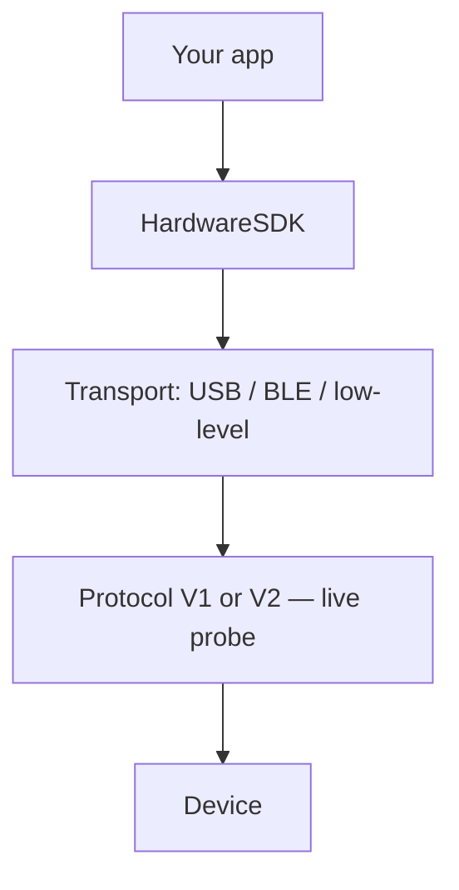

# Elegir transporte

Hardware SDK 1.2.x usa una única API JavaScript. `init({ env })` selecciona el **transporte**, no Protocol V1 o V2.

| Plataforma | Transporte | Paquete | `env` | Guía |
| --- | --- | --- | --- | --- |
| WebUSB en navegador / escritorio | WebUSB | `@onekeyfe/hd-common-connect-sdk` | `webusb` | [WebUSB](/es/hardware-sdk/transport/web-usb) |
| React Native | BLE | `@onekeyfe/hd-ble-sdk` | (valor predeterminado del SDK BLE) | [React Native BLE](/es/hardware-sdk/transport/react-native-ble) |
| Host nativo Android | BLE mediante plugin de bajo nivel | `@onekeyfe/hd-common-connect-sdk` | `lowlevel` | [Android](/es/hardware-sdk/transport/android) |
| Host nativo iOS | BLE mediante plugin de bajo nivel | `@onekeyfe/hd-common-connect-sdk` | `lowlevel` | [iOS](/es/hardware-sdk/transport/ios) |
| Host Flutter | BLE mediante plugin de bajo nivel | `@onekeyfe/hd-common-connect-sdk` | `lowlevel` | [Flutter](/es/hardware-sdk/transport/flutter) |
| Resumen de BLE nativo | BLE | `@onekeyfe/hd-common-connect-sdk` | `lowlevel` | [BLE nativo](/es/hardware-sdk/transport/native-ble) |

USB requiere una interfaz y firmware compatibles; valida conexión y firma en tu plataforma. BLE es compatible con Pro, Pro 2, Neo, Touch y Classic 1s / Pure — **no con Mini**. Air-Gap QR es un flujo de producto independiente: [Air-Gap](/es/air-gap).

## El transporte no es el protocolo [#transport-is-not-the-protocol]

| Capa | Qué es | Cómo elegirla |
| --- | --- | --- |
| **Transporte** | Cómo se mueven los bytes: USB, BLE o un plugin BLE nativo | `init({ env })` — `webusb` / BLE SDK / `lowlevel` |
| **Protocolo** | V1 o V2 en la comunicación una vez establecida la conexión | Consulta del SDK. Lee `connectProtocol`. **No** lo deduzcas del PID USB o nombre BLE |

Un Pro 2 conectado por USB y un Pro 2 conectado por BLE usan Protocol V2. Un Classic por USB usa Protocol V1. Consulta [Protocol V1 y V2](/es/hardware-sdk/concepts/protocol) y [Dispositivos](/es/hardware-sdk/concepts/devices).

No uses OneKey Bridge (`env: 'web'` + `checkBridgeStatus`) para nuevas aplicaciones WebUSB. Migración: [Bridge → WebUSB](/es/hardware-sdk/legacy-guides/migrate-bridge-to-common-connect-webusb).

## Después de conectar [#after-you-connect]

1. Primera dirección: [Primeros pasos](/es/hardware-sdk/getting-started)
2. PIN / eventos: [Guía de la API Core](/es/hardware-sdk/core-api-guide)
3. Interrupciones y `dispose()`: [Reconexión y liberación de recursos](/es/hardware-sdk/transport/reconnect)
4. Firmware: [Actualización del firmware](/es/hardware-sdk/firmware-update)
5. Conexión BLE personalizada: [Transporte de bajo nivel](/es/hardware-sdk/concepts/low-level-plugin)
