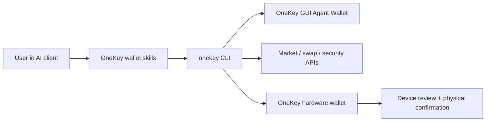

# OneKey Agent Wallet

> Bêta privée. L’accès, les commandes prises en charge et les parcours de portefeuille dépendent de vos versions de OneKey et de la CLI. Consultez le schéma de la CLI installée avant d’utiliser ces exemples.

OneKey Agent Wallet est la couche portefeuille destinée aux agents IA qui ont besoin d’actions réelles sur la chaîne, de contexte de marché et d’une signature contrôlée par l’utilisateur. Les agents peuvent lire l’état du portefeuille, trouver des adresses de réception, rechercher des jetons, obtenir des cotations et préparer des échanges, effectuer des contrôles de sécurité et renvoyer les actions à haut risque vers l’interface graphique ou le matériel OneKey pour confirmation par l’utilisateur.

Utilisez cette section lorsque vous créez des agents IA, des compétences, des outils MCP, des automatisations ou des processus en ligne de commande nécessitant des fonctions de portefeuille. Utilisez la documentation du Hardware SDK pour une intégration directe aux transports des appareils OneKey et aux API de signature de bas niveau.

## Ce que les agents peuvent faire [#what-agents-can-do]

| Domaine | Fonctionnalité de l’agent | Exemple de demande utilisateur |
| --- | --- | --- |
| Portefeuille | Vérifier les soldes, afficher les adresses de réception, consulter l’historique, préparer des transferts, dériver les types d’adresses BTC | `Show my ETH balance and receiving address.` |
| Échanges et ponts | Obtenir des cotations, construire, exécuter et suivre des échanges, gérer les PSBT BTC en signature seule, découvrir les réseaux des ponts | `Swap 1 ETH to USDC after showing me the quote.` |
| Marché et recherche | Rechercher des jetons, récupérer des prix, des listes de tendances, des données de chandeliers, de liquidité, de détenteurs et effectuer des recherches rapides ou approfondies | `What Solana tokens are trending right now?` |
| Sécurité | Auditer des jetons, simuler des transactions, vérifier des autorisations, signaler les incohérences de chaîne/adresse et les indicateurs de risque des jetons | `Is this token safe before I buy it?` |
| Contrôle du matériel | Connecter un appareil OneKey, vérifier son authenticité, utiliser le mode de phrase secrète et examiner les demandes de signature prises en charge sur l’appareil | `Use my hardware wallet for this transfer.` |
| Gestion des sessions | Associer un Agent Wallet géré dans l’interface graphique via App Transfer ou passer à une session reposant sur le matériel | `Connect my OneKey Agent Wallet.` |

## Fonctionnement [#how-it-works]

L’agent communique avec OneKey via le paquet `onekey-wallet-skills` et la CLI `onekey`. App Transfer et la connexion matérielle sélectionnent différents types de sessions. Consultez la session active avant d’utiliser les commandes de portefeuille ; la confirmation matérielle s’applique aux demandes de signature reposant sur le matériel.

## Choisissez votre parcours [#choose-your-path]

| Public | Commencer par | Pourquoi |
| --- | --- | --- |
| Développeur créant une intégration d’agent | [Fonctionnalités](/fr/agent-wallet/capabilities) et [Compétences de portefeuille](/fr/agent-wallet/wallet-skills) | Associer chaque fonctionnalité du produit à une commande CLI définie par un schéma et à un contrat de réponse. |
| Utilisateur du vibe coding essayant l’automatisation de portefeuille | [Démarrage rapide](/fr/agent-wallet/quickstart) et [Exemples pratiques](/fr/agent-wallet/recipes) | Copier d’abord les instructions en langage naturel, puis examiner les commandes sous-jacentes. |
| Auditeur de sécurité ou propriétaire de portefeuille | [Règles de sécurité](/fr/agent-wallet/safety) et [Contrôle du matériel](/fr/agent-wallet/hardware-control) | Vérifier ce que les agents peuvent lire et exécuter, et quand le matériel OneKey doit prendre le relais. |
| Membre de l’équipe produit ou support | [Session Agent Wallet](/fr/agent-wallet/wallet-session) et [Liaison sans clé](/fr/agent-wallet/keyless-binding) | Comprendre l’Agent Wallet géré dans l’interface graphique, la liaison de compte sans clé et le modèle de session active. |

## Implémentation actuelle [#current-implementation]

Le point d’entrée public est le dépôt externe [`onekey-wallet-skills`](https://github.com/OneKeyHQ/onekey-wallet-skills). Les compétences prennent en charge Claude Code, Codex, Cursor, OpenCode et OpenClaw, et orientent les demandes en langage naturel vers les processus de portefeuille, d’échange, de marché et de sécurité.

Le paquet `@onekeyfe/cli` reste la couche d’implémentation sous-jacente aux compétences. Celles-ci utilisent son schéma courant pour découvrir les commandes et paramètres pris en charge, associer des sessions App Transfer ou matérielles, et fournir des réponses structurées au lieu d’exposer la sortie brute du terminal aux utilisateurs.
