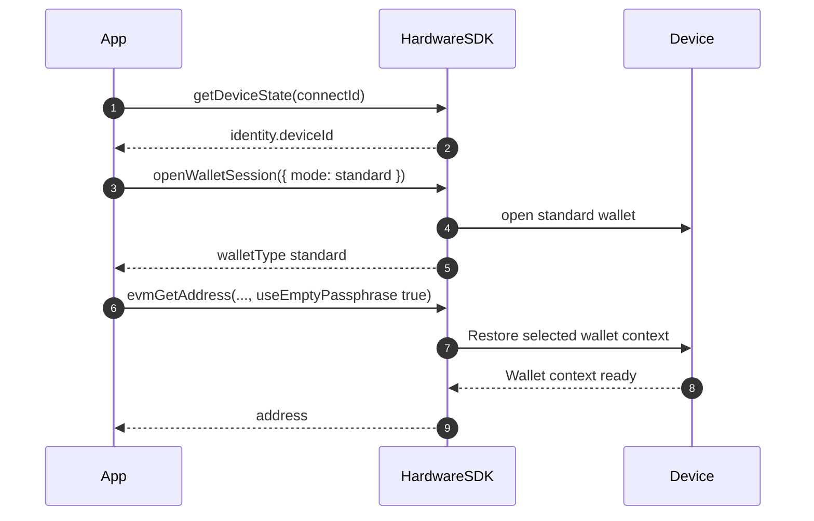
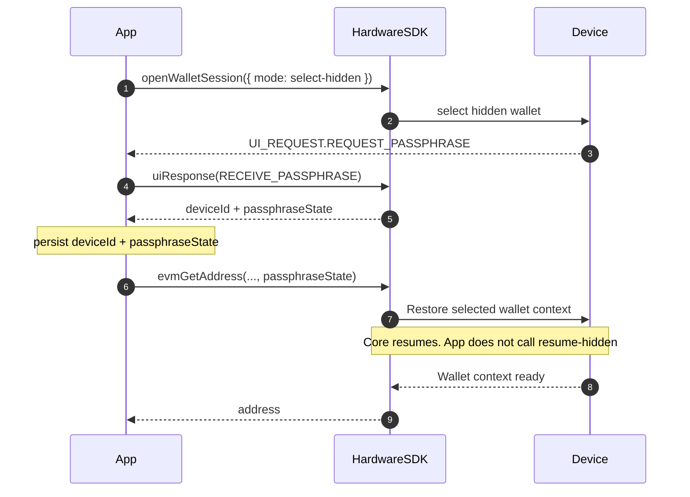

<span id="passphrase" />

# Phrase secrète

Règles et bonnes pratiques de gestion des phrases secrètes (portefeuilles cachés).

## Concepts fondamentaux [#core-concepts]

- **Portefeuille standard** = graine + phrase secrète vide ; **portefeuille caché** = graine + phrase secrète non vide (sensible à la casse).
- Chaque phrase secrète différente génère un portefeuille totalement différent — même si un seul caractère change.
- Les phrases secrètes ne peuvent pas être récupérées ; sauvegardez-les en lieu sûr.
- Forcez le portefeuille standard en définissant `useEmptyPassphrase: true`.

## Prise en charge des appareils [#device-support]

Ne déduisez pas la prise en charge de la saisie sur l’hôte ou sur l’appareil du seul nom du modèle. Lisez `getDeviceState` pour identifier l’appareil, le micrologiciel et l’état actuel, puis suivez la demande réelle de l’interface. La disponibilité dépend de l’appareil, du micrologiciel, du SDK et de l’environnement d’exécution.

| Demande ou condition | Comportement de l’hôte |
| --- | --- |
| `REQUEST_PASSPHRASE` | Présentez uniquement les choix de saisie pris en charge par la demande et l’appareil cible. Préservez la corrélation des réponses. |
| Une demande marquée `deviceOnly` | Demandez à l’utilisateur de continuer sur l’appareil ; ne recueillez pas la phrase secrète sur l’hôte. |
| `REQUEST_PASSPHRASE_ON_DEVICE` | Notification uniquement ; affichez les instructions pour l’appareil et n’envoyez pas `uiResponse`. |
| Mode de saisie demandé indisponible | Expliquez la limite ; ne changez pas silencieusement de méthode de saisie. |

Persistez l’association du portefeuille (`deviceId` et `passphraseState`) si nécessaire, pas un identifiant du micrologiciel `session_id`.

## Déroulement de l’interaction [#interaction-flow]

Hardware SDK 1.2.x : `searchDevices` → `getDeviceState` → `openWalletSession` → adresse / signature avec `deviceId` + `passphraseState` (ou `useEmptyPassphrase: true`). Abonnez-vous à `UI_EVENT` avant d’ouvrir un portefeuille. Consultez [Sessions de portefeuille](/fr/hardware-sdk/concepts/wallet-session).

### Portefeuille standard [#standard-wallet]



```ts
const state = await HardwareSDK.getDeviceState(connectId);
if (!state.success) throw new Error(state.payload.error);
const deviceId = state.payload.identity.deviceId;
if (!deviceId) throw new Error("Device has no wallet identity");

const standard = await HardwareSDK.openWalletSession(connectId, { mode: 'standard' });
if (!standard.success) throw new Error(standard.payload.error);

await HardwareSDK.evmGetAddress(connectId, deviceId, {
  path: "m/44'/60'/0'/0/0",
  useEmptyPassphrase: true,
});
```

### Portefeuille caché (ouvrir une fois, réutiliser l’empreinte) [#hidden-wallet-open-once-reuse-fingerprint]



```ts
import { UI_EVENT, UI_REQUEST, UI_RESPONSE } from '@onekeyfe/hd-core';

HardwareSDK.on(UI_EVENT, async (message) => {
  if (message.type === UI_REQUEST.REQUEST_PASSPHRASE) {
    await HardwareSDK.uiResponse({
      type: UI_RESPONSE.RECEIVE_PASSPHRASE,
      ...message.payload.responseCorrelation,
      payload: { passphraseOnDevice: true, value: '', save: false },
    });
  }
});

const opened = await HardwareSDK.openWalletSession(connectId, {
  mode: 'select-hidden',
});
if (!opened.success) throw new Error(opened.payload.error);
if (opened.payload.walletType !== 'hidden') {
  throw new Error('A hidden wallet was not opened');
}
const deviceId = opened.payload.deviceId;
const passphraseState = opened.payload.passphraseState;

await HardwareSDK.evmGetAddress(connectId, deviceId, {
  path: "m/44'/60'/0'/0/0",
  passphraseState,
});
await HardwareSDK.btcGetAddress(connectId, deviceId, {
  path: "m/84'/0'/0'/0/0",
  coin: 'btc',
  passphraseState,
});
```

Saisie de phrase secrète sur l’appareil ou via le logiciel :

```ts
// On-device
payload: { passphraseOnDevice: true, value: '' }

// Software
payload: { value: userInput, passphraseOnDevice: false, save: false }
```

### Processus ultérieur / reconnexion [#later-process--reconnect]

Persistez uniquement `deviceId + passphraseState`. Ne persistez **pas** l’identifiant `session_id` du micrologiciel. Chargez l’association et transmettez-la lors de l’appel d’adresse / de signature suivant. Core reprend dans cette méthode. `openWalletSession` n’a aucun mode de reprise.

```ts
import { OpenWalletSessionMode } from '@onekeyfe/hd-core';

// Process 1 — after the user selects the hidden wallet
const opened = await HardwareSDK.openWalletSession(connectId, {
  mode: OpenWalletSessionMode.SelectHidden,
});
if (!opened.success) throw new Error(opened.payload.error);
if (opened.payload.walletType !== 'hidden') {
  throw new Error('A hidden wallet was not opened');
}
saveBinding({
  deviceId: opened.payload.deviceId,
  passphraseState: opened.payload.passphraseState,
});

// Process 2 — later process, same machine
const { deviceId, passphraseState } = loadBinding();

await HardwareSDK.evmGetAddress(connectId, deviceId, {
  path: "m/44'/60'/0'/0/0",
  passphraseState,
});
```

`preloadSessionCache` est un point d’entrée de compatibilité pour les anciens enregistrements App/CLI Keychain. Les nouvelles intégrations ne doivent pas l’appeler et ne doivent pas stocker `session_id`.

Si l’appareil s’est verrouillé entre les processus, le PIN est redemandé au premier appel protégé. Consultez [Sessions de portefeuille](/fr/hardware-sdk/concepts/wallet-session).

### Déverrouillage préalable (CLI) [#unlock-first-pattern-cli]

```ts
const state = await HardwareSDK.getDeviceState(connectId);
if (!state.success) throw new Error(state.payload.error);

if (!state.payload.status.unlocked) {
  await HardwareSDK.deviceUnlock(connectId, {});
}

await HardwareSDK.evmGetAddress(connectId, savedDeviceId, {
  path: "m/44'/60'/0'/0/0",
  passphraseState: savedPassphraseState,
});
```

## Conseils de sécurité [#security-tips]

- **Ne jamais journaliser ni persister** les phrases secrètes en clair.
- Utilisez `useEmptyPassphrase: true` pour empêcher la création accidentelle d’un portefeuille caché.
- Appareils Pro/Touch : le PIN doit être saisi sur l’appareil ; la phrase secrète peut être saisie sur l’appareil ou via le logiciel.

## FAQ [#faq]

### Que se passe-t-il si j’oublie ma phrase secrète ? [#what-happens-if-i-forget-my-passphrase]

Les fonds du portefeuille caché deviennent définitivement inaccessibles. Il n’existe aucun moyen de récupérer une phrase secrète oubliée. Conservez toujours une sauvegarde sécurisée.

### La phrase secrète est-elle identique au PIN ? [#is-the-passphrase-the-same-as-the-pin]

Non. Le PIN protège l’accès physique à l’appareil. La phrase secrète crée un portefeuille entièrement différent à partir de la même graine. Leurs fonctions de sécurité sont distinctes :

| | PIN | Phrase secrète |
|---|-----|-----------|
| Rôle | Protection de l’accès à l’appareil | Création de portefeuille caché |
| Récupération | Peut être réinitialisé par effacement de l’appareil + récupération de la graine | Ne peut pas être récupérée |
| Stockage | Stocké sur l’appareil | Ne pas persister en clair ; la mise en cache du SDK dépend du parcours de saisie et de `save` |
| Sensible à la casse | Sans objet (numérique) | Oui |

### Puis-je avoir plusieurs portefeuilles cachés ? [#can-i-have-multiple-hidden-wallets]

Oui. Chaque phrase secrète unique crée un portefeuille caché distinct. Vous pouvez en avoir autant que vous le souhaitez — un par phrase secrète unique.

### L’appareil valide-t-il ma phrase secrète ? [#does-the-device-validate-my-passphrase]

Une nouvelle phrase secrète saisie peut dériver un portefeuille différent. Lorsqu’un appel ultérieur fournit une valeur attendue de `passphraseState`, le SDK vérifie cette association et échoue en cas d’incohérence ; ne considérez pas une phrase secrète mal saisie comme le portefeuille souhaité.

### Quelle est la différence entre `passphraseOnDevice` et la saisie logicielle ? [#whats-the-difference-between-passphraseondevice-and-software-input]

- **Sur l’appareil** : La phrase secrète est saisie directement sur l’écran/le clavier de l’appareil matériel. Elle ne quitte jamais l’appareil.
- **Saisie logicielle** : La phrase secrète est saisie dans votre application et envoyée à l’appareil via le SDK.

Voir aussi : [Paramètres communs](/fr/hardware-sdk/concepts/common-params), [Connexion des événements et de l’interface](/fr/hardware-sdk/core-api-guide#events-ui).

Sur Protocol V1, `select-hidden` peut renvoyer un portefeuille standard lorsque la protection par phrase secrète est désactivée. Vérifiez `walletType` avant d’enregistrer ou d’utiliser `passphraseState`.
