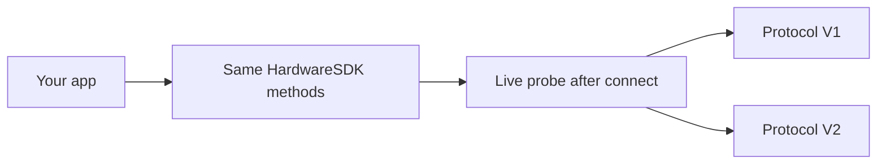

<span id="protocol-v1-and-v2" />

# Protocol V1 et V2

Hardware SDK 1.2.0 utilise deux protocoles de communication. Les intégrateurs conservent une seule API JavaScript. Ne différenciez pas le comportement selon le PID USB, le nom BLE ou la chaîne produit.



| | Protocol V1 | Protocol V2 |
| --- | --- | --- |
| Appareils actuels | Classic, Mini, Touch, Pro | Pro 2, Neo |
| Comment le SDK le détecte | Réponse en direct après connexion | `Ping` / interrogation du protocole en direct après connexion |
| Méthodes publiques | Méthodes existantes du Hardware SDK | Mêmes méthodes, adaptées dans Core |
| Règle d’appel | Sérialiser par appareil en pratique | Sérialiser par appareil ; obligatoire |
| Mise à jour du micrologiciel | `firmwareUpdateV2` / `firmwareUpdateV3` | `firmwareUpdateV4` |
| Méthodes de chaîne | Familles V1+V2 et familles V1 uniquement | Familles V1+V2 uniquement |
| Instantané de l’appareil | [`getDeviceState`](/fr/hardware-sdk/basic-api/get-device-state) (`getFeatures` est obsolète) | Identique |

Stellar, Alephium, Nexa, Dynex, Nervos, SCDO, Benfen et la chaîne Neo sont uniquement V1. Ils ne sont pas pris en charge sur Pro 2 / Neo. Matrice complète : [Prise en charge des chaînes](/fr/hardware-sdk/concepts/chain-support). USB / BLE / Air-Gap de l’appareil : [Appareils](/fr/hardware-sdk/concepts/devices).

## Détection [#detection]

Le SDK confirme le protocole à partir de la **connexion active**. Ne déduisez pas V1/V2 à partir de :

- PID / VID USB
- Nom annoncé par BLE
- Chaîne produit ou boîtier

Si vous persistez un résultat précédent, associez-le **par `connectId`** (USB et BLE d’une même unité sont des points de terminaison différents). Le champ public est `connectProtocol` dans l’objet appareil.

Transmettre `connectProtocol` lors d’un appel impose une exigence stricte : le SDK ne bascule pas silencieusement vers l’autre protocole.

## Ce qui reste identique [#what-stays-the-same]

- `HardwareSDK.init({ env })` sélectionne toujours le **transport** (USB / BLE / bas niveau), pas Protocol V1 ou V2.
- `searchDevices` → `connectId` → `getDeviceState` → méthodes de chaîne.
- Le PIN, la phrase secrète et la confirmation par bouton arrivent toujours sous forme de `UI_EVENT`. Répondez uniquement avec `uiResponse` sur les demandes de saisie. Consultez le [Guide de l’API Core](/fr/hardware-sdk/core-api-guide).

## Ce qu’il ne faut pas faire [#what-you-must-not-do]

- Ne lancez pas deux appels métier simultanés sur le même appareil.
- Ne rejouez pas automatiquement une signature, un effacement ou une mise à jour du micrologiciel après une déconnexion ou un délai dépassé.
- Ne lisez pas le champ de micrologiciel `session_id` dans les réponses pour le stocker. L’identité du portefeuille est `deviceId + passphraseState`. Consultez [Sessions de portefeuille](/fr/hardware-sdk/concepts/wallet-session).
- N’appelez pas les éléments internes de Protocol V2 (`DeviceSessionGet`, `DeviceInfoGet`, …). Ce ne sont pas des éléments publics `CoreApi`.

## État de l’appareil [#device-state]

Utilisez [`getDeviceState`](/fr/hardware-sdk/basic-api/get-device-state). `getFeatures` est limité à Protocol V1 (Classic / Mini / Touch / Pro) ; Pro 2 et Neo le rejettent avant toute projection de compatibilité. `getDeviceState` inclut toujours un instantané de forme Features pour V1 et V2.

```ts
const state = await HardwareSDK.getDeviceState(connectId);
if (!state.success) throw new Error(state.payload.error);
```

Utilisez `scope: 'settings'` ou `scope: 'firmware'` uniquement lorsque vous devez actualiser ces sections. La valeur renvoyée reste un instantané complet.

## Suivant [#next]

- [Appareils](/fr/hardware-sdk/concepts/devices)
- [Obtenir l’état de l’appareil](/fr/hardware-sdk/basic-api/get-device-state)
- [firmwareUpdateV4](/fr/hardware-sdk/device-api/firmwareupdatev4)
