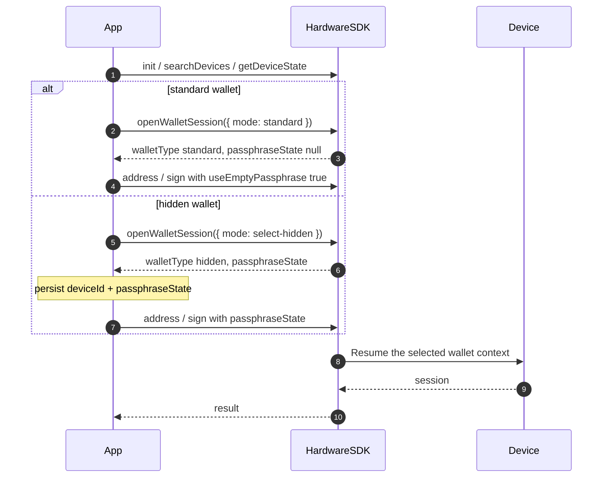

<span id="wallet-sessions" />

# Sessions de portefeuille

Cette page décrit une session de portefeuille **matériel** : le contexte de graine / de phrase secrète déverrouillé sur l’appareil.

Il ne s’agit pas d’une [session Agent Wallet](/fr/agent-wallet/wallet-session). Agent Wallet est un produit reposant sur l’interface graphique OneKey. Les sessions matérielles existent sur Classic / Pro / Pro 2 / Neo, qu’Agent Wallet soit utilisé ou non.

## Identité publique [#public-identity]

Ne persistez que cette paire comme association de portefeuille :

| Champ | Signification | Persister ? |
| --- | --- | --- |
| `deviceId` | Durée de vie de la graine actuelle (`device_id` provenant de Features / DeviceState) | Oui |
| `passphraseState` | Empreinte du portefeuille caché. `null` sur le portefeuille standard | Oui, si caché |
| micrologiciel `session_id` | Identifiant de déverrouillage côté appareil | **Non.** Core le conserve en interne |

Si vous omettez `passphraseState` sur un portefeuille caché, les API d’adresse et de signature peuvent réussir sur le portefeuille **standard** sans erreur. Transmettez toujours `useEmptyPassphrase: true` ou une véritable `passphraseState`.

## API recommandée (1.2.0) [#preferred-api-120]



Les nouvelles intégrations doivent ouvrir un portefeuille avec [`openWalletSession`](/fr/hardware-sdk/basic-api/open-wallet-session) :

```ts
import { OpenWalletSessionMode } from '@onekeyfe/hd-core';

// Standard wallet
const standard = await HardwareSDK.openWalletSession(connectId, {
  mode: OpenWalletSessionMode.Standard,
});
if (!standard.success) throw new Error(standard.payload.error);
```

Ou laisser l’utilisateur sélectionner un portefeuille caché :

```ts
// Choose this flow instead of the standard-wallet example.
const hidden = await HardwareSDK.openWalletSession(connectId, {
  mode: OpenWalletSessionMode.SelectHidden,
});
if (!hidden.success) throw new Error(hidden.payload.error);
if (hidden.payload.walletType !== 'hidden' || !hidden.payload.passphraseState) {
  throw new Error('A hidden wallet was not opened');
}
```

Stockez `payload.deviceId`, `payload.walletType`, et `payload.passphraseState`. Transmettez ensuite ces valeurs aux appels d’adresse / de signature. Core reprend le contexte de portefeuille requis dans cette méthode. N’appelez pas `openWalletSession` avant chaque signature.

`openWalletSession` n’a aucun mode `resume-hidden`. Transmettre `mode: 'resume-hidden'` renvoie `CallMethodInvalidParameter`. Chargez l’association enregistrée et transmettez `passphraseState` lors de l’appel d’adresse / de signature suivant.

## API de compatibilité obsolète [#deprecated-compatibility-api]

[`getPassphraseState`](/fr/hardware-sdk/basic-api/get-passphrase-state) est obsolète. Les applications existantes peuvent la conserver avec `initSession` / `useEmptyPassphrase` / `passphraseState` sur chaque appel. Core adapte toujours ce parcours à Protocol V1 et V2. Le nouveau code doit utiliser `openWalletSession`.

Ne combinez pas `openWalletSession({ mode })` avec `useEmptyPassphrase` / `initSession` sur le même appel.

## Attach-to-PIN [#attach-to-pin]

Certains appareils Pro / Pro 2 peuvent associer un portefeuille caché à un PIN dédié. L’API publique renvoie toujours `walletType: 'hidden'` et un `passphraseState`. Vous n’implémentez pas de second protocole de session pour Attach-to-PIN.

Si le SDK renvoie `DeviceCheckUnlockTypeError`, le type de déverrouillage actuel ne permet pas d’accéder au portefeuille demandé. Verrouillez l’appareil et laissez l’utilisateur le déverrouiller avec le PIN prévu ; ne réessayez pas la même association en boucle.

## Suivant [#next]

- [openWalletSession](/fr/hardware-sdk/basic-api/open-wallet-session)
- [Identifiants](/fr/hardware-sdk/concepts/identifiers)
- [Phrase secrète](/fr/hardware-sdk/concepts/passphrase)
