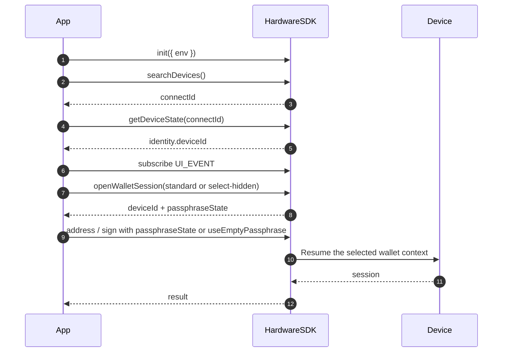

<span id="hardware-sdk-core-api-guide" />

# Guide de l’API Core du Hardware SDK

Guide du cycle de vie : initialisation → recherche → événements → premier appel protégé → nettoyage.

Les tableaux de paramètres se trouvent dans [Paramètres communs](/fr/hardware-sdk/concepts/common-params). Les différences d’appareils et de protocoles se trouvent dans [Appareils](/fr/hardware-sdk/concepts/devices) et [Protocol V1 et V2](/fr/hardware-sdk/concepts/protocol).

## Parcours rapide [#quick-flow]
<div id="request-basics" />

- Forme de l’appel : `HardwareSDK.method(connectId, deviceId?, params)` → `Promise<{ success, payload }>` ; vérifiez toujours `success` avant d’accéder à `payload`.
- Identifiants : `connectId` depuis `searchDevices` ; `deviceId` depuis `getDeviceState` (obligatoire pour BLE, recommandé pour WebUSB). Actualisez `deviceId` après réinitialisation/récupération. Tableau complet : [Identifiants](/fr/hardware-sdk/concepts/identifiers).
- Contrat d’interface : abonnez-vous à `UI_EVENT` une seule fois ; appelez uniquement `uiResponse` sur les événements de type saisie `UI_REQUEST` (PIN / phrase secrète / sélection du bootloader). Orientez les demandes par appareil lorsque plusieurs sont connectés.
- Sérialisez les appels par appareil. Réutilisez un portefeuille caché en transmettant `passphraseState` aux méthodes ultérieures (parcours de compatibilité : `initSession + passphraseState`). N’appelez pas `openWalletSession` de nouveau pour cela.

```ts
const res = await HardwareSDK.evmGetAddress(connectId, deviceId, {
  path: "m/44'/60'/0'/0/0",
  useEmptyPassphrase: true,
});

if (!res.success) throw new Error(res.payload.error);
console.log(res.payload.address);
```

### Déroulement de l’interaction [#interaction-flow]



## Identifiants et environnements Core [#core-identifiers--environments]

| ID | Rôle | Obtenir via | Change lors de |
| --- | --- | --- | --- |
| `connectId` | Quelle connexion | `searchDevices()` | Rebranchement USB, nouvel appairage BLE, changement de transport |
| `deviceId` | Quelle durée de vie de graine | `getDeviceState` (`getFeatures` est obsolète) | Effacement, récupération, changement de graine |

USB et BLE ont des valeurs de `connectId` différentes pour la même unité — mettez-les en cache séparément. Consultez [Identifiants](/fr/hardware-sdk/concepts/identifiers) et [Déconnexions et reconnexion](/fr/hardware-sdk/transport/reconnect).

**Exigences d’exécution**

- `webusb` — HTTPS + action utilisateur.
- `react-native` — autorisation BLE + (souvent) autorisation de localisation.
- `lowlevel` — adaptateur BLE hôte transmettant les blocs bruts de notification.
- Micrologiciel — certaines API échouent en mode Bootloader.

### Quels identifiants sont obligatoires ? [#which-identifiers-are-required]

| Exigence | Description | Exemples d’API |
| :--- | :--- | :--- |
| 🟢 Aucun identifiant | Initialisation, configuration et gestion des événements du SDK | `init` `on/off` `searchDevices` `getLogs` `dispose` `uiResponse` |
| 🟡 `connectId` uniquement | Gestion, état et opérations de micrologiciel de l’appareil | `getDeviceState` `openWalletSession` `cancel` `deviceSettings` |
| 🔵 `connectId` + `deviceId` | Signature blockchain, adresse, chiffrement | `evmSignTransaction` `btcSignTransaction` `solSignMessage` `allNetworkGetAddress` |

## Cycle de vie standard (recommandé) [#standard-lifecycle-recommended]
<div id="standard-lifecycle" />

`init → search → getDeviceState → subscribe UI/DEVICE/FIRMWARE → call + uiResponse → cleanup`

```ts
import HardwareSDK from '@onekeyfe/hd-common-connect-sdk';
import { UI_EVENT, UI_REQUEST, UI_RESPONSE } from '@onekeyfe/hd-core';

const initialized = await HardwareSDK.init({ env: 'webusb', fetchConfig: true, debug: false });
if (!initialized) throw new Error('SDK initialization failed');

const devices = await HardwareSDK.searchDevices();
if (!devices.success || !devices.payload.length) throw new Error('No device');
// Select explicitly in the application when more than one device is available.
if (devices.payload.length !== 1) throw new Error('Select exactly one device before continuing');
const { connectId } = devices.payload[0];
if (!connectId) throw new Error("Missing connectId");

const state = await HardwareSDK.getDeviceState(connectId);
if (!state.success) throw new Error(state.payload.error);
const deviceId = state.payload.identity.deviceId;
if (!deviceId) throw new Error("Device has no wallet identity");

// Register the UI_EVENT handler shown below before any protected call.
HardwareSDK.on(UI_EVENT, handleUiEvent);

const address = await HardwareSDK.evmGetAddress(connectId, deviceId, {
  path: "m/44'/60'/0'/0/0",
  useEmptyPassphrase: true,
});
if (!address.success) throw new Error(address.payload.error);
```

Sérialisez par appareil. Actualisez `getDeviceState` après un changement d’appareil. Supprimez les écouteurs au démontage. Appelez `HardwareSDK.dispose()` uniquement lors de la fermeture du transport — consultez [Déconnexions et reconnexion](/fr/hardware-sdk/transport/reconnect).

## Paramètres communs [#common-params]

Le tableau complet, la matrice des transports, les combinaisons et les chemins HD ont été déplacés vers [Paramètres communs](/fr/hardware-sdk/concepts/common-params).

<div id="hd-path" />

Exemples de chemins HD : [Paramètres communs → chemin HD](/fr/hardware-sdk/concepts/common-params#hd-path).

Pour l’expérience PIN et phrase secrète, consultez [PIN](/fr/hardware-sdk/concepts/pin) et [Phrase secrète](/fr/hardware-sdk/concepts/passphrase). Le nouveau code d’ouverture de portefeuille doit utiliser [Sessions de portefeuille](/fr/hardware-sdk/concepts/wallet-session).

## Connexion des événements et de l’interface [#events--ui-wiring]
<div id="events-ui" />

Abonnez-vous une seule fois au démarrage de l’application. Appelez uniquement `uiResponse` pour les demandes de saisie. Copiez `payload.responseCorrelation` sur chaque réponse lorsqu’il est présent ; il identifie l’interaction en attente. Invalidez les rappels de la fenêtre après une annulation ou un événement de fermeture d’interface, et annulez la connexion sélectionnée lorsque l’utilisateur ferme la saisie. Ne journalisez pas les données des événements d’interface ni les valeurs saisies.

**Demandes d’interface nécessitant `uiResponse`**

| UI_REQUEST | Moment du déclenchement | Répondre avec |
| --- | --- | --- |
| `REQUEST_PIN` | Demande de saisie de PIN sur l’hôte ; les demandes uniquement sur l’appareil n’exigent aucune réponse | `UI_RESPONSE.RECEIVE_PIN` |
| `REQUEST_PASSPHRASE` | Choisir la saisie sur l’hôte ou sur l’appareil (`value: ""`, `passphraseOnDevice: true` pour la saisie sur l’appareil) | `UI_RESPONSE.RECEIVE_PASSPHRASE` |
| `REQUEST_DEVICE_IN_BOOTLOADER_FOR_WEB_DEVICE` | Sélecteur web du bootloader | `UI_RESPONSE.SELECT_DEVICE_IN_BOOTLOADER_FOR_WEB_DEVICE` |

**Notifications d’interface (sans `uiResponse`)**

| UI_REQUEST | Rôle |
| --- | --- |
| `REQUEST_PASSPHRASE_ON_DEVICE` | Saisir la phrase secrète sur l’appareil ; notification uniquement |
| `REQUEST_BUTTON` | Confirmer sur l’appareil. La mise à jour du micrologiciel utilise `reason='firmware-update'` — toujours sans `uiResponse` |
| `DEVICE_PROGRESS` | Progression d’une tâche longue |
| `FIRMWARE_PROCESSING` / `FIRMWARE_PROGRESS` / `FIRMWARE_TIP` | États de mise à niveau du micrologiciel |
| `BLUETOOTH_PERMISSION` / `LOCATION_PERMISSION` | Demandes d’autorisation BLE |
| `BOOTLOADER` / `REQUIRE_MODE` / `NOT_INITIALIZE` / `FIRMWARE_NOT_SUPPORTED` | Indications de mode ou de prise en charge |

**Événements d’appareil / de micrologiciel**

| Canal | Événement | Traitement habituel |
| --- | --- | --- |
| `DEVICE.CONNECT` | données directes | Actualiser la liste des appareils |
| `DEVICE.DISCONNECT` | données directes | Invalider la connexion ; ne pas rejouer les appels ayant des effets de bord. [Reconnecter](/fr/hardware-sdk/transport/reconnect) |
| `DEVICE.STATE` / `DEVICE.FEATURES` / `DEVICE.SUPPORT_FEATURES` | données directes | Mettre à jour l’état / les fonctionnalités / les fonctionnalités prises en charge de l’appareil |
| `FIRMWARE_EVENT` | `RELEASE_INFO` / `BLE_RELEASE_INFO` | Proposer une mise à niveau lorsqu’elle peut être effectuée en toute sécurité. [Mise à jour du micrologiciel](/fr/hardware-sdk/firmware-update) |

```ts
import HardwareSDK from '@onekeyfe/hd-common-connect-sdk';
import { UI_EVENT, UI_REQUEST, UI_RESPONSE } from '@onekeyfe/hd-core';

import type { UiEventMessage } from '@onekeyfe/hd-core';

// These modal functions are provided by your application's UI.
declare function openPinModal(submit: (input: { value: string }) => void): void;
declare function openPassphraseModal(submit: (input: { value: string; onDevice: boolean; save: boolean }) => void): void;

const handleUiEvent = (msg: UiEventMessage) => {
  switch (msg.type) {
    case UI_REQUEST.REQUEST_PIN:
      if (msg.payload.deviceOnly || msg.payload.type === 'ButtonRequest_PinEntry' || msg.payload.type === 'ButtonRequest_AttachPin') {
        // Display an on-device prompt; no uiResponse is needed.
        return;
      }
      openPinModal(({ value }) =>
        HardwareSDK.uiResponse({ ...msg.payload.responseCorrelation, type: UI_RESPONSE.RECEIVE_PIN, payload: value })
      );
      return;
    case UI_REQUEST.REQUEST_PASSPHRASE:
      if (msg.payload.deviceOnly) {
        HardwareSDK.uiResponse({
          ...msg.payload.responseCorrelation,
          type: UI_RESPONSE.RECEIVE_PASSPHRASE,
          payload: { value: '', passphraseOnDevice: true, save: false },
        });
        return;
      }
      openPassphraseModal(({ value, onDevice, save }) =>
        HardwareSDK.uiResponse({
          ...msg.payload.responseCorrelation,
          type: UI_RESPONSE.RECEIVE_PASSPHRASE,
          payload: { value: onDevice ? "" : value, passphraseOnDevice: onDevice, attachPinOnDevice: false, save },
        })
      );
      return;
    default:
      break;
  }
};

HardwareSDK.on(UI_EVENT, handleUiEvent);
```

## Erreurs [#errors]
<div id="error-codes" />

| Groupe | Causes courantes | Actions recommandées |
| --- | --- | --- |
| Appareil (101–118, 200) | Mode incorrect, occupé, `deviceId` incohérent, non initialisé | Confirmer le mode, reconnecter, exécuter de nouveau `init` + `getDeviceState` |
| IFrame (300–305) | Initialisation absente, chargement/délai dépassé/blocage | Vérifier que `init` a réussi ; vérifier la CSP / l’iframe |
| Méthode/Micrologiciel (400–418) | Paramètres incorrects, micrologiciel requis, chemin interdit | Valider le chemin HD ; [Mise à jour du micrologiciel](/fr/hardware-sdk/firmware-update) |
| Transport (600–603) | Transport non configuré, appel concurrent | Vérifier `env`, sérialiser les appels |
| Bluetooth (700–722) | Scan/autorisation/connexion/délai dépassé | Autorisation, proximité ; ne pas boucler sur un appairage obsolète |
| Exécution/Bridge (800–822) | PIN annulé, délai Bridge dépassé | Respecter l’annulation ; rétablir la connexion sans rejouer automatiquement la signature |
| Appareil web (901–902) | WebUSB non autorisé | HTTPS + action utilisateur |

Associez les erreurs selon `payload.code`, pas selon le texte de `payload.error`. Définitions : [`HardwareError.ts`](https://github.com/OneKeyHQ/hardware-js-sdk/blob/onekey/packages/shared/src/HardwareError.ts).

## Voir aussi [#related]

- [Premiers pas](/fr/hardware-sdk/getting-started)
- [Transport](/fr/hardware-sdk/transport) · [Reconnecter](/fr/hardware-sdk/transport/reconnect)
- [Paramètres communs](/fr/hardware-sdk/concepts/common-params)
- [Mise à jour du micrologiciel](/fr/hardware-sdk/firmware-update)
- [Guides de signature](/fr/hardware-sdk/signers)
