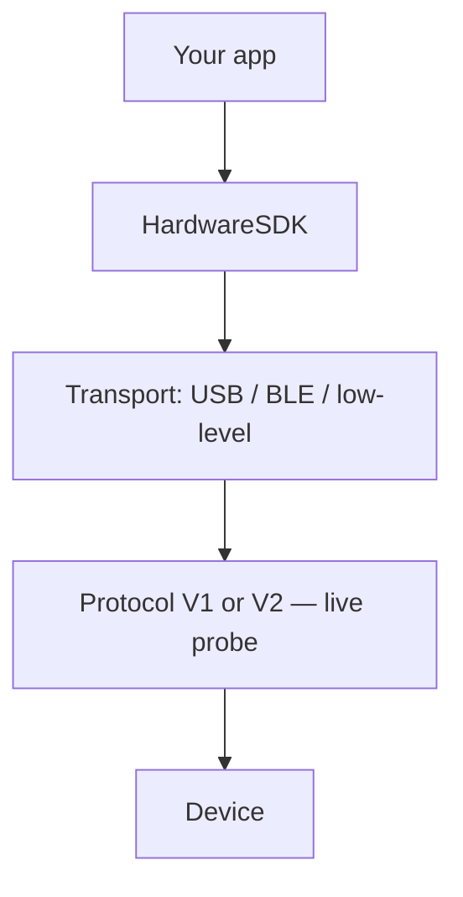

import { ExternalLink, Play, Monitor } from 'lucide-react'

# Introduction

Documentation destinée aux développeurs pour intégrer le matériel OneKey dans des applications web et natives.

Hardware SDK **1.2.x** prend en charge Protocol V1 et Protocol V2 via la même API JavaScript. Vous débutez ? Commencez par [Premiers pas](/fr/hardware-sdk/getting-started).

Cette page est une **vue d’ensemble** — choisissez le paquet SDK adapté à votre plateforme et installez-le. Pour le parcours complet (recherche → événements → PIN/phrase secrète → premier appel de signature), les paramètres, les événements et la gestion des erreurs, consultez le [Guide de l’API Core](/fr/hardware-sdk/core-api-guide).

## Choisissez votre transport [#choose-your-transport]

Les intégrations USB doivent utiliser `@onekeyfe/hd-common-connect-sdk` ; utilisez `@onekeyfe/hd-web-sdk` uniquement lorsque l’hôte impose une configuration iframe/plugin.

### Méthodes de connexion [#connection-methods]

| Méthode | Description | Appareils pris en charge |
|--------|-------------|-------------------|
| **USB / WebUSB** | USB filaire ; navigateur via WebUSB ; Node.js / CLI via node-usb | Appareils avec interface USB et micrologiciel compatibles |
| **Bluetooth BLE (natif)** | Applications natives via BLE (pas Web Bluetooth) ; nécessite Bluetooth et les autorisations du système | Pro, Pro 2, Neo, Touch, Classic 1s / Classic 1s Pure ; **Mini ne prend pas en charge BLE** |
| **Air-Gap (QR)** | Signature QR hors ligne | OneKey Pro et Pro 2 ; **Neo n’a pas de caméra** |

### Guide des plateformes [#platform-guide]

| Plateforme (pile) | Transport | Paquet SDK | Guide |
|------------------|-----------|-------------|-------|
| Web (navigateur) | WebUSB | [@onekeyfe/hd-common-connect-sdk](https://github.com/OneKeyHQ/hardware-js-sdk/tree/onekey/packages/hd-common-connect-sdk) | [Guide de connexion WebUSB](/fr/hardware-sdk/transport/web-usb) |
| React Native | BLE | [@onekeyfe/hd-ble-sdk](https://github.com/OneKeyHQ/hardware-js-sdk/tree/onekey/packages/hd-ble-sdk) | [BLE React Native](/fr/hardware-sdk/transport/react-native-ble) |
| Android (natif) | BLE | [@onekeyfe/hd-common-connect-sdk](https://github.com/OneKeyHQ/hardware-js-sdk/tree/onekey/packages/hd-common-connect-sdk) | [BLE Android](/fr/hardware-sdk/transport/android) |
| iOS (natif) | BLE | [@onekeyfe/hd-common-connect-sdk](https://github.com/OneKeyHQ/hardware-js-sdk/tree/onekey/packages/hd-common-connect-sdk) | [BLE iOS](/fr/hardware-sdk/transport/ios) |
| Flutter | BLE | [@onekeyfe/hd-common-connect-sdk](https://github.com/OneKeyHQ/hardware-js-sdk/tree/onekey/packages/hd-common-connect-sdk) | [Flutter BLE](/fr/hardware-sdk/transport/flutter) |



Protocole de bas niveau et canaux personnalisés : [Plugin de transport de bas niveau et protocole](/fr/hardware-sdk/concepts/low-level-plugin)

## Installer le SDK [#install-sdk]

Choisissez un point d’entrée selon l’environnement d’exécution :

```bash
# Web / desktop WebUSB (recommended)
npm i @onekeyfe/hd-common-connect-sdk

# React Native BLE
npm i @onekeyfe/hd-ble-sdk

# Native host with low-level plugin (Android/iOS/Flutter bridge)
npm i @onekeyfe/hd-common-connect-sdk

# Plugin iframe host only (plugin-only)
npm i @onekeyfe/hd-web-sdk
```

Détails du transport :
- WebUSB : [Guide WebUSB](/fr/hardware-sdk/transport/web-usb)
- React Native BLE : [Guide BLE](/fr/hardware-sdk/transport/react-native-ble)
- Android / iOS / Flutter natif : transmettre les appels JS via des plugins de transport de bas niveau (voir les pages pour des exemples).
- Canal et protocole personnalisés : [Plugin de transport de bas niveau et protocole](/fr/hardware-sdk/concepts/low-level-plugin)

## Initialiser le SDK [#initialize-the-sdk]

Utilisez la méthode d’initialisation correspondant à votre environnement — évitez de mélanger les points d’entrée SDK.

### Web / ordinateur WebUSB [#web--desktop-webusb]

Utilisez `@onekeyfe/hd-common-connect-sdk` :

```ts
import HardwareSDK from '@onekeyfe/hd-common-connect-sdk';

const initialized = await HardwareSDK.init({
  env: 'webusb',
  debug: false,
  fetchConfig: true,
});
if (!initialized) throw new Error('SDK initialization failed');
```

### BLE React Native [#react-native-ble]

Utilisez `@onekeyfe/hd-ble-sdk` :

```ts
import HardwareSDK from '@onekeyfe/hd-ble-sdk';

const initialized = await HardwareSDK.init({
  debug: false,
});
if (!initialized) throw new Error('SDK initialization failed');
```

### Pont natif / bas niveau [#native-bridge--low-level]

Utilisez `@onekeyfe/hd-common-connect-sdk` :

```ts
import HardwareSDK from '@onekeyfe/hd-common-connect-sdk';
import type { LowlevelTransportSharedPlugin } from '@onekeyfe/hd-transport';

// Provide an implemented native BLE bridge; this is a preparation fragment.
declare const plugin: LowlevelTransportSharedPlugin;
const initialized = await HardwareSDK.init({
  env: 'lowlevel',
  debug: false,
  fetchConfig: true,
}, undefined, plugin);
if (!initialized) throw new Error('SDK initialization failed');
```

| Environnement | Cas d’usage |
|-------------|----------|
| `webusb` | WebUSB de navigateur (sans iframe) |
| `lowlevel` | Applications natives transmettant JS via un adaptateur de bas niveau |
| `react-native` | Pont RN personnalisé ou BLE Electron |
| `emulator` | Transport d’émulateur intégré |

### Hôte iframe du plugin [#plugin-iframe-host]

Utilisez `@onekeyfe/hd-web-sdk` (plugin uniquement). L’hôte iframe par défaut du SDK est `https://jssdk.onekey.so/<installed-package-version>/` depuis `getSDKVersion()`. Omettez `connectSrc` sauf si vous hébergez vous-même l’iframe.

import { SdkVersionNote } from '../../../components/SdkVersionNote'

<SdkVersionNote locale="fr" />

```ts
import HdWebSdk from '@onekeyfe/hd-web-sdk';

const HardwareSDK = HdWebSdk.HardwareWebSdk;

const initialized = await HardwareSDK.init({
  debug: false,
  // omit connectSrc — SDK fills https://jssdk.onekey.so/<installed-version>/
});
if (!initialized) throw new Error('SDK initialization failed');
```

## Étapes suivantes [#next-steps]

Après le retour de `HardwareSDK.init(...)`, suivez [Premiers pas](/fr/hardware-sdk/getting-started) pour la première adresse, puis le [Guide de l’API Core](/fr/hardware-sdk/core-api-guide) pour la suite du parcours :

- Matrice des appareils 1.2.0 : [Appareils](/fr/hardware-sdk/concepts/devices)
- Quelles chaînes sur Pro 2 / Neo : [Prise en charge des chaînes](/fr/hardware-sdk/concepts/chain-support)
- Protocol V1 ou V2 (détection automatique) : [Protocole](/fr/hardware-sdk/concepts/protocol)
- Ouvrir / reprendre un portefeuille : [Sessions de portefeuille](/fr/hardware-sdk/concepts/wallet-session)
- Sélecteur de transport et reconnexion : [Transport](/fr/hardware-sdk/transport) · [Reconnecter](/fr/hardware-sdk/transport/reconnect)
- Micrologiciel V2 / V3 / V4 : [Mise à jour du micrologiciel](/fr/hardware-sdk/firmware-update)

- Cycle de vie standard (`init → search → getDeviceState → subscribe → call + uiResponse → cleanup`) : [Guide de l’API Core → cycle de vie standard](/fr/hardware-sdk/core-api-guide#standard-lifecycle)
- Paramètres partagés des méthodes d’adresse, de signature et d’appareil : [Paramètres communs](/fr/hardware-sdk/concepts/common-params)
- Référence des identifiants (`connectId` / `deviceId` / `passphraseState` / …) : [Identifiants](/fr/hardware-sdk/concepts/identifiers)
- Parcours de saisie du PIN : [Code PIN](/fr/hardware-sdk/concepts/pin)
- Parcours de phrase secrète / portefeuille caché : [Phrase secrète](/fr/hardware-sdk/concepts/passphrase)

import { DeviceCompatibilityTable } from '../../../components/DeviceCompatibilityTable'

## Compatibilité des appareils et transports [#device-and-transport-compatibility]

<DeviceCompatibilityTable locale="fr" />

> **Mode Air-Gap :** OneKey Pro et Pro 2 prennent en charge la signature isolée par QR codes — aucune connexion USB ou Bluetooth requise, avec vérification des détails sur l’appareil avant signature. Consultez [Intégration Air-Gap](/fr/air-gap) pour plus de détails.

## Paquets principaux [#core-packages]

| Paquet | Rôle | NPM | Version |
|---------|---------|-----|---------|
| `@onekeyfe/hd-common-connect-sdk` | Interface SDK unifiée pour Web/Natif ; point d’entrée recommandé pour les transports | [npm](https://www.npmjs.com/package/@onekeyfe/hd-common-connect-sdk) | [](https://www.npmjs.com/package/@onekeyfe/hd-common-connect-sdk) |
| `@onekeyfe/hd-ble-sdk` | Pile BLE React Native pure (recommandée pour les projets RN) | [npm](https://www.npmjs.com/package/@onekeyfe/hd-ble-sdk) | [](https://www.npmjs.com/package/@onekeyfe/hd-ble-sdk) |
| `@onekeyfe/hd-transport-react-native` | Effets de bord/pont du transport React Native | [npm](https://www.npmjs.com/package/@onekeyfe/hd-transport-react-native) | [](https://www.npmjs.com/package/@onekeyfe/hd-transport-react-native) |
| `@onekeyfe/hd-transport-web-device` | Transport web pour l’accès aux appareils dans les contextes web | [npm](https://www.npmjs.com/package/@onekeyfe/hd-transport-web-device) | [](https://www.npmjs.com/package/@onekeyfe/hd-transport-web-device) |
| `@onekeyfe/hd-transport-emulator` | Transport d’émulateur (développer et tester sans appareil physique) | [npm](https://www.npmjs.com/package/@onekeyfe/hd-transport-emulator) | [](https://www.npmjs.com/package/@onekeyfe/hd-transport-emulator) |
| `@onekeyfe/hd-transport-http` | Transport de pont HTTP | [npm](https://www.npmjs.com/package/@onekeyfe/hd-transport-http) | [](https://www.npmjs.com/package/@onekeyfe/hd-transport-http) |
| `@onekeyfe/hd-transport-lowlevel` | Contrat d’adaptateur hôte de bas niveau (pour les intégrations natives) | [npm](https://www.npmjs.com/package/@onekeyfe/hd-transport-lowlevel) | [](https://www.npmjs.com/package/@onekeyfe/hd-transport-lowlevel) |
| `@onekeyfe/hd-core` | Événements, constantes et transmission des messages Core | [npm](https://www.npmjs.com/package/@onekeyfe/hd-core) | [](https://www.npmjs.com/package/@onekeyfe/hd-core) |
| `@onekeyfe/hd-shared` | Utilitaires et types partagés | [npm](https://www.npmjs.com/package/@onekeyfe/hd-shared) | [](https://www.npmjs.com/package/@onekeyfe/hd-shared) |
| `@onekeyfe/hd-web-sdk` | Enveloppe du SDK web (non recommandée ; privilégiez hd-common-connect-sdk) | [npm](https://www.npmjs.com/package/@onekeyfe/hd-web-sdk) | [](https://www.npmjs.com/package/@onekeyfe/hd-web-sdk) |

- Journal des modifications : [versions](https://github.com/OneKeyHQ/hardware-js-sdk/releases)

## Pour aller plus loin [#further-reading]

- Transport de bas niveau et protocole de messages (pour le débogage ou les adaptateurs personnalisés) : [Plugin de transport de bas niveau](/fr/hardware-sdk/concepts/low-level-plugin)
- Migration depuis l’ancien parcours `hd-web-sdk` : [Guide de migration](/fr/hardware-sdk/legacy-guides)
{/* - AI agent integration via OneKey skills : [AI Agent Integration](/en/hardware-sdk/agent-integration) */}

## Assistance [#support]

Pour les utilisateurs : cette documentation s’adresse principalement aux développeurs. Si vous rencontrez des problèmes avec nos produits, consultez notre centre d’aide ou soumettez une demande d’assistance.

- [Centre d’aide](https://help.onekey.so)
- [Problèmes](https://github.com/OneKeyHQ/hardware-js-sdk/issues)

## Dépôts associés [#related-repositories]

- [OneKey App (app-monorepo)](https://github.com/OneKeyHQ/app-monorepo)
- [Micrologiciel OneKey](https://github.com/OneKeyHQ/firmware)
- [OneKey Hardware JS SDK](https://github.com/OneKeyHQ/hardware-js-sdk)

---

## Essayer [#try-it-out]

<div className="mt-4 flex flex-wrap gap-3">
  <a
    href="/fr/hardware-sdk/playground"
    className="group inline-flex items-center gap-2 rounded-lg border border-zinc-200 bg-white px-4 py-2.5 text-sm font-medium text-zinc-700 transition-all hover:border-emerald-500/50 hover:bg-emerald-50 hover:text-emerald-700 dark:border-zinc-700 dark:bg-zinc-800 dark:text-zinc-300 dark:hover:border-emerald-500/40 dark:hover:bg-emerald-500/10 dark:hover:text-emerald-400"
  >
    <Play className="h-4 w-4" strokeWidth={1.5} />
    Environnement de test interactif
  </a>
  <a
    href="https://hardware-example.onekey.so/#/emulator"
    target="_blank"
    rel="noopener noreferrer"
    className="group inline-flex items-center gap-2 rounded-lg border border-zinc-200 bg-white px-4 py-2.5 text-sm font-medium text-zinc-700 transition-all hover:border-blue-500/50 hover:bg-blue-50 hover:text-blue-700 dark:border-zinc-700 dark:bg-zinc-800 dark:text-zinc-300 dark:hover:border-blue-500/40 dark:hover:bg-blue-500/10 dark:hover:text-blue-400"
  >
    <Monitor className="h-4 w-4" strokeWidth={1.5} />
    Émulateur en ligne
    <ExternalLink className="h-3 w-3 opacity-50" strokeWidth={2} />
  </a>
</div>
