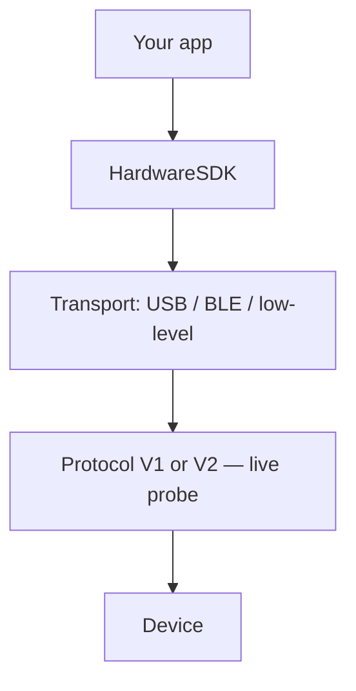

# Choisir un transport

Hardware SDK 1.2.x utilise une seule API JavaScript. `init({ env })` sélectionne le **transport**, pas Protocol V1 ou V2.

| Plateforme | Transport | Paquet | `env` | Guide |
| --- | --- | --- | --- | --- |
| WebUSB navigateur / ordinateur | WebUSB | `@onekeyfe/hd-common-connect-sdk` | `webusb` | [WebUSB](/fr/hardware-sdk/transport/web-usb) |
| React Native | BLE | `@onekeyfe/hd-ble-sdk` | (valeur par défaut du SDK BLE) | [BLE React Native](/fr/hardware-sdk/transport/react-native-ble) |
| Hôte Android natif | BLE via un plugin de bas niveau | `@onekeyfe/hd-common-connect-sdk` | `lowlevel` | [Android](/fr/hardware-sdk/transport/android) |
| Hôte iOS natif | BLE via un plugin de bas niveau | `@onekeyfe/hd-common-connect-sdk` | `lowlevel` | [iOS](/fr/hardware-sdk/transport/ios) |
| Hôte Flutter | BLE via un plugin de bas niveau | `@onekeyfe/hd-common-connect-sdk` | `lowlevel` | [Flutter](/fr/hardware-sdk/transport/flutter) |
| Vue d’ensemble du BLE natif | BLE | `@onekeyfe/hd-common-connect-sdk` | `lowlevel` | [BLE natif](/fr/hardware-sdk/transport/native-ble) |

USB nécessite une interface d’appareil et un micrologiciel compatibles ; validez la connexion et la signature sur votre plateforme cible. BLE concerne Pro, Pro 2, Neo, Touch, Classic 1s / Pure — **pas Mini**. QR Air-Gap constitue un parcours produit distinct : [Air-Gap](/fr/air-gap).

## Le transport n’est pas le protocole [#transport-is-not-the-protocol]

| Couche | Définition | Mode de sélection |
| --- | --- | --- |
| **Transport** | Déplacement des octets : USB, BLE ou plugin BLE natif | `init({ env })` — `webusb` / BLE SDK / `lowlevel` |
| **Protocole** | V1 ou V2 sur la liaison une fois celle-ci établie | Interrogation du SDK. Lisez `connectProtocol`. Ne le déduisez **pas** du PID USB ou du nom BLE |

Un Pro 2 en USB et un Pro 2 en BLE utilisent tous deux Protocol V2. Un Classic en USB utilise Protocol V1. Consultez [Protocol V1 et V2](/fr/hardware-sdk/concepts/protocol) et [Appareils](/fr/hardware-sdk/concepts/devices).

N’utilisez pas OneKey Bridge (`env: 'web'` + `checkBridgeStatus`) pour les nouvelles applications WebUSB. Migration : [Bridge → WebUSB](/fr/hardware-sdk/legacy-guides/migrate-bridge-to-common-connect-webusb).

## Après la connexion [#after-you-connect]

1. Première adresse : [Premiers pas](/fr/hardware-sdk/getting-started)
2. PIN / événements : [Guide de l’API Core](/fr/hardware-sdk/core-api-guide)
3. Interruptions et `dispose()` : [Reconnexion et libération](/fr/hardware-sdk/transport/reconnect)
4. Micrologiciel : [Mise à jour du micrologiciel](/fr/hardware-sdk/firmware-update)
5. Pont BLE personnalisé : [Transport de bas niveau](/fr/hardware-sdk/concepts/low-level-plugin)
