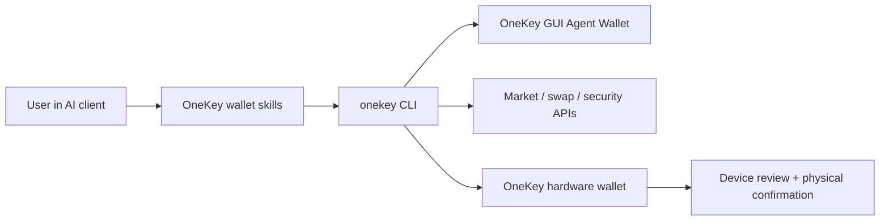

# OneKey Agent Wallet

> プライベートベータです。アクセス、対応コマンド、ウォレットフローは OneKey と CLI のバージョンによって異なります。これらの例を使用する前に、インストール済み CLI のスキーマを確認してください。

OneKey Agent Wallet は、実際のオンチェーン操作、市場情報、ユーザーが管理する署名を必要とする AI エージェント向けのウォレットレイヤーです。エージェントはウォレットの状態の読み取り、受取アドレスの検索、トークン調査、スワップの見積もりと準備、安全確認を実行でき、リスクの高い操作は OneKey GUI またはハードウェアに引き継いでユーザーの確認を求めることができます。

ウォレット機能を必要とする AI エージェント、スキル、MCP ツール、自動化、コマンドラインワークフローを構築する場合は、このセクションを参照してください。OneKey デバイスのトランスポートや低レベル署名 API と直接統合する場合は、Hardware SDK のドキュメントを参照してください。

## エージェントでできること [#what-agents-can-do]

| 分野 | エージェントの機能 | ユーザーリクエストの例 |
| --- | --- | --- |
| ウォレット | 残高の確認、受取アドレスの表示、履歴の確認、送金の準備、BTC アドレスタイプの導出 | `Show my ETH balance and receiving address.` |
| スワップとブリッジ | スワップの見積もり、構築、実行、追跡、BTC の署名のみの PSBT の処理、ブリッジ対応ネットワークの検索 | `Swap 1 ETH to USDC after showing me the quote.` |
| 市場情報と調査 | トークン検索、価格、注目リスト、ローソク足データ、流動性、保有者の取得、簡易調査または詳細調査 | `What Solana tokens are trending right now?` |
| セキュリティ | トークンの監査、トランザクションのシミュレーション、承認の確認、チェーンとアドレスの不一致やトークンのリスク兆候の報告 | `Is this token safe before I buy it?` |
| ハードウェア制御 | OneKey デバイスの接続、正規品かどうかの検証、パスフレーズモードの使用、対応する署名リクエストのデバイス上での確認 | `Use my hardware wallet for this transfer.` |
| セッション制御 | GUI で管理する Agent Wallet を App Transfer でペアリングするか、ハードウェアを利用するセッションに切り替え | `Connect my OneKey Agent Wallet.` |

## 仕組み [#how-it-works]

エージェントは `onekey-wallet-skills` および `onekey` CLI を通じて OneKey と通信します。App Transfer とハードウェアログインでは、異なる種類のセッションが選択されます。ウォレットコマンドを使用する前に、有効なセッションを確認してください。デバイス上での確認は、ハードウェアを利用する署名リクエストに適用されます。

## 目的に合った進め方 [#choose-your-path]

| 対象読者 | 最初に読むページ | 目的 |
| --- | --- | --- |
| エージェント統合を構築する開発者 | [機能](/ja/agent-wallet/capabilities) および [ウォレットスキル](/ja/agent-wallet/wallet-skills) | 各製品機能を、スキーマに基づく CLI コマンドとレスポンス仕様に対応付けます。 |
| バイブコーディングでウォレットの自動化を試すユーザー | [クイックスタート](/ja/agent-wallet/quickstart) および [実装例](/ja/agent-wallet/recipes) | まず自然言語のプロンプトをコピーし、その背後で使われるコマンドを確認します。 |
| セキュリティレビュー担当者またはウォレット所有者 | [安全上のルール](/ja/agent-wallet/safety) および [ハードウェア制御](/ja/agent-wallet/hardware-control) | エージェントが読み取れる内容、実行できる操作、OneKey ハードウェアへの引き継ぎが必要な場面を確認します。 |
| 製品またはサポート担当者 | [Agent Wallet セッション](/ja/agent-wallet/wallet-session) および [キーレス連携](/ja/agent-wallet/keyless-binding) | GUI で管理する Agent Wallet、キーレスアカウント連携、有効なセッションのモデルを理解します。 |

## 現在の実装 [#current-implementation]

公開されている導入先は外部の [`onekey-wallet-skills`](https://github.com/OneKeyHQ/onekey-wallet-skills) リポジトリです。スキルは Claude Code、Codex、Cursor、OpenCode、OpenClaw に対応し、自然言語のリクエストをウォレット、スワップ、市場情報、セキュリティの各ワークフローに振り分けます。

この `@onekeyfe/cli` パッケージは、引き続きスキルの実装レイヤーとして機能します。スキルはその最新のスキーマから対応コマンドとパラメーターを検出し、App Transfer またはハードウェアを利用するセッションをペアリングし、生のターミナル出力をユーザーに見せずに構造化された回答を返します。
