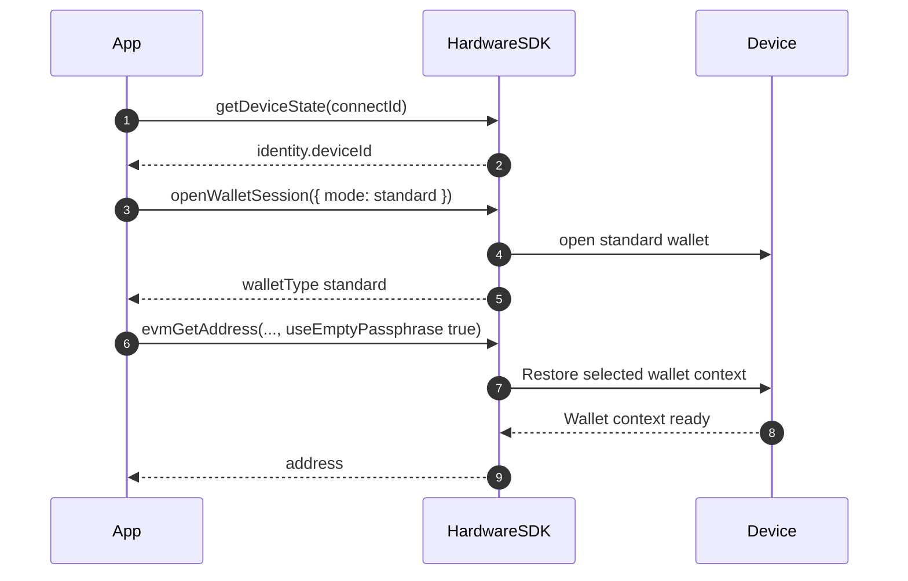
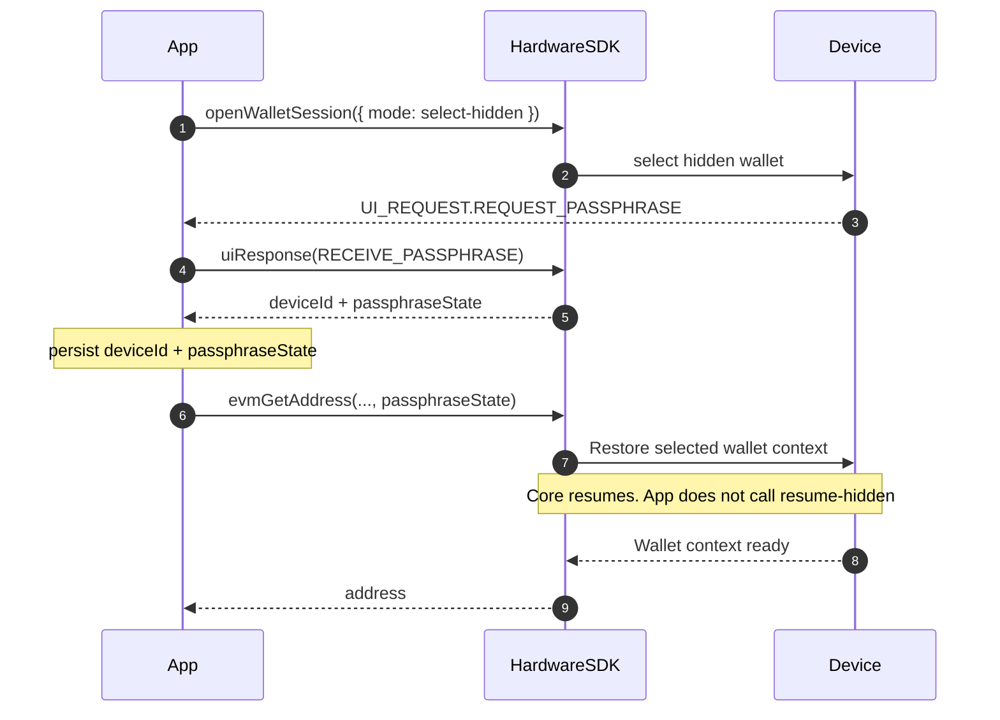

<span id="passphrase" />

# パスフレーズ

パスフレーズ (隠しウォレット) を扱うためのルールとベストプラクティス。

## 基本概念 [#core-concepts]

- **標準ウォレット** = シード + 空のパスフレーズ; **隠しウォレット** = シード + 空でないパスフレーズ (大文字と小文字を区別)。
- パスフレーズが異なると、たとえ 1 文字の違いでも、まったく別のウォレットが生成されます。
- パスフレーズは復元できません。安全にバックアップしてください。
- `useEmptyPassphrase: true` を設定して標準ウォレットを強制します。

## デバイスの対応状況 [#device-support]

モデル名だけからホスト入力やデバイス入力の対応を推測しないでください。`getDeviceState` を読み取り、デバイス、ファームウェア、現在の状態を特定してから、実際の UI リクエストに従います。利用可否はデバイス、ファームウェア、SDK、実行環境によって異なります。

| リクエストまたは条件 | ホストの動作 |
| --- | --- |
| `REQUEST_PASSPHRASE` | リクエストと対象デバイスが対応する入力方法のみを提示し、応答の関連付けを維持します。 |
| 次が指定されたリクエスト: `deviceOnly` | デバイス上で続行するようユーザーに案内し、ホストでパスフレーズを収集しないでください。 |
| `REQUEST_PASSPHRASE_ON_DEVICE` | 通知のみです。デバイス操作の案内を表示し、`uiResponse` を送信しないでください。 |
| 要求された入力モードが利用不可 | 制限を説明し、黙って入力方法を切り替えないでください。 |

必要に応じてウォレットの関連付け (`deviceId` および `passphraseState`) を永続化し、ファームウェアの `session_id` は永続化しないでください。

## 操作フロー [#interaction-flow]

Hardware SDK 1.2.x の手順は、`searchDevices` → `getDeviceState` → `openWalletSession` → `deviceId` + `passphraseState` (または `useEmptyPassphrase: true`) を使ったアドレス取得 / 署名です。ウォレットを開く前に `UI_EVENT` を購読してください。[ウォレットセッション](/ja/hardware-sdk/concepts/wallet-session)を参照してください。

### 標準ウォレット [#standard-wallet]



```ts
const state = await HardwareSDK.getDeviceState(connectId);
if (!state.success) throw new Error(state.payload.error);
const deviceId = state.payload.identity.deviceId;
if (!deviceId) throw new Error("Device has no wallet identity");

const standard = await HardwareSDK.openWalletSession(connectId, { mode: 'standard' });
if (!standard.success) throw new Error(standard.payload.error);

await HardwareSDK.evmGetAddress(connectId, deviceId, {
  path: "m/44'/60'/0'/0/0",
  useEmptyPassphrase: true,
});
```

### 隠しウォレット (一度開き、フィンガープリントを再利用) [#hidden-wallet-open-once-reuse-fingerprint]



```ts
import { UI_EVENT, UI_REQUEST, UI_RESPONSE } from '@onekeyfe/hd-core';

HardwareSDK.on(UI_EVENT, async (message) => {
  if (message.type === UI_REQUEST.REQUEST_PASSPHRASE) {
    await HardwareSDK.uiResponse({
      type: UI_RESPONSE.RECEIVE_PASSPHRASE,
      ...message.payload.responseCorrelation,
      payload: { passphraseOnDevice: true, value: '', save: false },
    });
  }
});

const opened = await HardwareSDK.openWalletSession(connectId, {
  mode: 'select-hidden',
});
if (!opened.success) throw new Error(opened.payload.error);
if (opened.payload.walletType !== 'hidden') {
  throw new Error('A hidden wallet was not opened');
}
const deviceId = opened.payload.deviceId;
const passphraseState = opened.payload.passphraseState;

await HardwareSDK.evmGetAddress(connectId, deviceId, {
  path: "m/44'/60'/0'/0/0",
  passphraseState,
});
await HardwareSDK.btcGetAddress(connectId, deviceId, {
  path: "m/84'/0'/0'/0/0",
  coin: 'btc',
  passphraseState,
});
```

デバイス入力とソフトウェア入力の比較:

```ts
// On-device
payload: { passphraseOnDevice: true, value: '' }

// Software
payload: { value: userInput, passphraseOnDevice: false, save: false }
```

### 後続プロセス / 再接続 [#later-process--reconnect]

永続化するのは `deviceId + passphraseState` のみです。ファームウェアの `session_id` を**永続化しないでください**。保存した関連付けを読み込み、次のアドレス取得 / 署名に渡します。Core はそのメソッド内で再開します。`openWalletSession` には再開モードはありません。

```ts
import { OpenWalletSessionMode } from '@onekeyfe/hd-core';

// Process 1 — after the user selects the hidden wallet
const opened = await HardwareSDK.openWalletSession(connectId, {
  mode: OpenWalletSessionMode.SelectHidden,
});
if (!opened.success) throw new Error(opened.payload.error);
if (opened.payload.walletType !== 'hidden') {
  throw new Error('A hidden wallet was not opened');
}
saveBinding({
  deviceId: opened.payload.deviceId,
  passphraseState: opened.payload.passphraseState,
});

// Process 2 — later process, same machine
const { deviceId, passphraseState } = loadBinding();

await HardwareSDK.evmGetAddress(connectId, deviceId, {
  path: "m/44'/60'/0'/0/0",
  passphraseState,
});
```

`preloadSessionCache` は古い App/CLI Keychain レコード用の互換 API です。新しい統合では呼び出さず、`session_id` を保存しないでください。

プロセス間でデバイスがロックされた場合、最初の保護された呼び出しで PIN が再度要求されます。参照: [ウォレットセッション](/ja/hardware-sdk/concepts/wallet-session).

### 先にロック解除するパターン (CLI) [#unlock-first-pattern-cli]

```ts
const state = await HardwareSDK.getDeviceState(connectId);
if (!state.success) throw new Error(state.payload.error);

if (!state.payload.status.unlocked) {
  await HardwareSDK.deviceUnlock(connectId, {});
}

await HardwareSDK.evmGetAddress(connectId, savedDeviceId, {
  path: "m/44'/60'/0'/0/0",
  passphraseState: savedPassphraseState,
});
```

## セキュリティ上のヒント [#security-tips]

- **ログ記録や永続化をしないでください:** 平文のパスフレーズ。
- `useEmptyPassphrase: true` で意図しない隠しウォレットの作成を防ぎます。
- Pro/Touch デバイスでは、PIN はデバイス上で入力する必要があります。パスフレーズはデバイス上またはソフトウェアから入力できます。

## よくある質問 [#faq]

### パスフレーズを忘れるとどうなりますか? [#what-happens-if-i-forget-my-passphrase]

隠しウォレットの資金に永久にアクセスできなくなります。忘れたパスフレーズを復元する方法はありません。必ず安全なバックアップを保管してください。

### パスフレーズと PIN は同じですか? [#is-the-passphrase-the-same-as-the-pin]

いいえ。PIN はデバイスへの物理的アクセスを保護します。パスフレーズは同じシードからまったく別のウォレットを作成します。それぞれ安全上の目的が異なります:

| | PIN | パスフレーズ |
|---|-----|-----------|
| 目的 | デバイスへのアクセス保護 | 隠しウォレットの作成 |
| 復元 | デバイスの消去 + シードの復元でリセット可能 | 復元不可 |
| 保存 | デバイスに保存 | 平文を永続化しないでください。SDK のキャッシュは入力フローと `save` に依存します。 |
| 大文字と小文字の区別 | 該当なし (数字) | はい |

### 複数の隠しウォレットを持てますか? [#can-i-have-multiple-hidden-wallets]

はい。異なるパスフレーズごとに別の隠しウォレットが作成されます。パスフレーズごとに 1 つ、必要な数だけ作成できます。

### デバイスはパスフレーズを検証しますか? [#does-the-device-validate-my-passphrase]

新しく入力したパスフレーズから別のウォレットが導出されることがあります。後の呼び出しで期待する `passphraseState` を指定すると、SDK が関連付けを確認し、不一致なら失敗します。入力ミスしたパスフレーズを、目的のウォレットとして扱わないでください。

### 次と `passphraseOnDevice` ソフトウェア入力の違いは何ですか? [#whats-the-difference-between-passphraseondevice-and-software-input]

- **デバイス上**: ハードウェアデバイスの画面/キーボードでパスフレーズを直接入力します。デバイスの外に出ることはありません。
- **ソフトウェア入力**: アプリでパスフレーズを入力し、SDK を通じてデバイスに送信します。

関連項目: [共通パラメーター](/ja/hardware-sdk/concepts/common-params), [イベントと UI の接続](/ja/hardware-sdk/core-api-guide#events-ui).

Protocol V1 では、パスフレーズ保護が無効な場合、`select-hidden` が標準ウォレットを返すことがあります。`passphraseState` を保存または使用する前に、`walletType` を確認してください。
