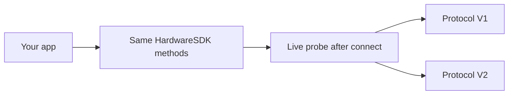

<span id="protocol-v1-and-v2" />

# Protocol V1 と V2

Hardware SDK 1.2.0 は 2 つの通信プロトコルを扱います。統合側は 1 つの JavaScript API を使い続けます。USB PID、BLE 名、製品文字列で分岐させないでください。



| | プロトコル V1 | プロトコル V2 |
| --- | --- | --- |
| 現在のデバイス | Classic, Mini, Touch, Pro | Pro 2, Neo |
| SDK の検出方法 | 接続後の実際の応答 | 接続後の実際の `Ping` / プロトコル検査 |
| 公開メソッド | 既存の Hardware SDK メソッド | 同じメソッド。Core 内部で対応付け |
| 呼び出しルール | 実運用ではデバイスごとに直列化 | デバイスごとの直列化が必須 |
| ファームウェア更新 | `firmwareUpdateV2` / `firmwareUpdateV3` | `firmwareUpdateV4` |
| チェーンメソッド | V1+V2 系と V1 専用系 | V1+V2 系のみ |
| デバイススナップショット | [`getDeviceState`](/ja/hardware-sdk/basic-api/get-device-state) (`getFeatures` は非推奨) | 同じ |

Stellar、Alephium、Nexa、Dynex、Nervos、SCDO、Benfen、Neo チェーンは V1 のみです。Pro 2 / Neo は未対応です。完全な対応表: [対応チェーン](/ja/hardware-sdk/concepts/chain-support)。デバイスの USB / BLE / Air-Gap: [デバイス](/ja/hardware-sdk/concepts/devices).

## 検出 [#detection]

SDK は次からプロトコルを確認します: **有効な接続**。次から V1/V2 を推測しないでください:

- USB PID / VID
- BLE の広告名
- 製品文字列または筐体

以前の結果を永続化する場合は、**`connectId` ごとに**関連付けます (同じ機器でも USB と BLE は別のエンドポイントです)。公開フィールドはデバイスオブジェクトの `connectProtocol` です。

`connectProtocol` を渡すと、厳密な要件として扱われ、SDK が黙ってもう一方のプロトコルにフォールバックすることはありません。

## 変わらない点 [#what-stays-the-same]

- `HardwareSDK.init({ env })` が選択するのは引き続き**トランスポート** (USB / BLE / 低レベル) であり、Protocol V1 と V2 のどちらを使うかではありません。
- `searchDevices` → `connectId` → `getDeviceState` → チェーンメソッド。
- PIN、パスフレーズ、ボタン確認は、引き続き `UI_EVENT` として届きます。`uiResponse` で応答するのは入力リクエストのみです。[Core API ガイド](/ja/hardware-sdk/core-api-guide)を参照してください。

## してはいけないこと [#what-you-must-not-do]

- 同じデバイスで 2 つの業務呼び出しを同時に実行しないでください。
- 切断やタイムアウトの後に、署名、消去、ファームウェア更新を自動で再実行しないでください。
- レスポンスからファームウェアの `session_id` を読み取って保存しないでください。ウォレットの識別情報は `deviceId + passphraseState` です。[ウォレットセッション](/ja/hardware-sdk/concepts/wallet-session)を参照してください。
- Protocol V2 の内部 API (`DeviceSessionGet`、`DeviceInfoGet`、…) を呼び出さないでください。これらは公開の `CoreApi` ではありません。

## デバイス状態 [#device-state]

[`getDeviceState`](/ja/hardware-sdk/basic-api/get-device-state) を使用してください。`getFeatures` は Protocol V1 専用です (Classic / Mini / Touch / Pro)。Pro 2 と Neo は互換情報への変換前に拒否します。`getDeviceState` は引き続き V1 と V2 の Features 形式のスナップショットを含みます。

```ts
const state = await HardwareSDK.getDeviceState(connectId);
if (!state.success) throw new Error(state.payload.error);
```

該当部分を更新する必要がある場合にのみ、`scope: 'settings'` または `scope: 'firmware'` を使用します。戻り値は引き続き完全なスナップショットです。

## 次へ [#next]

- [デバイス](/ja/hardware-sdk/concepts/devices)
- [デバイス状態を取得](/ja/hardware-sdk/basic-api/get-device-state)
- [firmwareUpdateV4](/ja/hardware-sdk/device-api/firmwareupdatev4)
