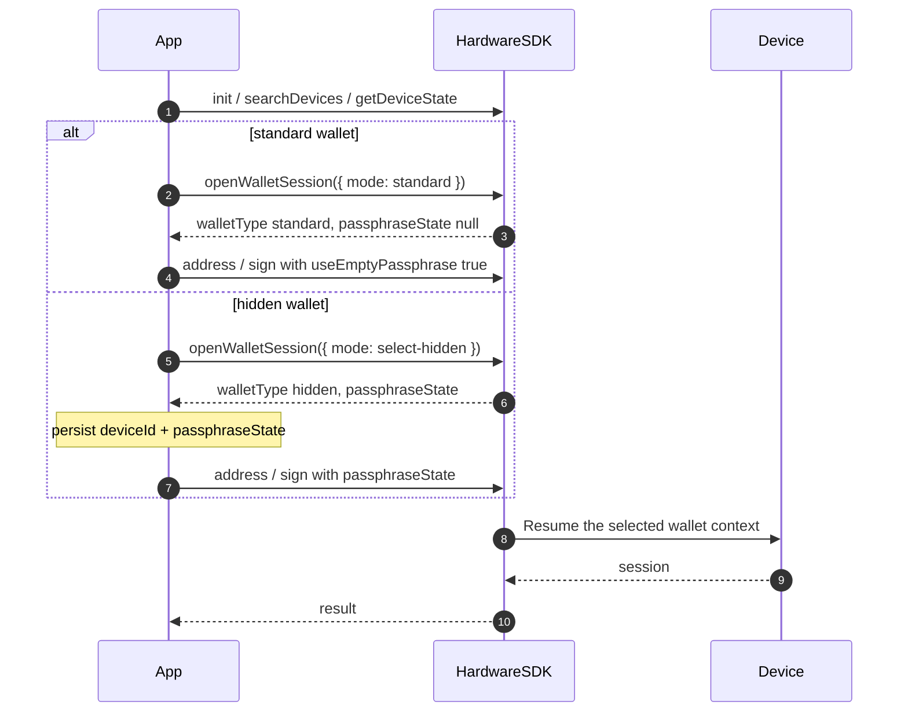

<span id="wallet-sessions" />

# ウォレットセッション

このページで扱うのは、デバイス上でロック解除されているシード / パスフレーズのコンテキストである、**ハードウェア**ウォレットセッションです。

[Agent Wallet セッション](/ja/agent-wallet/wallet-session)とは異なります。Agent Wallet は OneKey GUI 上の製品です。Agent Wallet の有無にかかわらず、Classic / Pro / Pro 2 / Neo にはハードウェアセッションがあります。

## 公開の識別情報 [#public-identity]

ウォレットの関連付けとして永続化するのは、この組み合わせだけです:

| フィールド | 意味 | 永続化するか? |
| --- | --- | --- |
| `deviceId` | 現在のシードの存続期間 (`device_id` Features / DeviceState から取得) | はい |
| `passphraseState` | 隠しウォレットのフィンガープリント。 `null` 標準ウォレットの場合 | 隠しウォレットならはい |
| ファームウェア `session_id` | デバイス側のロック解除ハンドル | **いいえ。** Core が内部で保持 |

`passphraseState` を省略すると、隠しウォレットのつもりでも、アドレス取得・署名 API が**標準**ウォレットでエラーなく成功する場合があります。必ず `useEmptyPassphrase: true` または実際の `passphraseState` を渡してください。

## 推奨 API (1.2.0) [#preferred-api-120]



新しい統合では [`openWalletSession`](/ja/hardware-sdk/basic-api/open-wallet-session) でウォレットを開いてください:

```ts
import { OpenWalletSessionMode } from '@onekeyfe/hd-core';

// Standard wallet
const standard = await HardwareSDK.openWalletSession(connectId, {
  mode: OpenWalletSessionMode.Standard,
});
if (!standard.success) throw new Error(standard.payload.error);
```

または、ユーザーに隠しウォレットを選択させます:

```ts
// Choose this flow instead of the standard-wallet example.
const hidden = await HardwareSDK.openWalletSession(connectId, {
  mode: OpenWalletSessionMode.SelectHidden,
});
if (!hidden.success) throw new Error(hidden.payload.error);
if (hidden.payload.walletType !== 'hidden' || !hidden.payload.passphraseState) {
  throw new Error('A hidden wallet was not opened');
}
```

`payload.deviceId`、`payload.walletType`、`payload.passphraseState` を保存し、その値をアドレス取得 / 署名に渡します。Core がそのメソッド内で必要なウォレットコンテキストを再開します。署名のたびに `openWalletSession` を呼び出さないでください。

`openWalletSession` には `resume-hidden` モードはありません。`mode: 'resume-hidden'` を渡すと `CallMethodInvalidParameter` が返されます。保存した関連付けを読み込み、次のアドレス取得 / 署名呼び出しに `passphraseState` を渡してください。

## 非推奨の互換 API [#deprecated-compatibility-api]

[`getPassphraseState`](/ja/hardware-sdk/basic-api/get-passphrase-state) は非推奨です。既存アプリでは、このメソッドと各呼び出しの `initSession` / `useEmptyPassphrase` / `passphraseState` を引き続き使用できます。Core は引き続きこの経路を Protocol V1 と V2 に対応付けます。新しいコードでは `openWalletSession` を使用してください。

同じ呼び出しで `openWalletSession({ mode })` と `useEmptyPassphrase` / `initSession` を併用しないでください。

## Attach-to-PIN [#attach-to-pin]

一部の Pro / Pro 2 は、隠しウォレットを専用 PIN に関連付けられます。公開 API は引き続き `walletType: 'hidden'` と `passphraseState` を返します。Attach-to-PIN のために別のセッションプロトコルを実装する必要はありません。

SDK が `DeviceCheckUnlockTypeError` を返した場合、現在のロック解除方法では要求したウォレットにアクセスできません。デバイスをロックし、目的の PIN でロック解除してもらってください。同じ関連付けで再試行を繰り返さないでください。

## 次へ [#next]

- [openWalletSession](/ja/hardware-sdk/basic-api/open-wallet-session)
- [識別子](/ja/hardware-sdk/concepts/identifiers)
- [パスフレーズ](/ja/hardware-sdk/concepts/passphrase)
