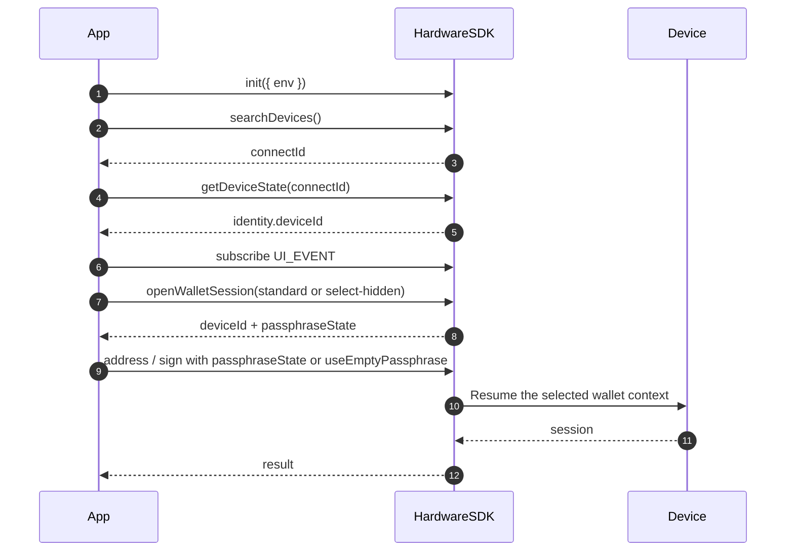

<span id="hardware-sdk-core-api-guide" />

# Hardware SDK Core API ガイド

ライフサイクルの手順: 初期化 → 検索 → イベント → 最初の保護された呼び出し → クリーンアップ。

パラメーター表は次にあります: [共通パラメーター](/ja/hardware-sdk/concepts/common-params)。デバイスとプロトコルの違いは次に記載しています: [デバイス](/ja/hardware-sdk/concepts/devices) および [Protocol V1 と V2](/ja/hardware-sdk/concepts/protocol).

## 基本フロー [#quick-flow]
<div id="request-basics" />

- 呼び出し形式: `HardwareSDK.method(connectId, deviceId?, params)` → `Promise<{ success, payload }>`。`payload` にアクセスする前に、必ず `success` を確認してください。
- 識別子: `connectId` は `searchDevices`、`deviceId` は `getDeviceState` から取得します (BLE では必須、WebUSB では推奨)。リセット/復元後は `deviceId` を更新してください。完全な表: [識別子](/ja/hardware-sdk/concepts/identifiers)。
- UI の仕様: `UI_EVENT` を 1 回だけ購読し、入力型の `UI_REQUEST` (PIN / パスフレーズ / Bootloader 選択) にのみ `uiResponse` を呼び出します。複数のデバイスが接続されている場合は、デバイスごとに振り分けてください。
- デバイスごとに呼び出しを直列化します。隠しウォレットを再利用するには、後続のメソッドに `passphraseState` を渡します (互換経路: `initSession + passphraseState`)。そのために `openWalletSession` を再度呼び出さないでください。

```ts
const res = await HardwareSDK.evmGetAddress(connectId, deviceId, {
  path: "m/44'/60'/0'/0/0",
  useEmptyPassphrase: true,
});

if (!res.success) throw new Error(res.payload.error);
console.log(res.payload.address);
```

### 操作フロー [#interaction-flow]



## Core の識別子と環境 [#core-identifiers--environments]

| ID | 目的 | 取得方法 | 変わるタイミング |
| --- | --- | --- | --- |
| `connectId` | どの接続か | `searchDevices()` | USB の再接続、BLE の再ペアリング、トランスポートの切り替え |
| `deviceId` | どのシードの存続期間か | `getDeviceState` (`getFeatures` は非推奨) | 消去、復元、シードの切り替え |

USB と BLE の `connectId` 値は同じ機器でも異なるため、別々にキャッシュしてください。参照: [識別子](/ja/hardware-sdk/concepts/identifiers) および [再接続と破棄](/ja/hardware-sdk/transport/reconnect).

**実行環境の要件**

- `webusb` — HTTPS + ユーザー操作。
- `react-native` — BLE の entitlement + (一般に) 位置情報の権限。
- `lowlevel` — 生の通知チャンクを転送するホスト BLE アダプター。
- ファームウェア — 一部の API は Bootloader では失敗します。

### 必要な識別子はどれですか? [#which-identifiers-are-required]

| 要件 | 説明 | API の例 |
| :--- | :--- | :--- |
| 🟢 識別子なし | SDK の初期化、設定、イベント管理 | `init` `on/off` `searchDevices` `getLogs` `dispose` `uiResponse` |
| 🟡 `connectId` のみ | デバイス管理、状態、ファームウェア操作 | `getDeviceState` `openWalletSession` `cancel` `deviceSettings` |
| 🔵 `connectId` + `deviceId` | ブロックチェーンの署名、アドレス取得、暗号化 | `evmSignTransaction` `btcSignTransaction` `solSignMessage` `allNetworkGetAddress` |

## 標準ライフサイクル (推奨) [#standard-lifecycle-recommended]
<div id="standard-lifecycle" />

`init → search → getDeviceState → subscribe UI/DEVICE/FIRMWARE → call + uiResponse → cleanup`

```ts
import HardwareSDK from '@onekeyfe/hd-common-connect-sdk';
import { UI_EVENT, UI_REQUEST, UI_RESPONSE } from '@onekeyfe/hd-core';

const initialized = await HardwareSDK.init({ env: 'webusb', fetchConfig: true, debug: false });
if (!initialized) throw new Error('SDK initialization failed');

const devices = await HardwareSDK.searchDevices();
if (!devices.success || !devices.payload.length) throw new Error('No device');
// Select explicitly in the application when more than one device is available.
if (devices.payload.length !== 1) throw new Error('Select exactly one device before continuing');
const { connectId } = devices.payload[0];
if (!connectId) throw new Error("Missing connectId");

const state = await HardwareSDK.getDeviceState(connectId);
if (!state.success) throw new Error(state.payload.error);
const deviceId = state.payload.identity.deviceId;
if (!deviceId) throw new Error("Device has no wallet identity");

// Register the UI_EVENT handler shown below before any protected call.
HardwareSDK.on(UI_EVENT, handleUiEvent);

const address = await HardwareSDK.evmGetAddress(connectId, deviceId, {
  path: "m/44'/60'/0'/0/0",
  useEmptyPassphrase: true,
});
if (!address.success) throw new Error(address.payload.error);
```

デバイスごとに直列化します。デバイスの切り替え後は `getDeviceState` で状態を更新し、アンマウント時にはリスナーを削除します。`HardwareSDK.dispose()` はトランスポートの終了時にのみ呼び出します。[再接続と破棄](/ja/hardware-sdk/transport/reconnect)を参照してください。

## 共通パラメーター [#common-params]

完全な表、トランスポート対応表、組み合わせ、HD パスは次に移動しました: [共通パラメーター](/ja/hardware-sdk/concepts/common-params).

<div id="hd-path" />

HD パスの例: [共通パラメーター → HD パス](/ja/hardware-sdk/concepts/common-params#hd-path).

PIN とパスフレーズの UX は [PIN](/ja/hardware-sdk/concepts/pin) と[パスフレーズ](/ja/hardware-sdk/concepts/passphrase)を参照してください。新しいウォレットを開くコードには[ウォレットセッション](/ja/hardware-sdk/concepts/wallet-session)を使用してください。

## イベントと UI の接続 [#events--ui-wiring]
<div id="events-ui" />

アプリの起動付近で一度購読します。`uiResponse` は入力リクエストにのみ呼び出します。`payload.responseCorrelation` が存在する場合は、保留中の操作を識別できるよう、各応答にコピーして含めてください。キャンセルや UI 終了イベントの後はモーダルのコールバックを無効化し、ユーザーが入力を閉じたら選択中の接続をキャンセルしてください。UI イベントのペイロードや入力値をログに記録しないでください。

**次が必要な UI リクエスト: `uiResponse`**

| UI_REQUEST | 発生する場面 | 応答内容 |
| --- | --- | --- |
| `REQUEST_PIN` | ホストの PIN 入力リクエスト。デバイス専用プロンプトは返信不要 | `UI_RESPONSE.RECEIVE_PIN` |
| `REQUEST_PASSPHRASE` | ホストまたはデバイス入力を選択 (`value: ""`, `passphraseOnDevice: true` はデバイス入力用) | `UI_RESPONSE.RECEIVE_PASSPHRASE` |
| `REQUEST_DEVICE_IN_BOOTLOADER_FOR_WEB_DEVICE` | Web Bootloader 選択画面 | `UI_RESPONSE.SELECT_DEVICE_IN_BOOTLOADER_FOR_WEB_DEVICE` |

**UI 通知 (次は不要: `uiResponse`)**

| UI_REQUEST | 目的 |
| --- | --- |
| `REQUEST_PASSPHRASE_ON_DEVICE` | デバイス上でパスフレーズを入力。通知のみ |
| `REQUEST_BUTTON` | デバイスで確認。ファームウェア更新では次を使用: `reason='firmware-update'` — この場合も不要: `uiResponse` |
| `DEVICE_PROGRESS` | 長時間タスクの進捗 |
| `FIRMWARE_PROCESSING` / `FIRMWARE_PROGRESS` / `FIRMWARE_TIP` | ファームウェア更新の状態 |
| `BLUETOOTH_PERMISSION` / `LOCATION_PERMISSION` | BLE 権限のプロンプト |
| `BOOTLOADER` / `REQUIRE_MODE` / `NOT_INITIALIZE` / `FIRMWARE_NOT_SUPPORTED` | モードや対応状況のヒント |

**デバイス / ファームウェアのイベント**

| チャネル | イベント | 一般的な処理 |
| --- | --- | --- |
| `DEVICE.CONNECT` | 直接のペイロード | デバイス一覧を更新 |
| `DEVICE.DISCONNECT` | 直接のペイロード | 接続を無効化し、副作用を伴う呼び出しを再実行しないでください。 [再接続](/ja/hardware-sdk/transport/reconnect) |
| `DEVICE.STATE` / `DEVICE.FEATURES` / `DEVICE.SUPPORT_FEATURES` | 直接のペイロード | デバイス状態 / 機能 / 対応機能を更新 |
| `FIRMWARE_EVENT` | `RELEASE_INFO` / `BLE_RELEASE_INFO` | 安全な場合に更新を案内します。 [ファームウェア更新](/ja/hardware-sdk/firmware-update) |

```ts
import HardwareSDK from '@onekeyfe/hd-common-connect-sdk';
import { UI_EVENT, UI_REQUEST, UI_RESPONSE } from '@onekeyfe/hd-core';

import type { UiEventMessage } from '@onekeyfe/hd-core';

// These modal functions are provided by your application's UI.
declare function openPinModal(submit: (input: { value: string }) => void): void;
declare function openPassphraseModal(submit: (input: { value: string; onDevice: boolean; save: boolean }) => void): void;

const handleUiEvent = (msg: UiEventMessage) => {
  switch (msg.type) {
    case UI_REQUEST.REQUEST_PIN:
      if (msg.payload.deviceOnly || msg.payload.type === 'ButtonRequest_PinEntry' || msg.payload.type === 'ButtonRequest_AttachPin') {
        // Display an on-device prompt; no uiResponse is needed.
        return;
      }
      openPinModal(({ value }) =>
        HardwareSDK.uiResponse({ ...msg.payload.responseCorrelation, type: UI_RESPONSE.RECEIVE_PIN, payload: value })
      );
      return;
    case UI_REQUEST.REQUEST_PASSPHRASE:
      if (msg.payload.deviceOnly) {
        HardwareSDK.uiResponse({
          ...msg.payload.responseCorrelation,
          type: UI_RESPONSE.RECEIVE_PASSPHRASE,
          payload: { value: '', passphraseOnDevice: true, save: false },
        });
        return;
      }
      openPassphraseModal(({ value, onDevice, save }) =>
        HardwareSDK.uiResponse({
          ...msg.payload.responseCorrelation,
          type: UI_RESPONSE.RECEIVE_PASSPHRASE,
          payload: { value: onDevice ? "" : value, passphraseOnDevice: onDevice, attachPinOnDevice: false, save },
        })
      );
      return;
    default:
      break;
  }
};

HardwareSDK.on(UI_EVENT, handleUiEvent);
```

## エラー [#errors]
<div id="error-codes" />

| グループ | 主な原因 | 推奨する対処 |
| --- | --- | --- |
| デバイス (101–118、200) | モード違い、ビジー、 `deviceId` 不一致、未初期化 | モードを確認、再接続、次を再実行: `init` + `getDeviceState` |
| IFrame (300–305) | 未初期化、読み込み/タイムアウト/ブロック | `init` の成功を確認し、CSP / iframe を確認 |
| メソッド/ファームウェア (400–418) | 不正なパラメーター、ファームウェア不足、禁止パス | HD パスを検証; [ファームウェア更新](/ja/hardware-sdk/firmware-update) |
| トランスポート (600–603) | トランスポート未設定、同時呼び出し | 確認項目 `env`, 呼び出しを直列化 |
| Bluetooth (700–722) | スキャン/権限/接続/タイムアウト | 権限、距離を確認。古いボンドで再試行を繰り返さない |
| 実行環境/Bridge (800–822) | PIN のキャンセル、Bridge のタイムアウト | キャンセルを尊重し、署名を自動再実行せずに接続を復旧 |
| Web デバイス (901–902) | WebUSB 未許可 | HTTPS + ユーザー操作 |

`payload.error` の文字列ではなく `payload.code` で判定します。定義: [`HardwareError.ts`](https://github.com/OneKeyHQ/hardware-js-sdk/blob/onekey/packages/shared/src/HardwareError.ts)。

## 関連項目 [#related]

- [はじめに](/ja/hardware-sdk/getting-started)
- [トランスポート](/ja/hardware-sdk/transport) · [再接続](/ja/hardware-sdk/transport/reconnect)
- [共通パラメーター](/ja/hardware-sdk/concepts/common-params)
- [ファームウェア更新](/ja/hardware-sdk/firmware-update)
- [署名者ガイド](/ja/hardware-sdk/signers)
