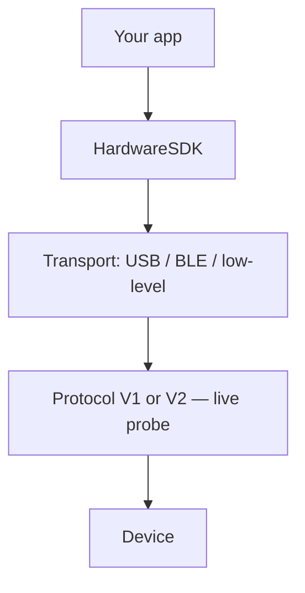

import { ExternalLink, Play, Monitor } from 'lucide-react'

<span id="introduction" />

# はじめに

Web アプリとネイティブアプリに OneKey ハードウェアを統合する開発者向けドキュメント。

Hardware SDK **1.2.x** は同じ JavaScript API で Protocol V1 と Protocol V2 に対応します。初めての方は次から始めてください: [はじめに](/ja/hardware-sdk/getting-started).

このページは **導入案内** — プラットフォームに適した SDK パッケージを選んでインストールします。一連の手順 (検索 → イベント → PIN/パスフレーズ → 最初の署名呼び出し) と、パラメーター、イベント、エラー処理は次を参照してください: [Core API ガイド](/ja/hardware-sdk/core-api-guide).

## トランスポートを選択 [#choose-your-transport]

USB 統合では `@onekeyfe/hd-common-connect-sdk` を使用してください。`@onekeyfe/hd-web-sdk` は、ホストが iframe/プラグイン構成を要求する場合にのみ使用します。

### 接続方法 [#connection-methods]

| メソッド | 説明 | 対応デバイス |
|--------|-------------|-------------------|
| **USB / WebUSB** | 有線 USB。ブラウザーは WebUSB、Node.js / CLI は node-usb | 互換性のある USB インターフェースとファームウェアを持つデバイス |
| **Bluetooth BLE (ネイティブ)** | BLE を使うネイティブアプリ (Web Bluetooth ではありません)。OS の Bluetooth と権限が必要 | Pro, Pro 2, Neo, Touch, Classic 1s / Classic 1s Pure; **Mini は BLE に対応していません** |
| **Air-Gap (QR)** | オフライン QR 署名 | OneKey Pro と Pro 2; **Neo にはカメラがありません** |

### プラットフォームガイド [#platform-guide]

| プラットフォーム (スタック) | トランスポート | SDK パッケージ | ガイド |
|------------------|-----------|-------------|-------|
| Web (ブラウザー) | WebUSB | [@onekeyfe/hd-common-connect-sdk](https://github.com/OneKeyHQ/hardware-js-sdk/tree/onekey/packages/hd-common-connect-sdk) | [WebUSB 接続ガイド](/ja/hardware-sdk/transport/web-usb) |
| React Native | BLE | [@onekeyfe/hd-ble-sdk](https://github.com/OneKeyHQ/hardware-js-sdk/tree/onekey/packages/hd-ble-sdk) | [React Native BLE](/ja/hardware-sdk/transport/react-native-ble) |
| Android (ネイティブ) | BLE | [@onekeyfe/hd-common-connect-sdk](https://github.com/OneKeyHQ/hardware-js-sdk/tree/onekey/packages/hd-common-connect-sdk) | [Android BLE](/ja/hardware-sdk/transport/android) |
| iOS (ネイティブ) | BLE | [@onekeyfe/hd-common-connect-sdk](https://github.com/OneKeyHQ/hardware-js-sdk/tree/onekey/packages/hd-common-connect-sdk) | [iOS BLE](/ja/hardware-sdk/transport/ios) |
| Flutter | BLE | [@onekeyfe/hd-common-connect-sdk](https://github.com/OneKeyHQ/hardware-js-sdk/tree/onekey/packages/hd-common-connect-sdk) | [Flutter BLE](/ja/hardware-sdk/transport/flutter) |



低レベルプロトコルとカスタムチャネル: [低レベルトランスポートプラグインとプロトコル](/ja/hardware-sdk/concepts/low-level-plugin)

## SDK をインストール [#install-sdk]

実行環境に応じて 1 つのエントリーを選択します:

```bash
# Web / desktop WebUSB (recommended)
npm i @onekeyfe/hd-common-connect-sdk

# React Native BLE
npm i @onekeyfe/hd-ble-sdk

# Native host with low-level plugin (Android/iOS/Flutter bridge)
npm i @onekeyfe/hd-common-connect-sdk

# Plugin iframe host only (plugin-only)
npm i @onekeyfe/hd-web-sdk
```

トランスポートの詳細:
- WebUSB: [WebUSB ガイド](/ja/hardware-sdk/transport/web-usb)
- React Native BLE: [BLE ガイド](/ja/hardware-sdk/transport/react-native-ble)
- ネイティブ Android / iOS / Flutter: 低レベルトランスポートプラグインを通じて JS 呼び出しを橋渡しします (各ページの例を参照)。
- カスタムチャネルとプロトコル: [低レベルトランスポートプラグインとプロトコル](/ja/hardware-sdk/concepts/low-level-plugin)

## SDK を初期化 [#initialize-the-sdk]

実行環境に対応する初期化メソッドを使用し、SDK エントリーを混在させないでください。

### Web / デスクトップ WebUSB [#web--desktop-webusb]

`@onekeyfe/hd-common-connect-sdk` を使用する場合:

```ts
import HardwareSDK from '@onekeyfe/hd-common-connect-sdk';

const initialized = await HardwareSDK.init({
  env: 'webusb',
  debug: false,
  fetchConfig: true,
});
if (!initialized) throw new Error('SDK initialization failed');
```

### React Native BLE [#react-native-ble]

`@onekeyfe/hd-ble-sdk` を使用する場合:

```ts
import HardwareSDK from '@onekeyfe/hd-ble-sdk';

const initialized = await HardwareSDK.init({
  debug: false,
});
if (!initialized) throw new Error('SDK initialization failed');
```

### ネイティブブリッジ / 低レベル [#native-bridge--low-level]

`@onekeyfe/hd-common-connect-sdk` を使用する場合:

```ts
import HardwareSDK from '@onekeyfe/hd-common-connect-sdk';
import type { LowlevelTransportSharedPlugin } from '@onekeyfe/hd-transport';

// Provide an implemented native BLE bridge; this is a preparation fragment.
declare const plugin: LowlevelTransportSharedPlugin;
const initialized = await HardwareSDK.init({
  env: 'lowlevel',
  debug: false,
  fetchConfig: true,
}, undefined, plugin);
if (!initialized) throw new Error('SDK initialization failed');
```

| 環境 | ユースケース |
|-------------|----------|
| `webusb` | ブラウザー WebUSB (iframe なし) |
| `lowlevel` | 低レベルアダプター経由で JS を橋渡しするネイティブアプリ |
| `react-native` | 独自の RN ブリッジまたは Electron BLE |
| `emulator` | 組み込みのエミュレータートランスポート |

### プラグインの iframe ホスト [#plugin-iframe-host]

`@onekeyfe/hd-web-sdk` を使用します (プラグインのみ)。SDK のデフォルトの iframe ホストは、`getSDKVersion()` から取得したバージョンを使う `https://jssdk.onekey.so/<installed-package-version>/` です。iframe を自分でホストする場合を除き、`connectSrc` を省略します。

import { SdkVersionNote } from '../../../components/SdkVersionNote'

<SdkVersionNote locale="ja" />

```ts
import HdWebSdk from '@onekeyfe/hd-web-sdk';

const HardwareSDK = HdWebSdk.HardwareWebSdk;

const initialized = await HardwareSDK.init({
  debug: false,
  // omit connectSrc — SDK fills https://jssdk.onekey.so/<installed-version>/
});
if (!initialized) throw new Error('SDK initialization failed');
```

## 次の手順 [#next-steps]

`HardwareSDK.init(...)` が返ったら、[はじめに](/ja/hardware-sdk/getting-started)に従って最初のアドレスを取得します。続いて [Core API ガイド](/ja/hardware-sdk/core-api-guide)で残りのフローを進めます:

- 1.2.0 のデバイス対応表: [デバイス](/ja/hardware-sdk/concepts/devices)
- Pro 2 / Neo の対応チェーン: [対応チェーン](/ja/hardware-sdk/concepts/chain-support)
- Protocol V1 と V2 (自動検出): [プロトコル](/ja/hardware-sdk/concepts/protocol)
- ウォレットを開く / 再開: [ウォレットセッション](/ja/hardware-sdk/concepts/wallet-session)
- トランスポートの選択と再接続: [トランスポート](/ja/hardware-sdk/transport) · [再接続](/ja/hardware-sdk/transport/reconnect)
- ファームウェア V2 / V3 / V4: [ファームウェア更新](/ja/hardware-sdk/firmware-update)

- 標準ライフサイクル (`init → search → getDeviceState → subscribe → call + uiResponse → cleanup`): [Core API ガイド → 標準ライフサイクル](/ja/hardware-sdk/core-api-guide#standard-lifecycle)
- アドレス取得、署名、デバイスメソッドの共通パラメーター: [共通パラメーター](/ja/hardware-sdk/concepts/common-params)
- 識別子のリファレンス (`connectId` / `deviceId` / `passphraseState` / …): [識別子](/ja/hardware-sdk/concepts/identifiers)
- PIN 入力フロー: [PIN コード](/ja/hardware-sdk/concepts/pin)
- パスフレーズ / 隠しウォレットのフロー: [パスフレーズ](/ja/hardware-sdk/concepts/passphrase)

import { DeviceCompatibilityTable } from '../../../components/DeviceCompatibilityTable'

## デバイスとトランスポートの互換性 [#device-and-transport-compatibility]

<DeviceCompatibilityTable locale="ja" />

> **Air-Gap モード:** OneKey Pro と Pro 2 は QR コードによるエアギャップ署名に対応します。USB や Bluetooth の接続は不要で、署名前にデバイス上で詳細を確認します。参照: [Air-Gap 統合](/ja/air-gap) で詳細を確認してください。

## 主要パッケージ [#core-packages]

| パッケージ | 目的 | NPM | バージョン |
|---------|---------|-----|---------|
| `@onekeyfe/hd-common-connect-sdk` | Web/Native 共通の SDK インターフェース。トランスポート利用の推奨エントリー | [npm](https://www.npmjs.com/package/@onekeyfe/hd-common-connect-sdk) | [](https://www.npmjs.com/package/@onekeyfe/hd-common-connect-sdk) |
| `@onekeyfe/hd-ble-sdk` | 純粋な React Native BLE スタック (RN プロジェクトに推奨) | [npm](https://www.npmjs.com/package/@onekeyfe/hd-ble-sdk) | [](https://www.npmjs.com/package/@onekeyfe/hd-ble-sdk) |
| `@onekeyfe/hd-transport-react-native` | React Native トランスポートの副作用/ブリッジ | [npm](https://www.npmjs.com/package/@onekeyfe/hd-transport-react-native) | [](https://www.npmjs.com/package/@onekeyfe/hd-transport-react-native) |
| `@onekeyfe/hd-transport-web-device` | Web 環境でデバイスにアクセスする Web トランスポート | [npm](https://www.npmjs.com/package/@onekeyfe/hd-transport-web-device) | [](https://www.npmjs.com/package/@onekeyfe/hd-transport-web-device) |
| `@onekeyfe/hd-transport-emulator` | エミュレータートランスポート (実機なしで開発・テスト) | [npm](https://www.npmjs.com/package/@onekeyfe/hd-transport-emulator) | [](https://www.npmjs.com/package/@onekeyfe/hd-transport-emulator) |
| `@onekeyfe/hd-transport-http` | HTTP ブリッジトランスポート | [npm](https://www.npmjs.com/package/@onekeyfe/hd-transport-http) | [](https://www.npmjs.com/package/@onekeyfe/hd-transport-http) |
| `@onekeyfe/hd-transport-lowlevel` | 低レベルのホストアダプター仕様 (ネイティブ統合用) | [npm](https://www.npmjs.com/package/@onekeyfe/hd-transport-lowlevel) | [](https://www.npmjs.com/package/@onekeyfe/hd-transport-lowlevel) |
| `@onekeyfe/hd-core` | Core イベント、定数、メッセージの接続 | [npm](https://www.npmjs.com/package/@onekeyfe/hd-core) | [](https://www.npmjs.com/package/@onekeyfe/hd-core) |
| `@onekeyfe/hd-shared` | 共通ユーティリティと型 | [npm](https://www.npmjs.com/package/@onekeyfe/hd-shared) | [](https://www.npmjs.com/package/@onekeyfe/hd-shared) |
| `@onekeyfe/hd-web-sdk` | Web SDK ラッパー (非推奨。hd-common-connect-sdk を優先) | [npm](https://www.npmjs.com/package/@onekeyfe/hd-web-sdk) | [](https://www.npmjs.com/package/@onekeyfe/hd-web-sdk) |

- 変更履歴: [リリース](https://github.com/OneKeyHQ/hardware-js-sdk/releases)

## 関連ドキュメント [#further-reading]

- 低レベルトランスポートとメッセージプロトコル (デバッグや独自アダプター用): [低レベルトランスポートプラグイン](/ja/hardware-sdk/concepts/low-level-plugin)
- 従来の `hd-web-sdk` フローから移行する場合: [移行ガイド](/ja/hardware-sdk/legacy-guides)
{/* - AI agent integration via OneKey skills: [AI Agent Integration](/en/hardware-sdk/agent-integration) */}

## サポート [#support]

ユーザーの方へ: このドキュメントは主に開発者向けです。製品の使用中に問題が発生した場合は、ヘルプセンターを参照するか、サポートチケットを送信してください。

- [ヘルプセンター](https://help.onekey.so)
- [課題](https://github.com/OneKeyHQ/hardware-js-sdk/issues)

## 関連リポジトリ [#related-repositories]

- [OneKey アプリ (app-monorepo)](https://github.com/OneKeyHQ/app-monorepo)
- [OneKey ファームウェア](https://github.com/OneKeyHQ/firmware)
- [OneKey Hardware JS SDK](https://github.com/OneKeyHQ/hardware-js-sdk)

---

## 試してみる [#try-it-out]

<div className="mt-4 flex flex-wrap gap-3">
  <a
    href="/ja/hardware-sdk/playground"
    className="group inline-flex items-center gap-2 rounded-lg border border-zinc-200 bg-white px-4 py-2.5 text-sm font-medium text-zinc-700 transition-all hover:border-emerald-500/50 hover:bg-emerald-50 hover:text-emerald-700 dark:border-zinc-700 dark:bg-zinc-800 dark:text-zinc-300 dark:hover:border-emerald-500/40 dark:hover:bg-emerald-500/10 dark:hover:text-emerald-400"
  >
    <Play className="h-4 w-4" strokeWidth={1.5} />
    インタラクティブなプレイグラウンド
  </a>
  <a
    href="https://hardware-example.onekey.so/#/emulator"
    target="_blank"
    rel="noopener noreferrer"
    className="group inline-flex items-center gap-2 rounded-lg border border-zinc-200 bg-white px-4 py-2.5 text-sm font-medium text-zinc-700 transition-all hover:border-blue-500/50 hover:bg-blue-50 hover:text-blue-700 dark:border-zinc-700 dark:bg-zinc-800 dark:text-zinc-300 dark:hover:border-blue-500/40 dark:hover:bg-blue-500/10 dark:hover:text-blue-400"
  >
    <Monitor className="h-4 w-4" strokeWidth={1.5} />
    オンラインエミュレーター
    <ExternalLink className="h-3 w-3 opacity-50" strokeWidth={2} />
  </a>
</div>
