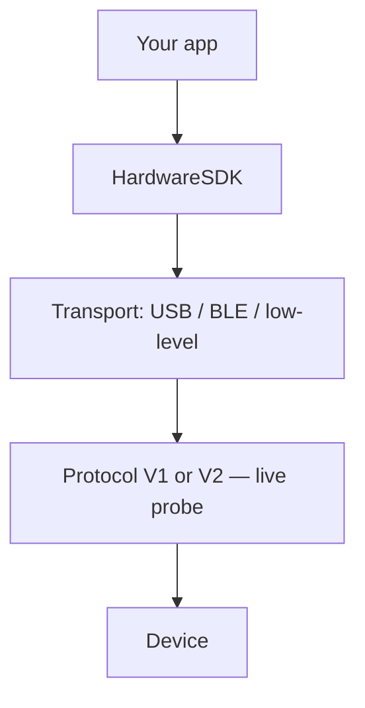

# トランスポートを選択

Hardware SDK 1.2.x は単一の JavaScript API を使用します。`init({ env })` が選択するのは**トランスポート**であり、Protocol V1 と V2 のどちらを使うかではありません。

| プラットフォーム | トランスポート | パッケージ | `env` | ガイド |
| --- | --- | --- | --- | --- |
| ブラウザー / デスクトップの WebUSB | WebUSB | `@onekeyfe/hd-common-connect-sdk` | `webusb` | [WebUSB](/ja/hardware-sdk/transport/web-usb) |
| React Native | BLE | `@onekeyfe/hd-ble-sdk` | (BLE SDK のデフォルト) | [React Native BLE](/ja/hardware-sdk/transport/react-native-ble) |
| Android ネイティブホスト | 低レベルプラグイン経由の BLE | `@onekeyfe/hd-common-connect-sdk` | `lowlevel` | [Android](/ja/hardware-sdk/transport/android) |
| iOS ネイティブホスト | 低レベルプラグイン経由の BLE | `@onekeyfe/hd-common-connect-sdk` | `lowlevel` | [iOS](/ja/hardware-sdk/transport/ios) |
| Flutter ホスト | 低レベルプラグイン経由の BLE | `@onekeyfe/hd-common-connect-sdk` | `lowlevel` | [Flutter](/ja/hardware-sdk/transport/flutter) |
| ネイティブ BLE の概要 | BLE | `@onekeyfe/hd-common-connect-sdk` | `lowlevel` | [ネイティブ BLE](/ja/hardware-sdk/transport/native-ble) |

USB には互換性のあるデバイスインターフェースとファームウェアが必要です。対象プラットフォームで接続と署名を検証してください。BLE は Pro、Pro 2、Neo、Touch、Classic 1s / Pure に対応し、 **Mini は未対応**。Air-Gap QR は別の製品経路です: [Air-Gap](/ja/air-gap).

## トランスポートとプロトコルは別 [#transport-is-not-the-protocol]

| レイヤー | 内容 | 選択方法 |
| --- | --- | --- |
| **トランスポート** | バイトの転送方法: USB、BLE、ネイティブ BLE プラグイン | `init({ env })` — `webusb` / BLE SDK / `lowlevel` |
| **プロトコル** | 接続確立後に使う通信上の V1 または V2 | SDK による検査。`connectProtocol` を読み取ります。USB PID や BLE 名から**推測しないでください**。 |

USB の Pro 2 も BLE の Pro 2 も Protocol V2 です。USB の Classic は Protocol V1 です。参照: [Protocol V1 と V2](/ja/hardware-sdk/concepts/protocol) および [デバイス](/ja/hardware-sdk/concepts/devices).

新しい WebUSB アプリでは OneKey Bridge を使わないでください (`env: 'web'` + `checkBridgeStatus`)。移行方法: [Bridge → WebUSB](/ja/hardware-sdk/legacy-guides/migrate-bridge-to-common-connect-webusb).

## 接続後 [#after-you-connect]

1. 最初のアドレス: [はじめに](/ja/hardware-sdk/getting-started)
2. PIN / イベント: [Core API ガイド](/ja/hardware-sdk/core-api-guide)
3. 切断と `dispose()`: [再接続と破棄](/ja/hardware-sdk/transport/reconnect)
4. ファームウェア: [ファームウェア更新](/ja/hardware-sdk/firmware-update)
5. カスタム BLE ブリッジ: [低レベルトランスポート](/ja/hardware-sdk/concepts/low-level-plugin)
